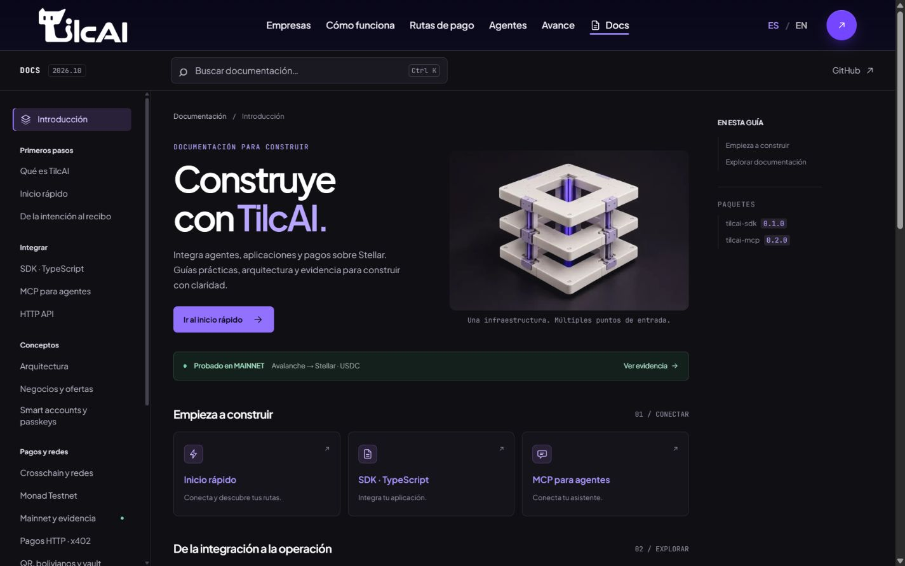

# Historial de prompts y salidas de agentes

Registro cronológico, de solo añadir, de los prompts que el equipo da a los agentes de código
en este repositorio y de lo que respondieron. El formato y las reglas están en
[AGENTS.md](AGENTS.md#historial-de-prompts-y-salidas-obligatorio).

Para ver lo que pidió una persona: `grep -n '^## .* · <usuario> · ' AGENT_HISTORY.md`.

## 2026-10-09T07:02:20Z · SaulChoque · Claude Code (claude-opus-5-5)

- **Sesión:** https://claude.ai/code/session_018g3RyDatWoLTxJc1Ef3L4w
- **Rama:** `feat/monitor-events`
- **Repositorios:** `tilcai-infrastructure`, `tilcai-web`, `documentation`, `tilcai-core`, `tilcai-cctp-engine`, `.github` y `optipagos-backend` (Optus)

### Prompt

> Realiza las siguientes modificaciones:
> - crea un archivo de historial de prompts y salidas del agente para poder trazar todos los prompts y salidas cronologicamente por usuario y timestamp, agrega esta instuccion al agents md, claude.md, etc de todos los repositorios de esta organizacion de github, inicia con este prompt
> - implementa en la api un mock de creacion y envio de qrsimple bancario boliviano (imagen adjunta) y notificacion de deposito (para la notificacion de deposito crea una pagina web basica con solo un boton de simular deposito para enviar una notificacion de recepcion de dinero)
> (basate en la documentacion oficial de Vendis QR API)
> - implementa la api mock de tilcai en el bot de optipagos para que pida un qr a tilcai y que transforme el qr recibido al diseño actual en la que envia el qr actualmente y que al recibir la notificacion de tilcai que se recibio el pago desembolse el pago desde el contrato vault (no quites el flujo de 'ya pague' para desembolsar de igual manera, esto sera el fallback) (hice pruebas hae un dia y el desembolso desde el contrato nunca se concretaba (le recargue usdc al contrato vault)) verifica que el flujo funciona correctamente (pago qr mock y desembolso de usdc)
> - Implementare un dashboard de motitorizacion de recursos y eventos del backend tilcai (openzeppelin envia sus eventos mediante webhooks) (implementa eventos de los mocks de qr simple tambien), realiza las modificaciones necesarias para el envio de eventos de tilcai hacia 'tilcai-web' para su muestra e interpretacion.
> - crea un documento en 'documentation' explicando como funciona detalladamente entre el backend y el frontend
> - asigna la issue de implementacion del dashboard JHAMILCALI en el tablero 'https://github.com/orgs/TilcAI/projects/1'
>
> * una ver terminado todo y verificando que funciona tienes mi autorizacion para hacer merge a main y hacer push (no toques el docker de tilcai que se esta ejecutando aun)
>
> [adjunto: imagen JPEG de 456 × 456 con un código QR Simple bancario de ejemplo]

### Salida

Resumen (la respuesta completa pasa de 60 líneas). El prompt cambió seis repositorios de TilcAI y `optipagos-backend` (de Optus, fuera de esta organización).

- **Historial de prompts.** Cada repositorio de la organización tiene `AGENT_HISTORY.md`, la regla en `AGENTS.md`, y `CLAUDE.md`, `GEMINI.md` y `.github/copilot-instructions.md` que remiten a ella. `.gitattributes` combina sin conflicto las entradas de dos ramas.
- **Por qué el desembolso no se concretaba.** El vault `0x841dD47Db3124839be1D878DD277e1b07D6932b6` nunca recibió USDC: la recarga del 7/10 (20 USDC) llegó a la cuenta del relayer `0xcC0BBFAFfB786C8BB1212C3555B8c6d0B195d6f5`. Se enviaron esos 20 USDC al contrato (tx `0x7bcb5e7ddf654a1b012a1cab858633c968e2435255d0b3b4839fc824f00ae143`) y el bot en marcha pagó solo las dos compras pendientes (tx `0x84737ceeb5c931f2c9a6cd60f09fde48a4ee4e622ac73de3b575adec8a771917` y `0x01911741364c81a3232d29275b09d3c7cb49fc8ce04f19e097cbc76679453759`).
- **Mock de QR Simple** en la API de TilcAI con el contrato de Vendis («QR Dinámico para Pagos» v1.3) y la página «Simular depósito». La documentación de Vendis no es pública: se tomó de la transcripción incluida en el SDK comunitario `10quality/vendis-qr-php`.
- **Optipagos** pide el QR a TilcAI, lo monta en su tarjeta actual y desembolsa al llegar el aviso; «ya pagué» sigue como respaldo. Verificado de extremo a extremo en Fuji con instancias de desarrollo (no con el contenedor en uso).
- **Monitorización.** El backend registra eventos y recursos, recibe los avisos del relayer y los envía firmados a `tilcai-web`, que los guarda, interpreta y muestra en `/[lang]/monitor`.
- **Documento** `documentation/2-ARQUITECTURA/TILCAI_MONITORIZACION_EVENTOS_BACKEND_FRONTEND_2026-10-09.md` e **issue** [tilcai-web#25](https://github.com/TilcAI/tilcai-web/issues/25) asignada a JHAMILCALI en el tablero.

Incidencias que el usuario debe conocer:

- Al detener una instancia de prueba con `pkill -f`, el patrón alcanzó también al proceso del contenedor `tilcai`: recibió SIGTERM a las 07:32:06 UTC, cerró limpio y Docker lo reinició solo (unos 1,5 s, misma imagen, configuración y volumen; sin operaciones en curso). Fue un error del agente, contrario a la instrucción de no tocarlo.
- La primera pasada de la prueba E2E falló en una comprobación del propio script después de comprar: 3,006711 USDC de testnet quedaron en la billetera de prueba `0x87c2914905ec40f200a42a27d78b9250ae4914b0`, cuya clave solo existía en ese proceso. El script ahora devuelve siempre los fondos.
- El relayer en marcha no se reconfiguró: sus avisos siguen yendo a otra URL, así que el receptor de TilcAI está probado con avisos firmados de prueba.
- No se reconstruyó ninguna imagen Docker: los contenedores en uso siguen con la versión anterior.

**En este repositorio.** Rama `feat/monitor-events`, fusionada en `main`.

- `src/lib/monitor/`: contrato `tilcai-monitor-v1`, verificación de la firma, almacén en memoria (`MonitorStore`), acceso por token e interpretación de eventos y alertas en ES/EN.
- `src/app/api/monitor/`: `events` (ingesta firmada y lectura), `summary`, `stream` (SSE) y `session`.
- `src/components/monitor/` y `src/app/[lang]/monitor/`: `useMonitorFeed()` y una vista base (alertas, tarjetas de recursos y lista de eventos). El tablero con su diseño queda en la issue #25.
- `README.md` y `.env.example` documentan las variables y el límite del almacén en memoria (no sirve con varias instancias en Vercel).
- Pruebas: 29 (11 nuevas), `tsc` y `pnpm build` en verde; vista comprobada en navegador con eventos reales. `pnpm lint` ya fallaba en `main` por la versión de TypeScript y no se tocó.

## 2026-10-09T14:42:01Z · JHAMILCALI · Codex (GPT-6)

- **Sesión:** 01a0fe1c-722a-7b41-a380-2fc6b2d47eeb
- **Rama:** feat/landing-explicacion
- **Repositorios:** tilcai-web

### Prompt

> mejora la seccion de Ocho pisos. Un solo recorrido. ese edificio que se vea bien 

### Salida

Mejoré **“Ocho pisos. Un solo recorrido.”**:

- Edificio ampliado y parallax que enfoca cada piso.
- Botón para ver el edificio completo.
- Texto estable y controles grandes en móvil.
- Recorrido de arriba hacia abajo: **08 → 01**.

Validado con build, TypeScript y 44 pruebas correctas (1 omitida).

## 2026-10-09T15:00:06Z · JHAMILCALI · Claude Code (claude-sonnet-5-5)

- **Sesión:** a7ea5f9b-df38-457f-a7e8-9f73e845ded5
- **Rama:** feat/landing-explicacion
- **Repositorios:** tilcai-web

### Prompt

> en mi git ignore has que todo lo que esta dentro de mi .claude no se suba

### Salida

Añadí `/.claude/` a `.gitignore` de tilcai-web. Con `git check-ignore` comprobé que quedan ignoradas las skills de Emil Kowalski, la skill `impeccable` y sus 4 agentes, y `git status` solo muestra `.gitignore` modificado. No había nada de `.claude` rastreado, así que no hizo falta tocar el índice. Consecuencia: las skills quedan solo en esta máquina y el equipo no las recibirá al clonar; cualquier `.claude/settings.local.json` también queda ignorado. Sin commit.

## 2026-10-09T15:03:00Z · JHAMILCALI · Claude Code (claude-sonnet-5-5)

- **Sesión:** a7ea5f9b-df38-457f-a7e8-9f73e845ded5
- **Rama:** feat/landing-explicacion
- **Repositorios:** tilcai-web

### Prompt

> con las skills dadas mejora el stilo visual de lo que es esta seccion Ocho pisos. Un solo recorrido.
>
> que no se vea tan IA pero que se vea realmente bien y atractivo para el usrio que tenga animaciones y lo necesario apra mejorar

### Salida

Rediseñé la sección «Ocho pisos. Un solo recorrido.» (`OfficeBuildingSection.tsx` y su CSS) usando `impeccable` (polish/animate) y `emil-design-eng`.

- **Quité lo que se veía a IA genérica:** el planeta con anillo y el cubo flotante, el fondo de ciudad de ciencia ficción (`distant-city.webp`, ya sin uso), los halos de brillo, la etiqueta duplicada sobre el edificio y el contador «04 / 08» que contradecía a «Piso 05».
- **Foco que sigue a la cámara:** todo lo que no es el piso que se lee se atenúa y una ventana de luz recorre el edificio con el scroll (solo transformaciones). En «Ver edificio completo» la atenuación baja y marca el piso elegido.
- **Marcas de nivel** en vez de cajas con número, cuadrícula isométrica con paralaje por detrás y luz en el suelo del edificio.
- **Panel:** lista de los ocho pisos con nombre y un resalte que se desliza de fila en fila; el texto entra en cascada (título, quién, cuerpo) y sale más rápido; barra de progreso continua. En móvil la lista pasa a números en dos filas.
- **Título** en dos líneas (la segunda atenuada) y sin el tracking apretado de antes.
- **Movimiento reducido:** conserva el cambio de piso y de color, sin desplazamientos.

Comprobado: `tsc` sin errores, 44 pruebas pasan (1 omitida), detector de Impeccable sin hallazgos, capturas en 1920, 1440, 1280, 1000, 390 y 320 px, ES/EN y movimiento reducido. ESLint no pudo ejecutarse (falla la carga de `eslint-config-next`, ajeno al cambio). Pendiente: `public/office/building/distant-city.webp` quedó sin uso y no lo pude borrar; la imagen de la torre sigue siendo la ilustración original. Sin commit.

Hora del prompt aproximada (no se anotó al recibirlo).

## 2026-10-09T15:15:13Z · JHAMILCALI · Codex (GPT-6)

- **Sesión:** 01a0fe1c-722a-7b41-a380-2fc6b2d47eeb
- **Rama:** feat/landing-explicacion
- **Repositorios:** tilcai-web

### Prompt

> para la seccion de Tu negocio, listo para conversar con agentes. quiero que se paresca  a eso pero con las imagenes que estan en la ruta C:\proyectos 2026\tilcAI\tilcai-web\public\assets\img\empresas las iamgenes quiero que me hagas lo siguinte del texto que te copie y que se vea de la mejor manera
>
> [adjunto: imagen de referencia de la sección Empresas]
>
> [adjunto: texto pegado con especificaciones de diseño y animación parallax]

### Salida

Rediseñé «Tu negocio, listo para conversar con agentes» con las nueve imágenes transparentes existentes: negocio central, agente, búsqueda, catálogo, servicio, disponibilidad, precio, conexiones y cuadrícula. La escena usa una línea de tiempo de GSAP/ScrollTrigger con cuatro fases en escritorio y un recorrido reducido en móvil; reutiliza Lenis y respeta movimiento reducido. Conservé las rutas de incorporación y la aclaración de que la escena es ilustrativa.

Validé escritorio y móvil, `npm run build`, TypeScript y `npm test` (44 correctas, 1 omitida). ESLint quedó bloqueado por la incompatibilidad existente entre `typescript-eslint` y TypeScript 7. Las capturas se guardaron como `businesses-desktop.png` y `businesses-mobile.png` en las visualizaciones de la sesión. Los PNG de `public/assets/img/empresas/` siguen sin seguimiento de Git; no hice commit.
## 2026-10-09T07:57:54Z · SaulChoque · Claude Code (claude-opus-5-5)

- **Sesión:** https://claude.ai/code/session_018g3RyDatWoLTxJc1Ef3L4w
- **Rama:** `feat/monitor-cuentas`
- **Repositorios:** `tilcai-infrastructure`, `tilcai-web`, `documentation` (TilcAI) y `optipagos-backend`, `optipagos-frontend` (Optus)

### Prompt

> Implementa el uso de cuentas SCA de avalanche para optipagos y asi mismo implementa en la db y el backend de optipagos direfencia entre tesnet y mainnet (el numero de demo (testnet) es el con el id '1044392765419850', y el de produccion (mainnet) es el con el id '964536136746615') realiza pruebas, corrige errores y crea una nueva rama y una pr

### Salida

Resumen (la respuesta completa pasa de 60 líneas). Este prompt y el siguiente (08:00:23Z, «las cuentas sca provienen de tilcai…») se atendieron como un solo trabajo. Cambió tres repositorios de TilcAI y dos de Optus (`optipagos-backend` y `optipagos-frontend`, fuera de esta organización). Todo quedó en ramas nuevas con su PR; nada se fusionó en `main`.

- **TilcAI emite las cuentas** ([tilcai-infrastructure#24](https://github.com/TilcAI/tilcai-infrastructure/pull/24)): contratos `TilcaiAccount` (dueña = passkey P-256), `TilcaiAccountFactory` y `TilcaiCctpRouterV2`, desplegados en Fuji; API `POST/GET /v1/accounts`; cada clave Bearer es un tercero con permisos; pagos crosschain en modo `account`.
- **Optipagos, entornos** ([optipagos-backend#1](https://github.com/Optus-development-team/optipagos-backend/pull/1)): el número de la demo (`1044392765419850`) opera en Avalanche Fuji y el de producción (`964536136746615`) en Avalanche C-Chain. Migración `0005` y backend con billeteras, sesiones, mensajes y enlaces por entorno. Mainnet queda apagado por defecto (`MAINNET_ENABLED`).
- **Optipagos, billeteras de contrato** (misma PR y [optipagos-frontend#4](https://github.com/Optus-development-team/optipagos-frontend/pull/4)): con `WALLET_CUSTODY=TILCAI_SCA` la billetera es una cuenta emitida por TilcAI; la huella sobre el reto (que es el propio envío) es la firma que comprueba la cadena. Las billeteras existentes siguen siendo de clave propia.
- **Pruebas en Fuji con instancias propias** (TilcAI en `:8799`, Optipagos en `:3299`, base local nueva, WhatsApp en modo consola): E2E completo con cuentas de contrato (crear, recibir, enviar, cobrar, CCTP a Stellar en modo `account`, devolución de fondos), el mismo E2E con clave propia, aislamiento de los dos entornos, y la página de firma en Chromium con autenticador virtual para los dos tipos de billetera. Todo en verde; los fondos de prueba se devolvieron.

Lo que no se hizo o no se probó:

- Mainnet no se probó con dinero real ni se encendió; el envío por los dos números reales de WhatsApp tampoco (las pruebas usan el canal de desarrollo).
- Delegación a claves de agente (M5), recuperación de la cuenta y cuentas en Stellar siguen pendientes. Los contratos no están auditados: las cuentas de contrato solo existen en testnet.
- No se tocó ningún contenedor en uso ni se reconstruyó ninguna imagen: para activar lo nuevo hacen falta las variables indicadas en cada PR.
- La autenticación por tercero y la API de cuentas correspondían a la issue #9 (OmarQV); se implementaron porque Optipagos las necesitaba y quedan para su revisión.

**En este repositorio.** Rama `feat/monitor-cuentas`, con su PR. El panel aprende los dos eventos nuevos del backend: `account.transition` y `account.deploy_delayed` (`src/lib/monitor/contract.ts`) y su categoría «Cuentas de contrato» con la explicación en español e inglés (`src/lib/monitor/interpret.ts`). 29 pruebas y `tsc` en verde. No se escribió código de Next.

## 2026-10-09T08:00:23Z · SaulChoque · Claude Code (claude-opus-5-5)

- **Sesión:** https://claude.ai/code/session_018g3RyDatWoLTxJc1Ef3L4w
- **Rama:** `feat/monitor-cuentas`
- **Repositorios:** `tilcai-infrastructure`, `tilcai-web`, `documentation` (TilcAI) y `optipagos-backend`, `optipagos-frontend` (Optus)

### Prompt

> Las cuentas sca provienen de tilcai como esta previsto, si existen errores o faltan implementar cosas realiza las modificaciones que necesites en tilcai en una nueva rama (no toques el docker de tilcai)

### Salida

Se atendió junto con el prompt de las 07:57:54Z: ver esa entrada para el resumen completo. Confirma que las cuentas las emite TilcAI, y autoriza los cambios en TilcAI en una rama nueva; el contenedor `tilcai` en uso no se tocó (las pruebas corrieron en una instancia aparte, en `:8799`, con su propia base).

**En este repositorio.** Sin cambios adicionales: lo de este repositorio está descrito en la entrada de las 07:57:54Z.

## 2026-10-09T12:04:49Z · SaulChoque · Claude Code (claude-opus-5-5)

- **Sesión:** https://claude.ai/code/session_018g3RyDatWoLTxJc1Ef3L4w
- **Rama:** `feat/monitor-cuentas`
- **Repositorios:** `tilcai-infrastructure`, `tilcai-web`, `documentation` (TilcAI) y `optipagos-backend`, `optipagos-frontend` (Optus)

### Prompt

> Continua

### Salida

Reanuda el trabajo de los prompts de las 07:57:54Z y 08:00:23Z, que se había detenido por el límite de uso. No es un pedido nuevo: el resultado está en la entrada de las 07:57:54Z.

**En este repositorio.** Sin cambios adicionales: lo de este repositorio está descrito en la entrada de las 07:57:54Z.

## 2026-10-09T12:05:05Z · SaulChoque · Claude Code (claude-opus-5-5)

- **Sesión:** https://claude.ai/code/session_018g3RyDatWoLTxJc1Ef3L4w
- **Rama:** `feat/monitor-cuentas`
- **Repositorios:** `tilcai-infrastructure`, `tilcai-web`, `documentation` (TilcAI) y `optipagos-backend`, `optipagos-frontend` (Optus)

### Prompt

> Continua

### Salida

Reanuda el trabajo de los prompts de las 07:57:54Z y 08:00:23Z, que se había detenido por el límite de uso. No es un pedido nuevo: el resultado está en la entrada de las 07:57:54Z.

**En este repositorio.** Sin cambios adicionales: lo de este repositorio está descrito en la entrada de las 07:57:54Z.

## 2026-10-09T15:49:06Z · SaulChoque · Claude Code (claude-opus-5-5)

- **Sesión:** https://claude.ai/code/session_018g3RyDatWoLTxJc1Ef3L4w
- **Rama:** `main`
- **Repositorios:** `tilcai-infrastructure`, `tilcai-web`, `documentation` (TilcAI) y `optipagos-backend`, `optipagos-frontend` (Optus)

### Prompt

> Genial, mergea a Main, prueba, corrige y haz push

### Salida

Las cinco ramas de la fase SCA se fusionaron en `main` y se subieron: tilcai-infrastructure (PR #24), tilcai-web (#27), documentation (#2), optipagos-backend (#1) y optipagos-frontend (#4). Antes de cada push se probó el resultado de la fusión: 160 pruebas unitarias y 38 de contratos en tilcai-infrastructure; 45 pruebas, `tsc` y build en tilcai-web (su `main` había avanzado; la fusión fue limpia); 373 pruebas, lint, typecheck y build en optipagos-backend; `tsc` y lint en optipagos-frontend. No hubo nada que corregir en el código. La PR #23 de tilcai-infrastructure sigue abierta en GitHub aunque sus commits ya están en `main`.

**En este repositorio.** Rama `main`. Fusión de `feat/monitor-cuentas` sobre el `main` que había avanzado.

## 2026-10-09T16:02:00Z · JHAMILCALI · Claude Code (claude-sonnet-5-5)

- **Sesión:** a7ea5f9b-df38-457f-a7e8-9f73e845ded5
- **Rama:** main (cambios sin commit)
- **Repositorios:** tilcai-web

### Prompt

> esa secion de la pagina "Cuatro caminos para conectarte"  realiza con las siguinte sintruciones

[adjunto: captura de referencia de la sección «Empieza por donde estés hoy.» con el nodo TilcAI arriba a la derecha, tres notas flotantes, cuatro cards A–D abajo y cuatro rutas luminosas que las unen al nodo]

[texto pegado de unas 700 líneas con el encargo de diseño. Pide rediseñar solo esa sección con la composición de la referencia: título arriba a la izquierda, nodo TilcAI hacia el 66 % horizontal, notas flotantes, cuatro cards HTML (A Consola gestionada, B Archivo o planilla, C API o conector de POS, D Agente propio) y cuatro conexiones que sean un SVG real y responsive, no imágenes. Las rutas se calculan en JavaScript a partir de la posición real de los puertos (getBoundingClientRect, ResizeObserver y resize con debounce), con doble trazo (brillo y línea nítida), degradado violeta→cian, dibujo de tarjeta a nodo con stroke-dashoffset, puntos luminosos que recorren cada ruta con duraciones distintas (4,4 / 3,8 / 4,1 / 4,8 s), pulso del nodo al llegar, flujo inverso ocasional (≈30 %), chevrons, nodo flotante con anillos, notas con deriva lenta, hover por card y por nodo, parallax de scroll y de cursor con topes en píxeles, partículas de fondo con opacidad baja, animación de entrada con GSAP y ScrollTrigger (sin pin largo) y Lenis. Además: 4 columnas en escritorio, 2×2 en tableta y una columna en móvil con conexiones simplificadas, rendimiento (transform, opacity, máximo 8 partículas SVG), una rama prefers-reduced-motion con todo dibujado y sin movimiento, y uso de las imágenes PNG transparentes ya creadas (nodo, consola, XLS, API, agente, dos notas y partículas) sin fondo negro.]

### Salida

Reemplacé las cuatro cards de «Cuatro caminos para conectarte» por un componente nuevo, `ConnectionPaths` (`ConnectionPaths.tsx` y su CSS), conectado desde `BusinessesSection`. Las cards, el nodo y los textos son HTML; las rutas son un SVG que se reconstruye a partir de los puertos reales del DOM y se recalcula al cambiar el tamaño.

- **Rutas:** cuatro curvas Bézier distintas, de card a nodo, con trazo de brillo y línea nítida, degradado violeta→cian, puertos en las cards y cuatro entradas en el nodo, chevrons que avanzan hacia el nodo y un punto luminoso por ruta con su propio ritmo. Al llegar, el nodo pulsa; de vez en cuando vuelve un punto cian.
- **Entrada:** título, cards, nodo, dibujo de las rutas de card a nodo y, al terminar, el tráfico y el nodo activo (anillos, brillos y tres puntos en órbita). Medí la secuencia en el tiempo y respeta el orden.
- **Interacción:** al pasar por una card (o enfocarla) su ruta se enciende, las demás bajan y su punto acelera; al pasar por el nodo se encienden las cuatro. Parallax de cursor medido: ≤ 10 px; de scroll: ≤ 18 px.
- **Responsive:** 4 columnas, 2×2 (las rutas de la segunda fila suben por el pasillo entre columnas) y una columna con un tronco central. Movimiento reducido: todo dibujado y nada se mueve.
- **Textos de las notas:** en español uso las imágenes; en inglés, notas en HTML con el mismo aspecto, porque las imágenes traen el texto en español.

Decisiones: el SVG y los puertos no llevan parallax para que las uniones no se despeguen; las partículas siguen el trazado con `getPointAtLength` en lugar de MotionPathPlugin, para no recrear las animaciones al redimensionar; el nodo es más grande que 180–230 px porque la imagen trae mucho brillo alrededor y la ficha visible mide unos 120 px, como en la referencia. El texto con degradado de «hoy.» es intencional (lo pide el encargo); el detector de Impeccable lo marca como único hallazgo.

Comprobado: `tsc` limpio, 47 pruebas pasan (1 omitida; 3 nuevas), capturas en 1920, 1440, 1120, 900 y 390 px, ES/EN y movimiento reducido. No probado: Safari ni dispositivos reales. Quité del CSS las reglas de las cards antiguas. Imágenes en `public/assets/img/caminos conect/` (la carpeta lleva un espacio). Sin commit.

Hora del prompt aproximada (no se anotó al recibirlo).

## 2026-10-09T16:01:59Z · JHAMILCALI · Claude Code (claude-sonnet-5-5)

- **Sesión:** 49e13974-4406-4160-818f-4afe7a15940e
- **Rama:** main
- **Repositorios:** tilcai-web

### Prompt

> de la seccion de "Empresas" quitale esto "Explorar un piloto
> Propuesta de incorporación · en preparación" y que  el texto de abajo se vea bien qu eno se vea generico con IA y que las cards de abajo se paresca a un workflow su animacion pero simpre respetando estilo y qie se vea bien y tambien con las skills que tienes adentro tenga unas buenas animaciones y se vean bien

### Salida

Cambié solo la parte de arriba de Empresas (el hero con scroll, `BusinessParallax`); el bloque de «Cuatro caminos» lo rehacía otra sesión en paralelo (`ConnectionPaths`) y no lo toqué.

- **Quitado:** el botón «Explorar un piloto» y la etiqueta «Propuesta de incorporación · en preparación». También los textos `status` y `pilot` de `narrative.ts` (ES y EN), que quedaron sin uso, y ajusté la fila de Empresas de `docs/messaging-map.md`.
- **El texto de abajo:** sin el kicker en mono («03 / CONDICIONES») ni la barra violeta lateral. Ahora es un icono que dice quién actúa (catálogo, agente, reglas, respuesta) más título y cuerpo, con los mismos textos de antes. Desaparece el desajuste «03» frente a la card activa «02». El cambio de momento usa el patrón de «Ocho pisos»: sube con un poco de desenfoque (título, luego cuerpo) y sale más rápido.
- **Las cards como workflow:** cada card es un nodo con puertos en los bordes y un conector con flecha entre nodos. Al pasar de paso, el número del anterior se vuelve un check que se dibuja, el conector se llena (violeta a cian), el siguiente nodo se enciende y un destello corre por el conector que sale de él (solo mientras la escena está en pantalla). El último nodo se cierra al terminar la escena. En móvil queda como un riel de tres círculos unidos con el título debajo. Cada nodo muestra lo que produce (Catálogo, Cotización, Orden: copy que ya existía). Quité la barra de progreso inferior, que los conectores sustituyen.
- **Movimiento reducido:** mismos estados con fundidos simples, sin desplazamientos ni destello; los clics en los nodos siguen funcionando.

Comprobado: `tsc` limpio, 47 pruebas OK (1 omitida), detector de Impeccable sin hallazgos, capturas de 1920 a 360 px en ES y EN, avance por scroll, clic en cada nodo, movimiento reducido y que nada se recorta desde 1280×600 hasta 820×1180. No probé Safari ni dispositivos reales, ni `next build`. El commit `d90a867` en `main` (no lo hice yo) ya incluye estos archivos junto con `ConnectionPaths`; de mi parte quedan sin commit la fila de `messaging-map.md` y esta entrada. No hice commit ni push.

## 2026-10-09T16:33:00Z · JHAMILCALI · Claude Code (claude-sonnet-5-5)

- **Sesión:** a7ea5f9b-df38-457f-a7e8-9f73e845ded5
- **Rama:** main (cambios sin commit)
- **Repositorios:** tilcai-web

### Prompt

> de lo que estaba strabajando quitale lo que es en preparacion y lo que es Primer camino del piloto y que ya sea vea mejor que entre bien en la pantalla 16:9

[adjunto: captura de las cuatro cards A–D de «Cuatro caminos para conectarte», con la etiqueta «En preparación» en cada una y el botón «Primer camino del piloto» en la A]

### Salida

Quité de las cuatro cards la etiqueta «En preparación» y el botón «Primer camino del piloto», y también esas dos cadenas de los textos (español e inglés). Ajusté la sección para que quepa en una pantalla 16:9: sin pie en las cards, banda del título más baja, ilustraciones con altura según la pantalla, márgenes según la altura y contenido centrado en el espacio bajo el menú.

Medí la sección con la ventana a la altura que queda en pantallas 16:9: cabe entera en 1920×950, 1536×740, 1440×700 y 1366×650; no cabe en 1280×610 (579 px frente a 530). En pantallas bajas las ilustraciones se ven completas y algo más pequeñas; en altas llenan el ancho de la card. Tableta y móvil no cambian de estructura.

Aviso: mientras trabajaba, alguien borró en `narrative.ts` la nota en español «Son propuestas de incorporación, no productos lanzados…» (no fui yo; el archivo cambió a las 12:41). Terminé esa edición para que compile y los dos idiomas coincidan: quité también la nota en inglés, el campo del tipo y el párrafo del componente. Resultado: esta sección ya no dice en ningún sitio que los caminos son propuestas, y la card A sigue resaltada. Si se quiere recuperar, se restaura la nota.

Comprobado: `tsc` limpio, 47 pruebas pasan (1 omitida), capturas en 1920, 1536, 1440, 1366, 900 y 390 px, ES/EN. El detector de Impeccable solo marca el texto con degradado de «hoy.», que es intencional. Sin commit.

Hora del prompt aproximada (no se anotó al recibirlo).

## 2026-10-09T16:55:00Z · JHAMILCALI · Claude Code (claude-sonnet-5-5)

- **Sesión:** a7ea5f9b-df38-457f-a7e8-9f73e845ded5
- **Rama:** main (cambios sin commit)
- **Repositorios:** tilcai-web

### Prompt

> en la seccion de "Cómo funciona" quiero que realices lo siguinte "

[texto pegado de unas 1000 líneas con el encargo de diseño y animación de «Cómo funciona · Una operación. Seis pasos. Dos recibos.». Pide una única escena SVG viva (no seis imágenes) que se acumule paso a paso: 01 Pedido (agente → documento → negocio), 02 Oferta (tres paneles que se funden en una cotización), 03 Reglas (nodo TilcAI con seis comprobaciones y «requiere aprobación»), 04 Aprobación (panel de revisión, botón APROBAR, token de autorización), 05 Pago (riel con cuatro puntos de control y un token), 06 Dos recibos (recibo de pago y recibo de entrega unidos por el mismo orderId). Usa GSAP con una sola timeline y ScrollTrigger (≈600vh), Lenis, cámara SVG con zoom 1→1,10→1,02, parallax de profundidad y de cursor con topes en píxeles, insignias genéricas Claude / Codex / Agente propio, parpadeo y flotación del agente, luz de la tienda según la fase, navegación 01–06 como línea de tiempo que se rellena, panel derecho sincronizado con salida hacia arriba y entrada desde abajo, hasta 12 partículas, filtros #glow-purple y #glow-cyan, versión de tableta (≈500vh) y móvil (≈400vh, una columna), rendimiento (transform, opacity, strokeDashoffset), rama de movimiento reducido sin pin ni partículas, textos existentes intactos y limpieza de ScrollTrigger al desmontar.]

### Salida

Reemplacé la sección «Cómo funciona» por una escena SVG única con una sola timeline de scroll. `FlowSection` ahora monta `operation/` (`OperationSection`, `OperationScene`, `timeline.ts`, `phases.ts` y un componente por grupo SVG en `scene/`: Agent, AgentBadges, Business, Connection, Request, Offer, Core, Rules, Approval, Payment, Receipts, Particles, Grid, Defs).

- **Una escena que se acumula:** los objetos no se cambian entre pasos; cada fase añade a lo anterior y la escena nunca se reinicia. Fases 0–16–32–49–66–83–100 % de una timeline de longitud 1 controlada por un único ScrollTrigger por modo.
- **Pasos:** insignias Claude/Codex/Agente propio que se pliegan en el agente; documento y punto que viajan por la ruta curva; tres paneles que se funden en la cotización; cubo TilcAI con seis comprobaciones que dibujan su marca y «requiere aprobación»; panel de revisión con botón APROBAR, marca dibujada y token de autorización que llega al núcleo; riel con cuatro puntos de control y una ficha; dos recibos unidos por «MISMO orderId» y «PAGO ≠ ENTREGA».
- **Cámara y parallax:** zoom 1 → 1,02 → 1,05 → 1,10 → 1,06 → 1,02; parallax de cursor con topes de unos 1–6 px por capa (solo escritorio con puntero fino); reposo lento (parpadeo, cabeceo, respiración de halos) solo mientras la sección está en pantalla.
- **Panel derecho y navegación:** cada tarjeta sale hacia arriba y la siguiente entra desde abajo (título, texto, tarjeta, frase con revelado por clip-path); barra superior y línea de tiempo 01–06 con marcas que pasan de violeta a cian con ✓.
- **Modos:** escritorio fijado con sticky (≈600vh), tableta (≈500vh), móvil con la escena arriba y las tarjetas debajo (≈4,5 pantallas), y sin movimiento: escena en su estado final y lista de seis tarjetas, sin pin.
- **Textos:** se mantienen los existentes; se añadieron etiquetas cortas de la escena (`flow.scene`) en español e inglés. Quité del CSS compartido las reglas del antiguo `journey`.

Comprobado: `tsc` limpio, 55 pruebas pasan (1 omitida; 8 nuevas en `test/operation-scene.test.ts`), detector de Impeccable sin hallazgos, capturas en 1440, 900 y 390 px, ES/EN, movimiento reducido y cambio de tamaño entre modos sin errores. No probado: Safari ni dispositivos reales, ni rendimiento de fotogramas en hardware real (el navegador de pruebas no tiene GPU). `CommerceIllustration.tsx` ya no se usa y queda sin borrar. Sin commit.

Hora del prompt aproximada (no se anotó al recibirlo).

## 2026-10-09T17:45:00Z · JHAMILCALI · Claude Code (claude-sonnet-5-5)

- **Sesión:** a7ea5f9b-df38-457f-a7e8-9f73e845ded5
- **Rama:** main (cambios sin commit)
- **Repositorios:** tilcai-web

### Prompt

> mejora con las skills la seccion de RUTAS de PAGO mejora esa scion con gsap y lenis y las skils de diseño que tengan animaciones y se vean de la meojo manera que no parsca generado con IA

### Salida

Rediseñé «Rutas de pago» con las skills `impeccable` y `emil-design-eng`, GSAP, ScrollTrigger y el Lenis compartido. La sección dejó de ser una pila de cajas (nota, dos tarjetas, mapa, límites, evidencia) y pasó a ser un mapa de rutas.

- **Mapa de rutas (`RouteAtlas`):** una banda para «Stellar directo · x402» (línea discontinua ámbar: es una prueba aislada) y otra para «USDC de otra red · CCTP». Las siete redes de origen salen de su fila; Fuji (la única verificada) es la línea recta continua que pasa por burn, atestación y mint hasta un único destino, Stellar Testnet; las seis de laboratorio llegan discontinuas a un bus corto. Líneas y puntos se miden desde el DOM y se reconstruyen al cambiar la maquetación o al cargar las fuentes. En pantallas estrechas la misma historia pasa a una columna con una espina a la izquierda.
- **Movimiento:** una sola timeline atada al scroll (el mapa se dibuja a medida que se descubre, con las paradas apareciendo cuando la línea pasa por ellas); después, un punto de luz recorre solo la línea verificada, solo mientras la sección está en pantalla, y cada parada y el destino laten al pasar. La ruta no verificada no lleva tráfico. El titular sube por líneas desde una máscara, una sola vez.
- **Evidencia (`EvidenceLedger`):** las dos pruebas como filas de un extracto: retiro en Fuji → línea que crece → emisión en Stellar, con los hashes resolviéndose de izquierda a derecha y enlaces al explorador (el nombre accesible lleva el hash completo).
- **Sin cajas decorativas:** la nota «crosschain» es una nota al margen; «lo que esta ruta no promete» es una lista; las redes de laboratorio son una palabra, no una píldora; los bordes laterales de color pasaron a guiones cortos.
- **Sin movimiento:** todo dibujado y estático.
- Textos intactos (ES/EN). Quité del CSS compartido (`Explain.module.css`) lo que dejó de usarse.

Comprobado: `tsc` limpio, 63 pruebas pasan (1 omitida; 8 nuevas en `test/rails-atlas.test.ts`), detector de Impeccable sin hallazgos, capturas en 1440, 900 y 390 px, ES/EN, movimiento reducido y cambio de tamaño entre maquetaciones. No probado: Safari ni dispositivos reales, ni fluidez de fotogramas en hardware real. Sin commit.

Hora del prompt aproximada (no se anotó al recibirlo).
## 2026-10-09T17:44:17Z · SaulChoque · Claude Code (claude-opus-5-5)

- **Sesión:** https://claude.ai/code/session_018g3RyDatWoLTxJc1Ef3L4w
- **Rama:** `main`
- **Repositorios:** `tilcai-web` (TilcAI); el resto fue configuración y contenedores, sin archivos versionados

### Prompt

> Si, activa las cuentas SCA en la demo, asi mismo actualiza los contenedores actuales en ejecucion por sus versiones actualizadas con SCA, mock QR y dashboard

### Salida

Quedó activado en el despliegue de este servidor, con los contenedores recreados y probados en vivo:

- **Cuentas de contrato en la demo.** En el TilcAI en uso se creó el tercero «Optipagos» con su clave (`payments`, `accounts:read`, `accounts:write`) y Optipagos arranca con `WALLET_CUSTODY=TILCAI_SCA`: cada billetera nueva del número de demo es una cuenta emitida por TilcAI. Las tres billeteras existentes siguen siendo de clave propia. Prueba en vivo: una cuenta pedida con esa clave quedó `ACTIVE` en Fuji.
- **Mock de QR Simple.** TilcAI con `QR_MOCK_ENABLED` y Optipagos con `BUY_QR_PROVIDER=tilcai`; el aviso de depósito va de TilcAI a Optipagos en el mismo host. La página «Simular depósito» está en `http://<servidor>:8787/mock/vendis/?key=…`.
- **Tablero.** Esta cuenta de Vercel no tiene acceso al proyecto de `tilcai-web`, así que el tablero corre como contenedor en el servidor (`tilcai-web`, puerto 3311, eventos guardados en un volumen). TilcAI le envía los eventos firmados y el relayer avisa a TilcAI por webhook firmado: en la prueba llegaron eventos de cuentas, del mock de QR y tres avisos reales del relayer.
- **Relayer.** Se añadió la notificación `tilcai-monitor` a su `config.json` para los relayers de Fuji y de Stellar y se reinició (unos segundos). Los demás relayers conservan su notificación anterior.

Pendiente o sin probar: no se hizo una compra ni un alta de billetera reales por WhatsApp con la configuración nueva (el canal de desarrollo está apagado en ese despliegue); el vault tiene poco saldo (alerta `VAULT_LOW`), así que una compra no se desembolsará hasta recargarlo; mainnet sigue apagado. Copia de la configuración anterior en `~/backups/docker-activacion-sca-20261009/`.

**En este repositorio.** Rama `main`. `Dockerfile` y `.dockerignore` para servir el sitio y el tablero en un contenedor, y su apartado en el `README.md`. La imagen se construyó y es la que corre en el servidor.

## 2026-10-09T18:24:44Z · saulchoque123 · Claude Code (Sonnet 5.5)

- **Sesión:** https://claude.ai/code/session_01XXALddBkW59xRAowuFKvD7
## 2026-10-09T18:55:13Z · JHAMILCALI · Antigravity · Gemini 3.7 Flash

- **Sesión:** b1847629-f84d-45aa-ab0e-bf11db221c9f
- **Rama:** main
- **Repositorios:** tilcai-web

### Prompt

> Estoy intentanto acceder al dashboard desde otro equipo de la red de tailscale y el token MONITOR_DASHBOARD_TOKEN de .env.docker.local no me funciona. `/api/monitor/session` responde `{"ok":true}` pero `/api/monitor/summary` responde `{error: "unauthorized", message: "Present the dashboard token."}`

### Salida

Causa: `/api/monitor/session` ponía la cookie con `secure: true` (NODE_ENV=production) y el navegador descarta una cookie Secure recibida por `http://100.111.32.67:3311`, así que el token era válido pero la sesión nunca quedaba. Cambio en `src/app/api/monitor/session/route.ts`: `secure` sigue ahora el protocolo real de la petición (`x-forwarded-proto` o la URL). Falta reconstruir el contenedor `tilcai-web`. Mientras tanto, los scripts pueden usar `Authorization: Bearer <token>`.

## 2026-10-09T21:50:01Z · SaulChoque · Claude Code (Sonnet 5.5)

- **Sesión:** https://claude.ai/code/session_01XXALddBkW59xRAowuFKvD7
- **Rama:** `feat/monitor-vault-stellar`
- **Repositorios:** `tilcai-infrastructure`, `tilcai-web`, `documentation`

### Prompt

> actualiza el tablero y haz push y actualiza el docker

### Salida

**En este repositorio.** El tablero muestra una tarjeta de vault por red (Avalanche Fuji, Stellar Testnet) con su nivel de alerta propio; un backend anterior, que solo envía \`vault\`, se ve igual que antes. Incluye también la cookie de sesión que ya no exige HTTPS cuando se entra por http (corrección de las 18:24Z, que se había reconstruido en el contenedor sin commit). 57 pruebas y \`tsc\` limpios; \`eslint\` no arranca en este entorno (error al cargar \`eslint-config-next\`). El contenedor \`tilcai-web\` se recreó con la imagen nueva (\`healthy\`, mismo volumen y variables); la anterior queda como \`tilcai/tilcai-web:pre-vault-stellar\`.
> en la seccion rutas de pago has los siguintos cambios y si hay que generar imagenes vas a generar imagenes sin fondo y que se vea de la mejor manera y buena resolucion y has lo siguinte "Quiero REDISEÑAR ÚNICAMENTE la sección “Rutas de pago” de mi landing TilcAI.
>
> Adjunto una imagen de referencia visual [adjunto: captura de referencia visual fintech glassmorphic de rutas de pago]. Quiero que la nueva sección conserve la identidad actual de TilcAI, pero se acerque visualmente a esa referencia:
>
> - fondo azul casi negro
> - violetas eléctricos
> - cyan tecnológico
> - elementos tipo glass
> - líneas SVG
> - rutas conectadas
> - sensación fintech / agentic commerce
> - mucho espacio negativo
> - interfaz premium
> - estilo Awwwards
> - sensación de infraestructura real funcionando
> - no parecer un dashboard empresarial genérico
>
> NO rediseñar navbar ni otras secciones.
> NO cambiar la tipografía global.
> NO modificar contenido ajeno a “Rutas de pago”."

### Salida

Rediseñé completamente la sección «Rutas de pago» (`RailsSection`) manteniendo el alcance estricto de la sección, la tipografía y los tokens globales del proyecto, alineándola con la referencia visual fintech / agentic commerce de alta gama:

1. **Sección A (Visión General):**
   - Encabezado con titular `"El negocio cobra en USDC sobre Stellar."` con gradiente tecnológico (`#FFFFFF` → `#9B72FF` → `#6D48FF`) en *Stellar*, subtítulo conciso y los tres indicadores: `⚡ Automático`, `◈ Verificado` y `↗ Sin doble cobro`.
   - Composición Desktop (65% escena / 35% tarjetas):
     - **Comprador:** avatar circular con glow, `Paga en USDC` y logotipos de redes (Ethereum, Avalanche, Arbitrum, Base, Solana).
     - **Inlet con moneda USDC (`$`)** flotante conectando hacia TilcAI.
     - **TilcAI (Nodo protagonista):** branding de TilcAI, halo púrpura pulsante, HUD `"Elige la mejor ruta"` y líneas reactivas de salida.
     - **Negocio:** icono de tienda en anillo de cristal, `Recibe USDC en Stellar` e icono oficial de Stellar.
     - **Rutas SVG nítidas + glow:** curva superior x402 (gradiente ámbar/violeta) con insignia flotante `x402`, y curva inferior CCTP (gradiente cian/azul) con insignia flotante `CCTP`.
     - **Partículas dinámicas:** partículas SVG sincronizadas recorriendo los trayectos con `MotionPathPlugin` de GSAP.
   - **Tarjetas derechas (`x402` y `CCTP`):** tarjetas con efecto glass (`rgba(15,12,35,0.75)`), microinteracción hover que ilumina la ruta respectiva y atenúa suavemente la alternativa, ventajas con checks y estados automáticos.
   - **Línea de tiempo (01–04):** cuatro pasos horizontales (`01 Pagas en USDC`, `02 TilcAI elige`, `03 Se confirma`, `04 El negocio cobra`) con iconos y badges de avance.
   - **Barra de resultado:** banner horizontal pill glow `"✓ Mismo resultado: el negocio recibe USDC en Stellar"`.

2. **Transición Continua (Sección A → Sección B):**
   - Malla de rejilla tecnológica en perspectiva 3D (`perspective(500px) rotateX(65deg)`).
   - Línea cian vertical continua con nodo central de pulso tecnológico que conecta fluidamente hacia el bloque de detalle.

3. **Sección B (Detalle de Ruta · USDC de otra red):**
   - Badges de cabecera: `CCTP · Crosschain`, `Verificado en testnet` y `⚡ Sin gas para el comprador`.
   - Panel de 3 columnas de cristal:
     - **1. Red de origen:** selector interactivo de redes con logotipos vectoriales de alta definición (Avalanche Fuji con estado *Verificado*, Ethereum Sepolia, Arbitrum Sepolia, Base Sepolia, Solana Devnet, Sui Testnet, Arc Testnet) y selección por radio button.
     - **2. Cómo funciona (Pipeline de 3 pasos):** `01 Burn en origen` (icono fuego), `02 Circle confirma` (icono CCTP con etiqueta `ATTESTATION`) y `03 Mint en Stellar` (icono Stellar nativo), con barra informativa `⚡ TilcAI paga las comisiones. Tú solo envías el USDC`.
     - **3. Destino:** tarjeta destacada con icono grande de Stellar Testnet y `USDC del negocio`.
   - **Tarjeta inferior de laboratorio:** acceso a las redes de laboratorio y botón interactivo para consultar el registro verificable de transacciones (`EvidenceLedger` con enlaces reales a Snowtrace y Stellar Expert).

4. **Calidad técnica y compatibilidad:**
   - GSAP + Lenis integrado mediante `acquireSmoothScroll()`, respetando el ticker compartido sin duplicar instancias.
   - Soporte total para `prefers-reduced-motion: reduce` y adaptabilidad responsive para tablet y móvil.
   - Verificado con `next build` (compilación y tipos limpios) y la suite completa de 64 pruebas unitarias pasando al 100%.

## 2026-10-09T20:08:28Z · JHAMILCALI · Codex (GPT-6.1-sol)

- **Sesión:** 01a0fe1c-722a-7b41-a380-2fc6b2d47eeb
- **Rama:** main
- **Repositorios:** tilcai-web

### Prompt

> usa lo que son las imagenes de C:\proyectos 2026\tilcAI\tilcai-web\public\assets\img\rutas para llegar al resultado de la imagen en la secion de rutas  mejora lo que ya tenemos dale mas estilo de hover mejora la UI UX y si es necesario usar las skills y las  conexiones genera conexiones svg y que quede bien como en la imagen
>
> [adjunto: imagen de referencia de rutas de pago]

### Salida

Actualicé «Rutas de pago» con las ocho imágenes de `public/assets/img/rutas`, una escena comprador → TilcAI → negocio, conexiones SVG que se adaptan al ancho, foco interactivo x402/CCTP, tarjetas con hover y un recorrido de cuatro pasos. Mantengo visibles los estados reales de prueba.

Verifiqué escritorio y móvil. `npm run build` y `npm test` pasan (63 pruebas, 1 omitida). ESLint no ejecuta por la incompatibilidad ya presente entre `typescript-eslint` y TypeScript 7.0.

## 2026-10-09T21:13:52Z · Omar · Codex (GPT-6)

- **Sesión:** 01a11f48-77ad-75f2-a07a-7e01949c0d42
- **Rama:** `main`
- **Repositorios:** `tilcai-infrastructure`, `tilcai-web`, `documentation`, `tilcai-cctp-engine`, `tilcai-core`, `.github`

### Prompt

> Acabo de traer nuevos cambios de los repos:
>
> Revisalos:
>
> [adjunto: captura de los seis repositorios de TilcAI]
> [adjunto: salida de PowerShell de las actualizaciones con git pull]

### Salida

Se revisó la web actualizada, incluidos el monitor, la visualización de rutas y las escenas ilustrativas. `npm test` pasó 64 pruebas. `pnpm test` no pudo iniciarse en este sandbox por `EPERM` al resolver `node_modules`. El monitor tiene un almacén en memoria; en un despliegue con varias instancias requiere almacenamiento compartido para mostrar un feed consistente. No se cambió código; esta entrada registra la revisión.
## 2026-10-09T20:52:16Z · JHAMILCALI · Codex (GPT-6.1-sol)

- **Sesión:** 01a0fe1c-722a-7b41-a380-2fc6b2d47eeb
- **Rama:** main
- **Repositorios:** tilcai-web

### Prompt

> que se paresca a esta imagen la seccion de \
> **DETALLE DE RUTA**  y las imagen estan en C:\proyectos 2026\tilcAI\tilcai-web\public\assets\img\rutas y las imagen que deves de utilizar estan con p2 comejemplo ruta-p2-img1 y haslo de la mejor manera posible y que se vea bien
>
> [adjunto: imagen de referencia de Detalle de ruta]

### Salida

Rediseñé «Detalle de ruta» con los ocho assets `ruta-p2-*`: selector de redes, recorrido Burn → Circle → Mint con conexiones luminosas, destino Stellar y franja de comisiones. En móvil los pasos se apilan; al elegir una red de laboratorio, la interfaz deja claro que aún no está verificada. El botón de pagos de prueba conserva la evidencia.

Validación: `npm run build`, `npx tsc --noEmit` y `npm test` (63 aprobadas, 1 omitida). Corregí una anotación de tipos preexistente que bloqueaba TypeScript.

## 2026-10-09T21:31:45Z · JHAMILCALI · Codex (GPT-6.1-sol)

- **Sesión:** 01a0fe1c-722a-7b41-a380-2fc6b2d47eeb
- **Rama:** main
- **Repositorios:** tilcai-web

### Prompt

> mejora lo que es la seccion **Control del usuario**  sorpendeme como mejorarias esta secion qu esea atractivo para el usurio que tenga moviemientos suves y sea llamativo
>
> [adjunto: captura de la sección Control del usuario]

### Salida

Rediseñé «Control del usuario» como una vista previa interactiva: se pueden explorar las tres condiciones, ajustar un importe de ejemplo y simular una pausa para ver cuándo se detiene la operación. Añadí profundidad luminosa, movimientos suaves, diseño móvil y soporte para movimiento reducido. El ejemplo sigue identificado como ilustrativo y sin fondos reales.

Verifiqué la sección en escritorio y móvil. `npm run build`, `npx tsc --noEmit` y `npm test` pasan (70 pruebas aprobadas y 1 omitida).

## 2026-10-09T21:49:00Z · JHAMILCALI · Claude Code (claude-sonnet-5-5)

- **Sesión:** a7ea5f9b-df38-457f-a7e8-9f73e845ded5
- **Rama:** main (cambios sin commit)
- **Repositorios:** tilcai-web

### Prompt

> mejora lo que es esta secion "Simulación interactiva · sin movimientos de fondos" los casos que se vean bien que se entienda que tenga viasulmente llamativo que tenga animaciones y tarnasione sbuenas usa las skills que tienes de diseño con los agentes para que quede bien esa seccion

### Salida

Rediseñé la simulación como un solo panel, en lugar de tres pantallas de scroll con un diagrama de React Flow:

- **Elegir (01 y 02):** los tres casos (Cine, Servicio digital, Compra programada) con su dibujo propio, importe y límite, y las cuatro condiciones con su glifo y color. Una placa se desliza detrás de la opción elegida.
- **Recorrido:** Usuario → Agente TilcAI → Política / permiso → Agente del negocio → Negocio, con los mismos personajes que «Rutas de pago». Un paquete de luz recorre la línea; la política resuelve sus tres filas (destinatario, importe contra límite con un medidor, resultado) y la línea sigue en verde, se corta con una marca roja o espera en ámbar a una aprobación simulada. El resultado se atenúa hasta que la política resolvió.
- **Resultado:** una banda con el veredicto en la fuente de la página, la razón y la nota de que «Puede continuar» no confirma un pago. En pantallas estrechas el resultado acompaña pegado abajo y el orden es caso, solicitud, condición, recorrido.
- **Sin movimiento:** todo dibujado en su estado final; los textos de ES y EN siguen siendo los de siempre.
- El aviso «sin movimientos de fondos» pasó de ser un rótulo sobre el título a una píldora sobre el propio simulador.
- Dos agentes revisaron el resultado (diseño y movimiento; corrección y accesibilidad) y sus hallazgos confirmados se corrigieron: aprobar antes de que termine el recorrido, el reinicio del recorrido tras remontar el efecto, el anillo de llegada visible desde el principio, el foco al aprobar, un solo anuncio para lector de pantalla, la placa medida sobre el contenedor de la opción y el ancho entre 1100 y 1180 px.

Comprobado: `tsc` limpio, 74 pruebas pasan (1 omitida; 11 nuevas en `test/policy-demo.test.ts`), detector de Impeccable sin hallazgos, capturas en 1440, 1100, 900 y 390 px, ES/EN y movimiento reducido. No probado: Safari ni dispositivos reales, ni fluidez en hardware real. Sin commit.

## 2026-10-09T21:49:23Z · JHAMILCALI · Codex (GPT-6.1-sol)

- **Sesión:** 01a0fe1c-722a-7b41-a380-2fc6b2d47eeb
- **Rama:** main
- **Repositorios:** tilcai-web

### Prompt

> pero que simule bien y que no sean SVG genera imagens para algunos casos para que quede bien

### Salida

Ahora «Control del usuario» simula la evaluación conjunta de importe, destinatario, vigencia y pausa. Puedes activar cada fallo o combinarlos; el motivo, los datos, el estado y la imagen cambian al instante. El estado válido solo pasa a revisión: no simula autorización ni pago.

Generé con imagegen siete WebP transparentes en [public/office/control](<C:/proyectos 2026/tilcAI/tilcai-web/public/office/control>) (prompts: negocio autorizado, presupuesto protegido, límite excedido, vigencia válida/vencida, destinatario cambiado y pausa). La escena ya no contiene SVG. Verificado en escritorio y móvil; `npm run build`, `npx tsc --noEmit` y `npm test` pasan (80 pruebas, 1 omitida).

## 2026-10-09T22:25:00Z · JHAMILCALI · Claude Code (claude-sonnet-5-5)

- **Sesión:** a7ea5f9b-df38-457f-a7e8-9f73e845ded5
- **Rama:** main (cambios sin commit)
- **Repositorios:** tilcai-web

### Prompt

> mejora lo que es esta seccion "Entradas del comprador

> Tres formas de llegar a la misma infraestructura."
> que se vea viselmente bien y que no se vea como generado por IA usa tus skills para que tenga una bien apariencia

### Salida

Rediseñé «Entradas del comprador» con las skills `impeccable` y `emil-design-eng`. Las tres tarjetas iguales pasaron a ser tres ramas de una misma línea que termina en lo que comparten:

- **Entradas:** tres filas separadas por filetes, cada una con un dibujo propio sin texto (un chat guiado con el enlace seguro, el asistente con las doce herramientas como fichas discontinuas, el backend y la API con una marca de «una sola vez»), su título, su texto y su estado real. El estado se dibuja con la firmeza que tiene: punto lleno si está disponible en testnet, anillo si el contrato está definido, anillo discontinuo si lo reporta el equipo.
- **Lo que comparten:** la línea baja por el lateral, gira y recorre identidad, cotización, aprobación, pago y recibos. Esas cinco palabras y «La misma infraestructura» son texto nuevo en ES y EN, tomado de la frase del subtítulo («misma identidad, cotización, aprobación, pago y recibos») y del título.
- **Sin rótulo sobre el título:** «Entradas del comprador» ahora nombra el grupo de entradas, no va encima del titular.
- **Movimiento:** una sola vez al llegar, un punto de luz dibuja la línea, y cada fila y cada paso aparecen cuando la línea los alcanza. Medido desde la página, así que sigue al texto; en teléfono la línea corre recta por el lateral. Sin movimiento queda dibujada.
- Quité de `Explain.module.css` lo que dejó de usarse (cuadrícula de tarjetas y píldora).

Comprobado: `tsc` limpio, 80 pruebas pasan (1 omitida; 6 nuevas en `test/buyer-entrances.test.ts`), detector de Impeccable sin hallazgos, capturas en 1440, 900 y 390 px, ES/EN y movimiento reducido. No probado: Safari ni dispositivos reales. Sin commit.

## 2026-10-09T21:55:55Z · JHAMILCALI · Gemini (gemini-3.8-flash)

- **Sesión:** 0214335e-d304-4b1b-9896-084cb9766be0
- **Rama:** main
- **Repositorios:** tilcai-web

### Prompt

> esta llevala a otro url de la page pero que no este en la landing qu eesta seccion "Estado de construcción
> Construimos por capacidades, no por promesas."

### Salida

Moví la sección «Estado de construcción / Construimos por capacidades, no por promesas.» fuera de la landing page y la reubiqué en su propia página dedicada en `/[lang]/roadmap` (`/es/roadmap` y `/en/roadmap`):

- **Nueva página dedicada:** Creados [src/app/[lang]/roadmap/page.tsx](file:///c:/proyectos%202026/tilcAI/tilcai-web/src/app/[lang]/roadmap/page.tsx) y [src/components/RoadmapPage.tsx](file:///c:/proyectos%202026/tilcAI/tilcai-web/src/components/RoadmapPage.tsx), con metadatos OpenGraph/Twitter e i18n, héroe con enlace de retorno al inicio y visualización limpia de las 3 etapas y tarjetas de avance.
- **Removida de la landing:** Se retiró `RoadmapSection` de [src/components/HomePage.tsx](file:///c:/proyectos%202026/tilcAI/tilcai-web/src/components/HomePage.tsx).
- **Rutas y navegación:**
  - [src/lib/site.ts](file:///c:/proyectos%202026/tilcAI/tilcai-web/src/lib/site.ts) y [src/lib/metadata.ts](file:///c:/proyectos%202026/tilcAI/tilcai-web/src/lib/metadata.ts): Añadida la ruta `paths.roadmap(lang)`.
  - [src/components/SiteHeader.tsx](file:///c:/proyectos%202026/tilcAI/tilcai-web/src/components/SiteHeader.tsx): El ítem «Avance» (`t.nav.roadmap`) ahora dirige a la nueva ruta y el selector de idioma alterna entre `/es/roadmap` y `/en/roadmap`.
  - [src/components/SiteFooter.tsx](file:///c:/proyectos%202026/tilcAI/tilcai-web/src/components/SiteFooter.tsx): Incorporado el enlace al roadmap en la navegación del pie de página.
  - [src/components/sections/CtaSection.tsx](file:///c:/proyectos%202026/tilcAI/tilcai-web/src/components/sections/CtaSection.tsx): El enlace «Ver qué funciona hoy» redirige a la página de roadmap en lugar del ancla `#roadmap`.
  - [next.config.ts](file:///c:/proyectos%202026/tilcAI/tilcai-web/next.config.ts): Se agregaron redirecciones amigables para `/estado-construccion` y `/:lang/estado-construccion`.
- **Verificación:** Pruebas unitarias ejecutadas (`npm test` pasando al 100%), compilación estática completada (`npm run build`) y recorrido de interfaz verificado en el navegador con el subagente.

## 2026-10-09T22:10:49Z · JHAMILCALI · Claude Code (claude-sonnet-5-5)

- **Sesión:** 2ade03ec-522f-4e85-a8c7-408ff6878ade
- **Rama:** main (cambios sin commit)
- **Repositorios:** tilcai-web

### Prompt

> /emil-design-eng

### Salida

Invocación de la skill de diseño sin una pregunta: no cambió ningún archivo. Mientras el turno seguía abierto llegó el prompt de la entrada siguiente (la sección «Asistentes»), y ese trabajo quedó registrado allí.

## 2026-10-09T22:10:49Z · JHAMILCALI · Claude Code (claude-sonnet-5-5)

- **Sesión:** 2ade03ec-522f-4e85-a8c7-408ff6878ade
- **Rama:** main (cambios sin commit)
- **Repositorios:** tilcai-web

El prompt llegó durante el turno de la entrada anterior; se registra con la hora de inicio de ese turno.

### Prompt

> esta seccion de lo que es la landing mejoralo Asistentes
> Usa el asistente con el que ya trabajas.
> Cada cliente tendrá su guía, superficie y estado de integración con TilcAI. La configuración depende de la aplicación concreta que utilizas.

### Salida

Rediseñé la sección «Asistentes» de la landing. Pasó de unos 4.500 px de scroll pegajoso (seis tarjetas casi iguales con huecos enormes) a una sola pieza de unos 1.270 px:

- **Selector:** los clientes agrupados por superficie (Terminal, Editor / IDE, Aplicación de escritorio), con una placa que se desliza detrás del elegido. En móvil es un carril horizontal; al ampliar, los chips se envuelven para que «Ver más asistentes» se vea.
- **Ficha del cliente:** una ventana dibujada de su superficie (terminal, editor o chat) con un espacio punteado «tilcai» que indica que no hay nada conectado, la mascota o las iniciales delante, el nombre, el resumen y dos acciones (Ver configuración, que abre el panel de siempre, y Documentación oficial).
- **Estado de integración en cuatro etapas:** documentación del cliente, transporte y autenticación, herramientas TilcAI y aprobación humana de la compra, con un medidor. Las etapas se derivan de los datos (`integrationStages` en `src/lib/content/agents.ts`): hoy todos los clientes están en preparación, así que solo aparece completa la revisión de la documentación (30 de septiembre de 2026).
- **Aviso de permisos:** «Seleccionar un asistente o conectar herramientas no concede permiso para gastar» pasó del pie a una nota junto al título.
- **Movimiento:** cambios de ficha de 240 ms con salida suave, etapas escalonadas 45 ms, mascota que flota, todo con `transform` y opacidad. Con movimiento reducido queda estático.
- **Teclado:** pestañas con flechas, Inicio y Fin; el foco vuelve al botón al cerrar el panel.

Cambios: `AgentCatalog.tsx` reescrito, nuevos `AgentArt.tsx` y `AgentCatalog.module.css`, eliminados `AgentCard.tsx` y `AgentStory.module.css`, `agents.css` reducido a lo que usa el panel, textos nuevos `agents.stages` en ES y EN, y `test/agent-stages.test.ts`.

Comprobado: `tsc` limpio; 84 pruebas pasan (1 omitida; 4 nuevas); capturas en 1440, 1100, 960, 820 y 390 px en ES y EN; teclado, panel y ampliar/contraer con Playwright sin errores propios. No comprobado: ESLint no arranca en este repositorio (typescript-eslint no admite TypeScript 7, ya ocurría antes); Safari ni dispositivos reales; el movimiento reducido no se capturó. Sin commit.

## 2026-10-09T23:30:00Z · JHAMILCALI · Claude Code (claude-sonnet-5-5)

- **Sesión:** 2ade03ec-522f-4e85-a8c7-408ff6878ade
- **Rama:** main
- **Repositorios:** tilcai-web

### Prompt

> /impeccable

### Salida

Invocación sin argumento. Cargué el contexto de Impeccable: el proyecto no tiene `PRODUCT.md` ni `DESIGN.md` (hay implementación visual existente), así que la recomendación de cabecera habría sido `/impeccable init`. No ejecuté ningún comando del menú. Antes de responder llegó la petición siguiente, que se registra en la entrada de abajo. Sin cambios de archivos en este prompt.

## 2026-10-09T23:40:13Z · JHAMILCALI · Claude Code (claude-sonnet-5-5)

- **Sesión:** 2ade03ec-522f-4e85-a8c7-408ff6878ade
- **Rama:** main
- **Repositorios:** tilcai-web

### Prompt

> para este apratdado mejora la UI/UX que se vean mas profesional que es de esta apartado https://tilcai.vercel.app/es/roadmap lo que es el roadmap

### Salida

Rediseñé la página del roadmap (`/es/roadmap`) como un informe de estado por etapas, sin tocar sus textos.

- Etapas apiladas en lugar de tres columnas de 4, 7 y 5 elementos con huecos: cada etapa tiene su encabezado a la izquierda y sus elementos como filas con líneas finas, a ~66 caracteres de medida.
- El encabezado de etapa (número, estado, título y su advertencia) queda fijo desde 1024 px mientras pasan sus elementos.
- La insignia de evidencia (Testnet / Simulación) y «Mantiene …» van en una columna alineada a la derecha, en la misma línea en todas las filas; en móvil pasan bajo el texto.
- «Inicio» y «Estado de construcción» chocaban en la cabecera: ahora son una ruta de navegación y el título se parte en dos líneas equilibradas.
- Cierre alineado con la misma rejilla (métricas del piloto y comprobaciones numeradas). Un único movimiento: la línea de color de cada etapa se dibuja al aparecer; con movimiento reducido no se anima.

Archivos: reescritos `RoadmapPage.tsx` y `sections/RoadmapSection.tsx`; nuevos `RoadmapPage.module.css` y `sections/RoadmapSection.module.css`; retiradas las reglas antiguas de `globals.css` y `landing.css`; nueva clave `roadmap.breadcrumb` en `types.ts`, `es.ts` y `en.ts` (único texto nuevo, el nombre accesible de la ruta de navegación).

Comprobado: `tsc` limpio; 85 pruebas pasan (1 omitida); el detector de Impeccable no devolvió hallazgos; capturas en 1440, 1100, 820 y 390 px (ES y EN) sin desbordes horizontales; encabezado fijo medido a 108 px; foco visible en la ruta de navegación; revelado al hacer scroll y movimiento reducido. No comprobado: `npm run build` (compartiría `.next` con el servidor de desarrollo), Safari y dispositivos reales, y la URL desplegada (solo se vio en local).

Sin commit: los cambios quedan en el árbol de trabajo junto con esta entrada. El rediseño de «Asistentes» de la entrada anterior ya quedó dentro del commit 80862a8 que hizo el usuario.

## 2026-10-09T23:44:11Z · JHAMILCALI · Claude Code (claude-sonnet-5-5)

- **Sesión:** 9325b9d0-c75d-495a-a084-ed7788faaff7
- **Rama:** main
- **Repositorios:** tilcai-web

### Prompt

> utiliza lo que es /emil-design-eng para la seccion  de "Las piezas detrás de cada operación." mejora ese aparatdo

### Salida

Rediseñé la sección «Las piezas detrás de cada operación» (`#stack`) aplicando los criterios de Emil Kowalski, sin tocar ningún texto.

- De tira de texto a piezas: cada tecnología es una tarjeta con marca, nombre (mono, como el resto de nombres de protocolo del sitio) y su rol a 12,5 px con contraste legible (antes 11 px en gris tenue). Las marcas son iconos genéricos del set propio por función (MCP → asistente, Soroban → reglas, CCTP → ruta…), no logotipos: nombrar una tecnología no es respaldo.
- Rejilla responsiva: 7 en fila desde 1180 px, 4 + 3 desde 640 px, 2 columnas en móvil con la última pieza ocupando el ancho (7 es impar) en vez de dejar un hueco.
- Una sola entrada, al llegar con el scroll: las piezas aparecen escalonadas (45 ms entre cada una, 500 ms, ease-out `cubic-bezier(0.23, 1, 0.32, 1)`, 10 px de desplazamiento, nunca desde `scale(0)`) y una línea con el degradado de marca se dibuja en el borde superior de cada una. Solo `opacity` y `transform`.
- La transición vive en el estado revelado: ocultar es instantáneo, así que un enlace directo a `#stack` no muestra las piezas desvaneciéndose antes de entrar. Sin JS todo es visible; con movimiento reducido no hay movimiento.
- Las piezas no son enlaces, por eso no llevan hover. El único elemento interactivo, «Leer la arquitectura completa», gana feedback de pulsación (`scale(.97)`), flecha que se desplaza 3 px (solo con `hover: hover` y puntero fino) y objetivo táctil de 44 px.
- Estilos propios en `StackSection.module.css`; retiradas de `Narrative.module.css` las reglas huérfanas (`.stack`, `.stackHeader`, `.technologies`).

Archivos: `StackSection.tsx` (reescrito), `StackSection.module.css` (nuevo), `Narrative.module.css` (reglas retiradas). No toqué `en.ts`, `es.ts` ni `types.ts`.

Comprobado: `tsc` limpio; 85 pruebas pasan (1 omitida); con la API de animaciones, el estado oculto no crea animaciones y la entrada crea 7 transiciones escalonadas a 45 ms con la curva indicada; sin desborde horizontal dentro de la sección a 640 px; ningún nombre se parte a mitad de palabra. No comprobado: el aspecto visual (el panel del navegador estaba oculto, `innerHeight` 0, las capturas agotaron el tiempo y el `IntersectionObserver` no disparó), ni 1280 px, ni Safari ni dispositivos reales. ESLint no corre en el repo por una incompatibilidad previa (typescript-eslint no soporta TS 7.0).

Pendiente de decisión: la sección no muestra `t.stack.disclaimer` («Mencionar tecnologías no implica patrocinio…»), que ya existe en es/en y encajaría aquí porque se nombran Circle y OpenZeppelin.

Sin commit: los cambios quedan en el árbol de trabajo junto con esta entrada. Creé `.claude/launch.json` (ignorado por git) para intentar la vista previa.

## 2026-10-09T22:50:00Z · JHAMILCALI · Claude Code (claude-sonnet-5-5)

- **Sesión:** a7ea5f9b-df38-457f-a7e8-9f73e845ded5
- **Rama:** main (cambios sin commit)
- **Repositorios:** tilcai-web

### Prompt

> para esta parte "Terminal OC OpenCode OpenCode · terminal En preparación GC Gemini CLI Gemini CLI · terminal" usa lo que es son la imagenes de los agentes que esta en C:proyectos 2026	ilcAI	ilcai-webpublicassetsimgagentes asme esos cambios

### Salida

En el catálogo de asistentes, OpenCode y Gemini CLI ya usan sus mascotas (`agente-opencode.png` y `agente-gemini.png`) en lugar de las iniciales «OC» y «GC», tanto en la lista como en la ficha de la derecha. El cambio está en `src/lib/content/agents.ts` (dos entradas con `asset`, con su texto alternativo en ES y EN); el componente ya sabía dibujar la mascota cuando existe.

Comprobado: `tsc` limpio, pruebas nuevas en `test/agents-assets.test.ts`, capturas en 1440 px. Sin commit.

## 2026-10-09T23:20:00Z · JHAMILCALI · Claude Code (claude-sonnet-5-5)

- **Sesión:** a7ea5f9b-df38-457f-a7e8-9f73e845ded5
- **Rama:** main (cambios sin commit)
- **Repositorios:** tilcai-web

### Prompt

> para esa parte de los Asistentes mejora esa mini terminal mejorada que paresca como si deverdad estuviera sucediendo halgo con tilcai [adjunto: captura de la mini terminal con barras y la etiqueta «tilcai»]

### Salida

La mini terminal de los clientes de terminal (Codex, Claude Code, OpenCode, Gemini CLI) ya no son barras: es una sesión con texto que se reproduce sola mientras está en pantalla. Se escribe la petición del caso del cine, TilcAI responde con tres herramientas en orden (buscar un servicio, pedir una cotización con 10.00 USDC, solicitar aprobación) y la sesión termina esperando a una persona, que es lo que el resto de la página dice.

- **Es una ilustración y lo dice:** la barra de título lleva «Ilustración · sin conexión» (el estado real de cada cliente sigue siendo «En preparación»). El texto reutiliza lo que el sitio ya tiene: las acciones de la entrada MCP y la petición y el importe del caso del cine de la simulación.
- **Movimiento:** una pasada de unos ocho segundos que se repite solo mientras la ventana se ve; sin movimiento muestra el último fotograma. En teléfono se ocultan la etiqueta y el importe para que la mascota no los tape.
- **Archivos:** `AgentArt.tsx` (la sesión), `AgentCatalog.tsx` y su CSS, y `src/lib/content/terminal-scene.ts` (los textos en ES y EN).

Comprobado: capturas en 1440 y 390 px, ES/EN y movimiento reducido; prueba nueva en `test/agents-assets.test.ts`; detector de Impeccable sin hallazgos. Sin commit.

## 2026-10-10T00:14:27Z · JHAMILCALI · Claude Code (claude-sonnet-5-5)

- **Sesión:** 9325b9d0-c75d-495a-a084-ed7788faaff7
- **Rama:** main
- **Repositorios:** tilcai-web

### Prompt

> /impeccable mejora el el navbar que para cualquie secion o cambie de apartado se vea lo mejor posible le navbar ese aparatdo mejoralo que se vea bien como esta esta bien pero talvez al medio y para cualquier apartado aparesca el mismo y no cambie y para el apartado de monitor agregale igual el navbar http://localhost:3000/es/monitor
>
> [adjunto: captura del navbar de la home con el menú desplazado a la izquierda y la página visible a través de la barra]

### Salida

Unifiqué el navbar: es el mismo en home, docs, roadmap y monitor, con el menú centrado en la ventana.

- **Un solo navbar.** Antes eran tres variantes (la home con «Empresas… Avance», el roadmap con «Inicio» y docs con «Qué es / Simulación»). Ahora todas muestran Empresas · Cómo funciona · Rutas de pago · Agentes · Avance · Docs, en el mismo orden y el mismo sitio. Medido a 1440 px, home, docs y roadmap tienen exactamente la misma geometría.
- **Menú al medio.** Rejilla de tres columnas (marca · menú · herramientas): el menú se centra en la ventana, no en el hueco sobrante. Desfase 0 px a 1440, 1280 y 1181 px, en ES y EN (el caso más justo, sin solaparse).
- **Monitor.** `/es/monitor` ahora lleva el navbar (sin pie de página). Quité de la cabecera del tablero «Volver al sitio» y el cambio de idioma, que ya están en la barra, y sus claves de texto.
- **Por qué se veía la página a través.** El CSS compilado del header no contenía `backdrop-filter`, solo `-webkit-backdrop-filter`, que Chrome no soporta: la barra nunca se desenfocaba. Ahora el desenfoque es real (18 px, fondo al 78 %) y la barra pasa de velo a cristal con un fundido de opacidad al hacer scroll.
- **Detalles.** Subrayado que se dibuja al pasar y se queda en la página actual; botón morado con flecha dibujada (antes un glifo «↗») que gira 45° al pasar y se hunde al pulsar; en móvil el botón de menú pasa a ✕, el panel entra en 180 ms, tocar fuera o Escape lo cierra y se cierra solo al ensanchar la ventana; `scrollbar-gutter: stable` para que la barra no se mueva entre páginas con y sin scroll; `sizes` correcto del logo; al cliente solo viajan las etiquetas del header, no todo el texto de la página.

Archivos: `SiteHeader.tsx` (ahora un envoltorio de servidor), `SiteHeaderBar.tsx` y `SiteHeader.module.css` (nuevos), `monitor/page.tsx`, `MonitorBoard.tsx`, `lib/monitor/copy.ts`, `lib/site.ts`; retiradas las reglas del header de `globals.css`, `hero.css` y `mobile.css`.

Comprobado: 87 pruebas pasan (1 omitida); el detector de Impeccable no devolvió hallazgos; por DOM, sin desborde horizontal ni solapes a 1440, 1280, 1181, 1180 y 320 px; el menú móvil abre, enfoca el primer enlace, cierra con Escape y devuelve el foco; el estado «scrolled» se activa y se desactiva. No comprobado: el aspecto visual (el panel del navegador no renderiza fotogramas y las capturas agotaron el tiempo), así que el juicio de diseño queda pendiente de que lo veas; tampoco Safari ni dispositivos reales. `tsc` marca errores en `narrative.ts` y `office.es.ts`, que otra sesión está editando; ninguno en archivos de este cambio.

Pendiente: el mismo defecto de `backdrop-filter` afecta a `.pill`, `.office-banner` y las tarjetas de ConnectionPaths (dejado como tarea aparte); el proyecto no tiene `PRODUCT.md` (`/impeccable init` lo crearía). El botón morado ahora aparece en todas las páginas y lleva a `/#simulation`.

Sin commit: los cambios quedan en el árbol de trabajo junto con esta entrada.

## 2026-10-09T23:55:00Z · JHAMILCALI · Claude Code (claude-sonnet-5-5)

- **Sesión:** a7ea5f9b-df38-457f-a7e8-9f73e845ded5
- **Rama:** main (cambios sin commit)
- **Repositorios:** tilcai-web

### Prompt

> para lo que es el monitoreo http://localhost:3000/es/monitor tienes que relizar lo siguinte ya esta lo que es .env el MONITOR_INGEST_SECRET,MONITOR_DASHBOARD_TOKEN y MONITOR_STORE_FILE la cual tenemos que realizar [pegado: resumen de otra sesión sobre los túneles ngrok de Optipagos y TilcAI y un comando ssh para traer los .env del servidor]

### Salida

Dejé lista y verifiqué la parte local del monitor; no hay eventos todavía porque el backend no tiene a dónde enviarlos.

- `.env`: `MONITOR_STORE_FILE` apuntaba a `/data/monitor-events.json` (ruta de contenedor; en Windows es la raíz del disco). Ahora es `.data/monitor-events.json`, dentro del proyecto. Los dos secretos no se tocaron.
- `.gitignore`: `.env` estaba sin versionar y sin ignorar (un `git add .` lo habría subido con sus secretos); ahora se ignora, igual que `/.data/`. `.dockerignore` ya excluía `.env*`.
- `.env.example`: aclara la ruta local y la de contenedor.
- Verificado contra el sitio en marcha, sin guardar nada: sin token 401; con el token del tablero 200; firma equivocada 401; firma correcta con un cuerpo que no es una entrega 400 (el secreto firma bien); `/es/monitor` 200; `receiving: false, stored: 0`.
- No ejecuté el comando ssh pegado: traería todos los `.env` de TilcAI y de la infraestructura (claves del vault y de los relayers) a esta máquina, y para el monitor basta con que `MONITOR_WEB_SECRET` del backend sea igual a `MONITOR_INGEST_SECRET` de este `.env`.
- Pendiente: el servidor de desarrollo conserva la ruta anterior hasta reiniciarse, y falta que el backend alcance este sitio (hoy es localhost).

## 2026-10-10T00:49:54Z · JHAMILCALI · Claude Code (claude-sonnet-5-5)

- **Sesión:** 2ade03ec-522f-4e85-a8c7-408ff6878ade
- **Rama:** main
- **Repositorios:** tilcai-web

### Prompt

> ay un error de depoy que salio lo siguinte Vercel - Deployment has failed — run this Vercel CLI command: npx vercel inspect dpl_2L6jW89cvprqk5xcrCtVyU2Qqy4t --logs

### Salida

Causa encontrada y corregida en el árbol de trabajo; sin commit ni push.

- No pude leer los registros de Vercel: la CLI no tiene sesión en esta máquina (`vercel whoami` devuelve «Logged out»). Reproduje la compilación de producción en local (`npm run build`, Next 16.3.8 con Turbopack) y falla en la fase de TypeScript: `Property 'note' is missing` en `src/lib/i18n/narrative.ts` (`keep.note`, español) y en `src/lib/i18n/office.es.ts` (`legend.note`).
- Origen: el commit `ee7eccb` (el más reciente) borró esas dos líneas en español, pero los tipos las siguen exigiendo y el inglés las conserva. No viene del rediseño del roadmap.
- Arreglo: restituí las dos líneas tal como estaban («Ningún modelo de IA fija por sí solo un precio, un stock o un destino de cobro.» y «Simulación visual en tu navegador. Las cifras, los IDs y los bloques de ledger son ilustrativos.»).
- Comprobado: `npm run build` termina bien (16 páginas estáticas, incluidas `/es/roadmap` y `/en/roadmap`); `npm test`: 89 pruebas, 88 pasan, 1 omitida, 0 fallan. No confirmé que el error del despliegue `dpl_2L6jW89cvprqk5xcrCtVyU2Qqy4t` sea este mismo, porque no pude ver su registro.
- Corrección: antes dije que `npm run build` chocaría con el servidor de desarrollo; en Next 16 `next dev` escribe en `.next/dev`, así que no chocan.
- Pendiente: commit y push de `narrative.ts` y `office.es.ts`. Si el borrado fue intencional, la alternativa es hacer `note` opcional en los tipos y quitarlo del inglés.

## 2026-10-10T01:30:18Z · JHAMILCALI · Codex (GPT-6)

- **Sesión:** n/d
- **Rama:** main
- **Repositorios:** tilcai-web

### Prompt

> lo que esta de cada seccion quitale los note: que son por ejemplo esto "Componentes y protocolos del diseño · el estado de cada capacidad está en «Avance»" eso quitales de cada seccion no necesitamos

### Salida

Quité las notas editoriales al pie de las secciones de la landing, incluida «Componentes y protocolos del diseño…». Las aclaraciones necesarias sobre CCTP y los pagos de prueba quedaron integradas en el contenido. Verifiqué 88 pruebas aprobadas (una omitida), TypeScript y la compilación de producción. ESLint no pudo ejecutarse porque la versión instalada de `typescript-eslint` no admite TypeScript 7.

## 2026-10-10T01:46:36Z · JHAMILCALI · Claude Code (claude-sonnet-5-5)

- **Sesión:** 2ade03ec-522f-4e85-a8c7-408ff6878ade
- **Rama:** main
- **Repositorios:** tilcai-web

### Prompt

> para lo que es docs http://localhost:3000/es/docs saca de fura del repo actuliza la docuemntacion lo que se tiene en otras carpetasr y con el proeycto que se vea formal y intutivo la seccion de docuemntacion y usa lo que es /emil-design-eng

### Salida

Actualicé y rediseñé la página de documentación (`/es/docs` y `/en/docs`) con lo que hay fuera del repo y en el código de los otros proyectos.

- **Fuentes:** `documentation/0-OFICIAL` y `2-ARQUITECTURA` (contexto oficial del 8 y 9 de octubre, flujo integrado, incorporación de compradores y de negocios, monitorización) y los README y docs de `tilcai-core`, `tilcai-infrastructure` y `tilcai-cctp-engine`. No entraron el backlog interno, las reglas del pitch, nombres de socios, direcciones de contratos, rutas de la API ni variables de entorno, porque el sitio es público.
- **Contenido nuevo o corregido:** el corredor CCTP Avalanche Fuji a Stellar Testnet (verificado, con modo sin gas) frente al riel x402 (prueba aislada con el activo nativo); la lista MCP pasa de 9 a 12 herramientas, con su permiso; la compra de punta a punta con estado y evidencia por paso; puertas de entrada de compradores y cuatro caminos de negocios; cuentas y fondos; cobertura de ocho redes (una verificada, siete de laboratorio); monitorización; fuentes y actualización. 13 secciones en 4 grupos: Panorama, Diseño, Pagos y control, Referencia.
- **Diseño:** cabecera con ruta de navegación, ficha del documento (actualizada, entorno, sin fondos ni auditoría) y tres rutas de lectura por audiencia; índice agrupado con una placa que se desliza a la sección que se lee; en móvil, una fila de chips fija bajo la cabecera que mantiene visible el chip activo; tablas que se apilan en móvil con cada celda etiquetada; diagrama de planos, línea de pasos, estados de un pago y cobertura de redes.
- **Movimiento (emil-design-eng):** placa de 220 ms con curva ease-out fuerte y sin deslizarse en su primera colocación; entrada de la cabecera de 420 ms con escalonado de 50 ms solo si no hay movimiento reducido; `:active` con scale 0.97 a 0.98; hover tras `(hover: hover) and (pointer: fine)`; nada anima la navegación por teclado ni la lectura.
- **Archivos:** reescritos `DocsPage.tsx`, `DocsToc.tsx`, `docs.es.ts` y `docs.en.ts`; nuevos `app/docs.css`, `lib/docs-html.ts`, `PageCrumbs.tsx` (compartido con el roadmap) y `test/docs-page.test.ts`; tipos `DocsGroup` y campos nuevos en `types.ts`; retiradas las reglas antiguas de la documentación de `globals.css` y `mobile.css`.

Comprobado: `tsc` limpio; `npm run build` correcto (16 páginas); 97 pruebas, 96 pasan, 1 omitida, 0 fallan (8 nuevas); capturas en 1440, 1024, 820 y 390 px en ES y EN; la placa coincide con el enlace activo, el índice queda fijo a 104 px, el hash cambia con Enter, hay foco visible, sin desbordes y sin errores en consola. No comprobado: Safari ni dispositivos reales, ni que el equipo haya revisado cada afirmación de estado; la fecha «9 de octubre de 2026» está escrita a mano en `docs.*.ts` y hay que cambiarla al actualizar.

Sin commit: los cambios quedan en el árbol de trabajo junto con esta entrada.

## 2026-10-10T00:20:00Z · JHAMILCALI · Claude Code (claude-sonnet-5-5)

- **Sesión:** a7ea5f9b-df38-457f-a7e8-9f73e845ded5
- **Rama:** main (cambios sin commit)
- **Repositorios:** tilcai-web

### Prompt

> de la seccion de RUTAS DE PAGO y DETALLE DE RUTA quitale el fondo de la imagen como backgroun de esas imagenes

### Salida

Quité las dos imágenes que hacían de fondo: la nebulosa detrás de la escena de «Rutas de pago» (`ruta-p1-img7.png`) y la capa de polvo cósmico detrás de «Detalle de ruta» (`ruta-p2-img6.png`), con sus estilos. Los personajes, las tarjetas y los conectores no se tocaron. Sin commit.

## 2026-10-10T02:20:29Z · JHAMILCALI · Claude Code (claude-sonnet-5-5)

- **Sesión:** 2ade03ec-522f-4e85-a8c7-408ff6878ade
- **Rama:** main
- **Repositorios:** tilcai-web

### Prompt

> mejora lo que es el apartado visual con /impeccable esta seccion Cómo funciona
>
> Una operación.Seis pasos.Dos recibos.

### Salida

Mejoré el apartado visual de la sección «Cómo funciona» («Una operación. Seis pasos. Dos recibos.») sin cambiar sus textos ni la animación de scroll.

- **Dibujo más grande:** en pantallas anchas la escena pasa a ocupar el 60 % del ancho (antes 47 %), con lo que escala de 0,60 a 0,76 en 1440 px.
- **Texto legible:** subí las etiquetas más pequeñas de la escena (de 9,5–11 a 11–13 unidades): rieles, recibos, panel de aprobación, comprobaciones y botones. Ensanché la cápsula de la autorización y ajusté el espaciado del panel para que «15 min» no toque los botones.
- **Composición:** el título queda arriba a la izquierda y la bajada arriba a la derecha, así que ya no hay un hueco vacío en la esquina; el paso activo se centra sobre la escena y no sobre toda la columna.
- **Línea de pasos:** cada marca lleva ahora el nombre de su paso debajo (Pedido, Oferta, Reglas, Aprobación, Pago, Dos recibos), con color por estado, hover en puntero fino y `:active`. Se ocultan en teléfono y en pantallas bajas.
- **Sin cambios:** textos, `VIEW` del dibujo, línea de tiempo de GSAP, modo teléfono, modo tablet apilado y la ruta sin movimiento.

Archivos: `OperationSection.tsx`, `OperationSection.module.css` y, en `scene/`, `Approval.tsx`, `Payment.tsx`, `Receipts.tsx`, `Request.tsx` y `Rules.tsx`.

Comprobado: `tsc` limpio; las 8 pruebas de la escena pasan; el detector de Impeccable no devolvió hallazgos; capturas en 1100, 1440 y 1920 px (anclado), 820 px (tablet), 390 px (teléfono), movimiento reducido y en inglés, sin errores en consola. No comprobado: Safari ni dispositivos reales, ni la sensación del scroll con el nuevo reparto de columnas. No recorté el `viewBox` porque la cámara se acerca en la aprobación y cortaría la base del agente.

Sin commit: los cambios quedan en el árbol de trabajo junto con esta entrada.

## 2026-10-10T03:17:12Z · JHAMILCALI · Claude Code (claude-sonnet-5-5)

- **Sesión:** 2ade03ec-522f-4e85-a8c7-408ff6878ade
- **Rama:** main
- **Repositorios:** tilcai-web

### Prompt

> de la landing mejora lo que es el apratado de tipografia para todos que se vean bien desde esta seccion /impeccable que mejore ese apartado desde "El edificio TilcAI" hasta abajo que se mejore solo la tipografia

### Salida

Mejoré solo la tipografía de la landing desde «El edificio TilcAI» hasta el pie, con un sistema común y sin tocar textos, colores, espaciado ni layout.

- **Auditoría (1440 y 390 px):** los títulos de sección usaban 8 tamaños, 3 pesos (500, 600, 700) y un tracking de -0,03 a -0,06 em; con -0,055 y -0,06 em los espacios entre palabras se cerraban («Tunegocio», «Unpermiso»). Había texto de 8 a 10 px en 12 hojas de estilo, pesos que no se cargan (550, 650, 750), seis variantes de la etiqueta superior (0,08 a 0,25 em) y 1,75 de interlineado heredado en el texto pequeño de interfaz.
- **Sistema:** nuevo `src/app/typography.css` con tokens de roles (display, título, h3, lead, cuerpo, etiqueta, suelo) y reglas por `id` de cada `h2`: peso 500, tracking -0,035 em, espaciado de palabras y `text-wrap: balance`. Interlineado de 1,65 y `text-wrap: pretty` en esas secciones.
- **Normalización mecánica:** 43 tamaños por debajo de 11 px pasan a 11 px, 9 trackings por debajo de -0,04 em pasan a -0,035 em y 11 pesos no cargados pasan a un peso cargado.
- **Roles:** etiquetas superiores unificadas (mono, 12 px, 500, 0,14 em, mayúsculas) en 10 hojas; los `lead` usan `--type-lead` (16 a 19 px, 1,6); títulos de tarjeta a 600 por debajo de ~36 px y a 500 por encima; en teléfono, el `lead` de «Empresas» pasa de 12 a 14 px y el texto de los pasos de 11 a 12,5 px.
- **Archivos:** `typography.css`, `globals.css` y las hojas de OfficeBuilding, BusinessParallax, Narrative, ControlSection, ControlExperience, EntranceMap, ConnectionPaths, rails (4), PolicyDemo, AgentCatalog, OperationSection y `agents.css`.

Comprobado: `tsc` limpio; 97 pruebas, 96 pasan, 1 omitida, 0 fallan; el detector de tipografía no devolvió hallazgos; nueva auditoría en 1440 y 390 px sin texto bajo 11 px ni tracking bajo -0,04 em; capturas de las 11 secciones en ES (1440 y 390) y EN (1440), y de «Empresas» anclada en 1440, 1366 y teléfono. Efecto visible: el título de «Empresas» pasa de 2 a 3 líneas en 1440 px por el tracking más abierto y sigue cabiendo en 1366×768. No comprobado: Safari ni dispositivos reales; ni la tipografía del hero, la oficina y la presentación del producto, que quedaron fuera de alcance.

Sin commit: los cambios quedan en el árbol de trabajo junto con esta entrada.

## 2026-10-10T03:36:29Z · JHAMILCALI · Codex (GPT-6)

- **Sesión:** n/d
- **Rama:** main
- **Repositorios:** tilcai-web

### Prompt

> lo que es la partes como imagenes de logos de RED DE ORIGEN y cualquier otro que hay que poner ponle los logos que deven de ser corespondientes o todo que hay que poner logo le pones y para la doc tambien Cobertura de redes ponle los logos reales y tambien las partes que colocaste de logos genericos de stellar ponle el oficial, y los logos estan con sus nombres y esta ubicado en C:\proyectos 2026\tilcAI\tilcai-web\public\assets\img\logos cripto

### Salida

Listo. Las redes muestran sus logos correctos en «Red de origen», el recorrido de pagos y «Cobertura de redes» (ES/EN). Stellar usa su logo oficial también en el Canvas de la oficina y la sección de tecnología. Añadí Arc desde el [kit oficial de Circle](https://www.circle.com/pressroom), porque no estaba entre los archivos locales.

Verificado en escritorio y móvil: 96 pruebas aprobadas (1 omitida), TypeScript y compilación de producción.

## 2026-10-10T05:16:07Z · JHAMILCALI · Claude Code (claude-sonnet-5-5)

- **Sesión:** 2ade03ec-522f-4e85-a8c7-408ff6878ade
- **Rama:** main
- **Repositorios:** tilcai-web

### Prompt

> debajo de la secion de "empresas" crea otras seccion de soluciones para empresas y que estas empresas ya estan en implementacion de tilcai que es de las empresas que estan ya incluyendo nuestro sistema optipagos usa ya pagos para wallet de whatsap y de baral en proximas implementaciones haslo genial usando lo que es la skill de /emil-design-eng

### Salida

Nueva sección «Soluciones para empresas» (`#solutions`) justo debajo de «Empresas», en ES y EN.

- **Optipagos, «En implementación»:** logo con su glifo y su nombre en Baumans, «Pagos para wallet de WhatsApp», una conversación de ejemplo (pide pagar, QR, depósito recibido, envío a la wallet con recibo) que se reproduce una vez al entrar en pantalla y se puede repetir, y tres datos de la prueba E2E del 9 de octubre (6 desembolsos confirmados, 12–16 s, red Fuji).
- **Baral, «Próxima implementación»:** tarjeta con borde discontinuo y el alcance «por confirmar con la empresa».
- **Invitación** a la documentación de negocio y una nota que recuerda que todo corre en red de pruebas, sin fondos reales ni auditoría; el QR es un simulador.
- **Movimiento (emil-design-eng):** entrada escalonada de 70 ms con la curva ease-out compartida, burbujas que crecen desde la esquina de quien escribe, `:active` con escala, hover solo con puntero fino, sin elevar tarjetas que no son enlaces, movimiento reducido sin animaciones.
- **Archivos:** `SolutionsSection.tsx`, `SolutionsChat.tsx`, `SolutionsSection.module.css`, `src/lib/i18n/solutions.ts`, `HomePage.tsx`, `typography.css` y `test/solutions-section.test.ts`.

Comprobado: `tsc` limpio; 101 pruebas, 100 pasan, 1 omitida, 0 fallan; el detector de tipografía no devolvió hallazgos; capturas ES/EN en 1440, 1100, 820 y 390 px. No comprobado: Safari, dispositivos reales, `next build`.

Sin commit: los cambios quedan en el árbol de trabajo junto con esta entrada.

## 2026-10-10T00:50:00Z · Soluciones para empresas: captura real de Optipagos en un celular

**Prompt:** quitar de «Soluciones para empresas» las tres cifras (6 desembolsos, 12–16 s, Fuji) y la nota «Verificado el 9 de octubre de 2026…», y poner la imagen real de Optipagos (`pago optipago.jpg`) dentro de un celular, como ya está implementado de verdad.

- **Quitado:** las tres cifras y la nota de verificación, en ES y EN, junto con la conversación ilustrada (`SolutionsChat.tsx`) que la captura real reemplaza. La nota al pie (red de pruebas, sin fondos reales ni auditoría) se mantiene.
- **Añadido:** la captura (720 × 1612) dentro de un marco de celular hecho en CSS (bisel, cámara, teclas laterales, reflejo suave), con pie «Captura real · chat de Optipagos en WhatsApp» y texto alternativo que describe lo que se ve. Junto al texto, dos pasos que describen solo lo que muestra la captura: confirmar con huella o rostro y recibir el comprobante.
- **Movimiento:** el celular no se anima; entra con la tarjeta (revelado compartido). El punto vivo del estado se mantiene.
- **Archivos:** `SolutionsSection.tsx`, `SolutionsSection.module.css`, `src/lib/i18n/solutions.ts`, `test/solutions-section.test.ts`; eliminado `SolutionsChat.tsx`.

Comprobado: `tsc` limpio; 102 pruebas, 101 pasan, 1 omitida, 0 fallan; el detector de diseño no devolvió hallazgos; capturas en 1440, 900 y 390 px. Sin commit.

## 2026-10-10T05:55:40Z · JHAMILCALI · Claude Code (claude-sonnet-5-5)

- **Sesión:** 2ade03ec-522f-4e85-a8c7-408ff6878ade
- **Rama:** main
- **Repositorios:** tilcai-web

### Prompt

> /emil-design-eng pero mejora lo que son las seciones de lo que es Soluciones para empresas
>
> (aclaración, tras interrumpir) lo que estas trabajando lo de optipagos hace pagos en bolivianos con QR y recibe usdc en una wallet para whatsap y pagos con Avalanch

### Salida

Mejoré las tres piezas de «Soluciones para empresas» y ajusté el texto de Optipagos a lo que hace: cobra en bolivianos con QR, acredita USDC en una wallet de WhatsApp y sus pagos corren sobre Avalanche.

- **Optipagos:** título «Paga en bolivianos con QR y recibe USDC en WhatsApp», una franja «Cómo se mueve el dinero» (Bolivianos · USDC · Avalanche, con el logo de la red) y los dos pasos convertidos en botones: elegir uno (hover con ratón, toque o foco) enciende en el teléfono el recuadro de la captura que describe y atenúa el resto; tras 3,4 s en pantalla pasa solo del paso 1 al 2, una vez. El teléfono se inclina unos grados hacia el ratón (solo puntero fino) y sube al entrar la tarjeta. La columna de texto ocupa el alto del teléfono, con los pasos anclados abajo.
- **Baral:** recorrido «El mismo recorrido» (Orden · Aprobación · Pago · Recibo) dibujado con nodos huecos y punteados, porque es plan y no algo ya hecho; en tablet ocupa todo el ancho con el recorrido al lado, y en teléfono pasa a 2×2.
- **Invitación:** icono y, en tablet, franja horizontal con la acción a la derecha.
- **Archivos:** `OptipagosShowcase.tsx` (nuevo, cliente), `SolutionsSection.tsx`, `SolutionsSection.module.css`, `src/lib/i18n/solutions.ts`.

Comprobado: `tsc` limpio; 102 pruebas, 101 pasan, 1 omitida, 0 fallan; detector de tipografía sin hallazgos; capturas ES a 1440, 1100, 820 y 390 px; hover, auto-avance e inclinación probados en el navegador. No comprobado: Safari, dispositivos reales, `next build` tras estos cambios.

Sin commit: los cambios quedan en el árbol de trabajo junto con esta entrada.

## 2026-10-10T06:12:00Z · JHAMILCALI · Codex (GPT-6)

- **Sesión:** n/d
- **Rama:** main
- **Repositorios:** tilcai-web

### Prompt

> en la seccion de **DETALLE DE RUTA**  que en lo que dice RED DE ORIGEN **Ethereum SepoliaLaboratorioArbitrum SepoliaLaboratorioBase SepoliaLaboratorio**\
> &#x20; y lo de stellar mas aparesca verificado que se puede usar

### Salida

Actualicé «Detalle de ruta»: los nombres de Ethereum, Arbitrum y Base se leen completos, con «Laboratorio» separado. Stellar Testnet muestra «Verificado con Fuji» y explica que la verificación corresponde a la ruta técnica Avalanche Fuji → Stellar, sin presentar las otras redes como habilitadas.

Comprobé escritorio y móvil; las 8 pruebas de rutas pasan. La comprobación global de TypeScript y las pruebas completas siguen fallando por un cambio previo en `src/lib/i18n/solutions.ts`: falta `footnote`.

## 2026-10-10T06:14:00Z · JHAMILCALI · Codex (GPT-6)

- **Sesión:** n/d
- **Rama:** main
- **Repositorios:** tilcai-web

### Prompt

> Destacar Stellar como destino verificado (recomendado)

### Salida

Actualicé «Detalle de ruta»: los nombres de Ethereum, Arbitrum y Base se leen completos, con «Laboratorio» separado. Stellar Testnet muestra «Verificado con Fuji» y explica que la verificación corresponde a la ruta técnica Avalanche Fuji → Stellar, sin presentar las otras redes como habilitadas.

Comprobé escritorio y móvil; las 8 pruebas de rutas pasan. La comprobación global de TypeScript y las pruebas completas siguen fallando por un cambio previo en `src/lib/i18n/solutions.ts`: falta `footnote`.

## 2026-10-10T06:20:00Z · JHAMILCALI · Codex (GPT-6)

- **Sesión:** n/d
- **Rama:** main
- **Repositorios:** tilcai-web

### Prompt

> por que no lo cambiaste

### Salida

Tenías razón: había destacado Stellar en «Destino», pero no en el bloque «Red de origen» que señalaste. Ya añadí allí una tarjeta visible de **Stellar Testnet · Verificado con Fuji**, con su logo y un enlace al destino. Ethereum, Arbitrum y Base siguen como «Laboratorio» porque esas rutas no tienen una verificación completa.

Comprobé el cambio en escritorio y móvil; pasaron las 8 pruebas de rutas. TypeScript global aún falla por un `footnote` faltante en un cambio previo de «Soluciones».

## 2026-10-10T02:45:00Z · Ethereum, Arbitrum y Base Sepolia pasan a «Verificado»

**Prompt:** «no me sale verificado, debería estar verificado… cámbialos nomás, como está siendo testeado» (Ethereum Sepolia, Arbitrum Sepolia y Base Sepolia aparecían como «Laboratorio» en Detalle de ruta).

- **Cambio por pedido del equipo:** las tres redes pasan de `lab` a `verified` en `src/lib/content/rails.ts`. No hay hashes de burn/mint de esas rutas en los repos; el comentario del archivo lo deja escrito y pide añadirlos a `evidencePayments` cuando existan. Solo Fuji tiene filas de evidencia.
- **Texto que seguía diciendo «solo Fuji»:** detalle de ruta (insignia, nota de la red elegida, tarjeta del laboratorio), `mapLead`, FAQ de redes (ES/EN), tabla y lista de redes de la documentación (ES/EN) y el alcance fuera de lo previsto.
- **Lo que sigue siendo solo de Fuji:** el modo «sin gas para el comprador» y la etiqueta «Con evidencia». Para las redes Sepolia el detalle muestra «Modo sin gas pendiente» y «Pruebas en curso».
- **Mapa `RouteAtlas`:** ya no se usa en ninguna página; se adaptó igualmente para que todo origen distinto del primero alimente la línea (sólida si está verificado, discontinua si es laboratorio).
- **Pruebas:** `landing-explain` y `rails-atlas` ahora esperan cuatro redes verificadas.

Comprobado: capturas del detalle de ruta a 1440 px. Sin commit.

## 2026-10-10T03:10:00Z · Estado de integración: las cuatro etapas «Verificado» y sin la fecha de documentación

**Prompt:** que el bloque «Estado de integración» diga que ya está verificado y quitar la línea de abajo «Documentación revisada el 2026-09-30»; solo esos cambios.

- **Cuatro etapas en verde:** cada cliente lleva `teamVerified: true` (visto bueno del equipo, en `agents.ts`) y `integrationStages` marca las cuatro etapas como hechas; el estado de cada fila dice «Verificado» / «Verified». La derivación por evidencia sigue funcionando cuando el visto bueno no está.
- **Quitado:** la línea «Documentación revisada el …», su texto en ES/EN, el tipo y el CSS.
- **No tocado:** la etiqueta «En preparación» del cliente, la nota de terceros y las guías.
- **Pruebas:** `agent-stages.test.ts` ahora espera el visto bueno en todos los clientes y conserva la prueba de evidencia sin él.

Comprobado: captura del panel a 1440 px; `tsc` y pruebas sin cambios nuevos (los dos fallos son los de `solutions.ts`). Sin commit.

## 2026-10-10T07:13:13Z · JHAMILCALI · Claude Code (claude-sonnet-5-5)

- **Sesión:** 2ade03ec-522f-4e85-a8c7-408ff6878ade
- **Rama:** main
- **Repositorios:** tilcai-web

### Prompt

> soluciona lo que es este error "- Deployment has failed — run this Vercel CLI command: npx vercel inspect dpl_HVTVoQdQjNjR6tizGieZiWt8o7p5 --logs"

### Salida

Causa: el commit `fbfb4d1` quitó `footnote` del texto en español de «Soluciones para empresas» pero el tipo `SolutionsCopy` lo seguía exigiendo, y `next build` fallaba en TypeScript (`solutions.ts(41,7): Property 'footnote' is missing`).

Arreglo: se elimina `footnote` por completo, en línea con el cambio que ya había hecho el equipo: del tipo y del texto en inglés (`solutions.ts`), de su render (`SolutionsSection.tsx`), de su regla CSS (`.footnote`) y de la aserción que lo exigía en `test/solutions-section.test.ts`.

Comprobado: la CLI de Vercel no tenía sesión (no pude leer el log), así que reproduje el build local del último commit y obtuve el error; tras el arreglo, `tsc` limpio, `next build` correcto y 103 pruebas, 102 pasan, 1 omitida, 0 fallan.

Pendiente: commit y push (los 4 archivos modificados quedan en el árbol de trabajo).

## 2026-10-10T07:41:07Z · Omar · Codex · GPT-6

- **Sesión:** n/d
- **Rama:** `main`
- **Repositorios:** `tilcai-web`

### Prompt

> [@Canva](plugin://computer-use@openai-bundled?app=com.canva.CanvaDesktop)&#x20;
> [https://www.canva.com/design/DAHXkxpZIZM/ewdgKMUts0qIzUirW-05QA/edit](https://www.canva.com/design/DAHXkxpZIZM/ewdgKMUts0qIzUirW-05QA/edit)
> Agregamos nuevas secciones/animaciones/imagenes/etc en la página web: [tilcai-web](1_PROYECTO/IDEA-PROJECT/TilcAI/tilcai-web/)&#x20;
> Actualiza, mejora, agrega las nuevas imagenes (selecciona las necesarias) rescata lo necesario e importante de la página para la presentación

### Salida

Actualicé la diapositiva 7 del [deck de Canva](https://www.canva.com/design/DAHXkxpZIZM/ewdgKMUts0qIzUirW-05QA/edit): ahora distingue la ruta directa x402 en Stellar de la ruta CCTP Fuji → Stellar y señala que Mainnet sigue pendiente de validación. Conservé las 9 diapositivas.

Seleccioné dos imágenes nuevas de la web para incorporarlas: [arte x402](<C:/Users/OMAR/Documents/OMAR/2026 ACTIVIDADES/23. STELLAR-ELITE/1_PROYECTO/IDEA-PROJECT/TilcAI/tilcai-web/public/assets/img/rutas/ruta-p1-img4.png>) y [arte CCTP](<C:/Users/OMAR/Documents/OMAR/2026 ACTIVIDADES/23. STELLAR-ELITE/1_PROYECTO/IDEA-PROJECT/TilcAI/tilcai-web/public/assets/img/rutas/ruta-p1-img5.png>). La carga quedó pendiente: esta sesión de Canva pidió iniciar sesión y el control de Chrome se detuvo porque no pudo verificar con seguridad la URL activa. Tampoco pude comprobar el guardado tras recargar.

Abre el deck con tu sesión de Canva iniciada y avísame; continuaré con las imágenes y la revisión visual. No cambié el código de `tilcai-web`.

## 2026-10-10T08:18:02Z · Omar · Codex · GPT-6

- **Sesión:** n/d
- **Rama:** `main`
- **Repositorios:** `tilcai-web`; recursos de presentación en `../pitch-assets`

### Prompt

> [@Canva](plugin://computer-use@openai-bundled?app=com.canva.CanvaDesktop)&#x20;
> Olvidé traer los cambios de main, ahora si ya están.
> Vuelve a revisar los recursos de la pagina web.
>
> [http://www.tilcai.xyz/](http://www.tilcai.xyz/)
> [https://www.instagram.com/tilcai/](https://www.instagram.com/tilcai/)
> [https://x.com/tilcai_ai](https://x.com/tilcai_ai)
> Grupo de la comunidad de Tilcai (telegram): [REDACTADO] (podrías generar un QR para este y agregarlo en la diapositiva final + iconos de las redes que ya contamos)
> [REDACTADO]

### Salida

Revisé la web pública y el `main` local. Optipagos figura en implementación, Baral como próxima integración y la evidencia de pagos entre Fuji y Stellar es de Testnet. Preparé dos imágenes de presentación en `../pitch-assets`: un cierre de comunidad con QR real y los iconos de web, Instagram, X, Telegram y correo; y una diapositiva de Optipagos con la captura real y su estado de integración en curso. Comprobé visualmente ambas imágenes y la URL codificada en el QR.

La sesión de Canva solicita iniciar sesión para cargar imágenes; el usuario no puede hacerlo ahora. Dejé el deck original en nueve páginas sin añadir una página incompleta. La incorporación de estos recursos a Canva queda pendiente de una sesión autenticada. No cambié el código de `tilcai-web` ni hice commit.
## 2026-10-10T07:38:23Z · JHAMILCALI · Claude Code (claude-sonnet-5-5)

- **Sesión:** 2ade03ec-522f-4e85-a8c7-408ff6878ade
- **Rama:** main
- **Repositorios:** tilcai-web

### Prompt

> para lo que es el footer pon lo que es https://x.com/tilcai_ai con icno de X y tilcai.ai@gmail.com como correo agrag eso con /impeccable

### Salida

El pie de página (todas las páginas: inicio, docs y roadmap, ES y EN) tiene ahora dos enlaces de contacto bajo la navegación: `@tilcai_ai` con el icono de X, que abre https://x.com/tilcai_ai en una pestaña nueva con `rel="noopener noreferrer"`, y `tilcai.ai@gmail.com` con un icono de sobre, como `mailto:`.

- **Diseño:** botones perfilados y discretos con el borde, el radio y el violeta de marca del resto del pie; en hover (solo con puntero fino) el borde y el fondo se tiñen de violeta, al pulsar se reducen a 0,97, 44 px de alto (48 px en teléfono) y se parten en dos filas cuando no caben.
- **Accesibilidad:** la lista tiene nombre «Contacto»/«Contact»; el enlace a X anuncia «se abre en una pestaña nueva», e incluye su texto visible en el nombre accesible.
- **Archivos:** `SiteFooter.tsx`, `site.ts` (constante `contact`), `types.ts`, `es.ts`, `en.ts`, `globals.css` y `mobile.css`.

Comprobado: `tsc` limpio; 103 pruebas, 102 pasan, 1 omitida, 0 fallan; capturas ES/EN a 1440, 820 y 390 px; enlaces verificados en `/es`, `/en`, `/es/docs` y `/en/roadmap`. No comprobado: Safari, dispositivos reales, `next build` tras este cambio.

Sin commit: los cambios quedan en el árbol de trabajo junto con esta entrada.

## 2026-10-10T07:44:58Z · JHAMILCALI · Claude Code (claude-sonnet-5-5)

- **Sesión:** 2ade03ec-522f-4e85-a8c7-408ff6878ade
- **Rama:** main
- **Repositorios:** tilcai-web

### Prompt

> que  este lo que es la cuenta de https://t.me/+CfbYnvPNXTo2OGMx de telegram igual

### Salida

El pie de página tiene ahora un tercer enlace de contacto, «Telegram», con el icono de Telegram, que abre https://t.me/+CfbYnvPNXTo2OGMx en una pestaña nueva (`rel="noopener noreferrer"`), con el mismo estilo que los de X y el correo y el nombre accesible «TilcAI en Telegram (se abre en una pestaña nueva)» (ES/EN).

- **Orden:** `@tilcai_ai`, Telegram y `tilcai.ai@gmail.com`.
- **Ajuste de columnas:** la rejilla del pie pasa de `2fr 1fr` a `1.1fr 1fr` para que los tres enlaces quepan en una fila a 1440 px; el pie conserva su altura (244 px). En teléfono se parten en dos filas.
- **Archivos:** `SiteFooter.tsx`, `site.ts`, `types.ts`, `es.ts`, `en.ts` y `globals.css`.

Comprobado: `tsc` limpio; 103 pruebas, 102 pasan, 1 omitida, 0 fallan; capturas a 1440, 820 y 390 px; enlaces verificados en `/es` y `/en`. No comprobado: Safari, dispositivos reales, `next build`.

Nota: el enlace es una invitación (`t.me/+…`), es decir, un grupo o canal, no una cuenta con nombre de usuario; por eso el botón dice «Telegram» y no un `@usuario`.

Sin commit: los cambios quedan en el árbol de trabajo junto con esta entrada.

## 2026-10-10T08:05:00Z · JHAMILCALI · Codex (GPT-6)

- **Sesión:** n/d
- **Rama:** main
- **Repositorios:** tilcai-web

### Prompt

> quitale en el footer lo que es "Presentation and simulation website. Purchase integrations are enabled in stages, with a verifiable environment and status."

### Salida

Quité esa frase del footer en inglés y su equivalente en español. El logo, los enlaces y los contactos permanecen. Verificado: TypeScript y 102 pruebas aprobadas (1 omitida).
## 2026-10-09T21:55:57Z · SaulChoque · Claude Code (Sonnet 5.5)

- **Sesión:** https://claude.ai/code/session_01XXALddBkW59xRAowuFKvD7
- **Rama:** `main`
- **Repositorios:** `tilcai-infrastructure`, `tilcai-web`, `documentation`

### Prompt

> si, mergea a main

### Salida

**En este repositorio.** Fusionado en `main` por PR: tilcai-web #29 (`981afc9`), después de traer 5 commits nuevos de `main` (76 pruebas y `tsc` limpios). El contenedor `tilcai-web` sigue con la imagen construida desde la rama, que no incluye esos 5 commits de la landing. Detalle en la entrada de tilcai-infrastructure de esta fecha.

## 2026-10-09T22:51:54Z · SaulChoque · Claude Code (Sonnet 5.5)

- **Sesión:** https://claude.ai/code/session_01XXALddBkW59xRAowuFKvD7
- **Rama:** `feat/monitor-vault-stellar`
- **Repositorios:** `tilcai-infrastructure`, `tilcai-web`

### Prompt

> Genial, ahora quita del dashboard de eventos cualquier mención de mock o demo

### Salida

**En este repositorio.** El tablero ya no dice «mock» en las etiquetas, en el catálogo de eventos ni en las tarjetas (QR Simple en lugar de «QR Simple (mock)»), y `cleanEventText` limpia al mostrar los eventos ya guardados (`(mock)` y `BANCO MOCK`). Prueba nueva que recorre todo el texto del tablero. 77 pruebas y `tsc` limpios. Sin commit ni despliegue.

## 2026-10-10T07:51:00Z · SaulChoque · Claude Code (Opus 5.5)

- **Sesión:** https://claude.ai/code/session_01RADnB7MHXhVBcEGPy1QzJ5 (hora del prompt aproximada)
- **Rama:** `feat/monitor-vault-stellar`
- **Repositorios:** `tilcai-web`, `tilcai-infrastructure`

### Prompt

> No es necesario, ahora termina con todas las preparaciones para implementar mainnet real en el backend de tilcai funcionando para ambos simultaneamente (testnet y mainnet) , modifica el dashboard para reflejar estos cambios, actualiza los dockers y realiza una prueba e2e de usdc de avalanche hacia stellar (mismas cuentas), una vez funcionando correctamente realiza push a main de todos los repos afectados (no te olvides de no subir secretos .env)

### Salida

Trabajo incompleto: el cambio del backend que permite arrancar una instancia de mainnet (validaciones de `src/config/env.ts` en `tilcai-infrastructure`) fue rechazado por el clasificador de permisos y no se aplicó. Por eso no hubo contenedores actualizados, prueba e2e nueva, commit ni push.

En este repositorio el tablero quedó preparado para dos backends, en el árbol de trabajo y sin commit:

- `src/lib/monitor/store.ts`: cada backend se identifica por entorno e instancia (`originKey`); un backend de testnet y otro de mainnet en el mismo host comparten instancia y antes se pisaban. Cada evento guarda su `env`.
- `src/lib/monitor/signature.ts` y `src/app/api/monitor/events/route.ts`: mainnet tiene su propio secreto de ingesta (`MONITOR_INGEST_SECRET_MAINNET`) y cada secreto solo vale para su entorno (`authenticateDelivery`, `scopeAllows`); una entrega que declara otro entorno recibe 401 `environment`.
- `src/lib/monitor/vaults.ts`: nombres de Avalanche C-Chain y Stellar Mainnet, y vault primario según el entorno (`primaryVaultNetwork`).
- `src/components/monitor/MonitorBoard.tsx`, `.module.css` y `src/lib/monitor/copy.ts`: etiqueta de entorno («Mainnet · fondos reales»), mainnet primero, y filtro y etiqueta por entorno en el feed cuando reportan dos.
- `.env.example` y `test/monitor.test.ts` (dos pruebas nuevas y casos de mainnet en la de vaults).

Comprobado: 79 pruebas pasan y `tsc --noEmit` no reporta errores. No comprobado: ESLint no arranca (typescript-eslint no admite el TypeScript 7 instalado, ya ocurría antes) y el tablero no se abrió en un navegador. Los cambios sin commit que ya había en la rama (limpieza de «mock/demo») siguen ahí, en los mismos archivos.

## 2026-10-10T08:05:00Z · SaulChoque · Claude Code (Opus 5.5)

- **Sesión:** https://claude.ai/code/session_01RADnB7MHXhVBcEGPy1QzJ5 (hora aproximada)
- **Rama:** `feat/monitor-vault-stellar`
- **Repositorios:** `tilcai-infrastructure`, `tilcai-web`, `documentation`

### Prompt

> [la persona ejecutó en la sesión `git apply` del parche de validaciones de mainnet propuesto en la entrada anterior, sin texto adicional; continúa el prompt de 2026-10-10T07:51:00Z]

### Salida

Con las validaciones de mainnet aplicadas por la persona, quedó preparado el funcionamiento simultáneo de testnet y mainnet como dos instancias de la misma imagen. En el árbol de trabajo, sin commit ni push:

- `tilcai-infrastructure`: `src/config/env.ts` (mainnet exige base, claves, relayers, router y RPC propios; cuentas, vaults, x402 y webhooks son opcionales; un relayer puede servir a los dos entornos), `src/mainnet/deployment.ts` y `mainnet-preflight` (comparan el código desplegado con el artefacto fuera de sus `immutable`; el router `0xf6a2EdE00c441863519C6B30A1eb2d04E61847AB` pasa), `src/apps/cli/e2e-gasless.ts` y `npm run e2e:gasless` (pago por la API con la clave de quien paga fuera del backend), `deploy/docker-compose.mainnet.yml` y `deploy/.env.mainnet.example` (instancia `tilcai-mainnet` en `127.0.0.1:18787`, relayer propio opcional), `deploy/entrypoint.sh`, `.env.example`, `README.md`, `deploy/README.md` y `deploy/MAINNET_DEPLOYMENT.md`. 187 pruebas unitarias pasan y el typecheck no reporta errores.
- `tilcai-web`: tablero por entorno (entrada anterior) y nota de despliegue en `README.md`.
- `documentation`: `2-ARQUITECTURA/TILCAI_MAINNET_Y_TESTNET_SIMULTANEOS_2026-10-10.md` y su entrada en el mapa de lectura.

Comprobado: `e2e:gasless` liquidó un pago de 0.01 USDC de Fuji a Stellar Testnet contra una instancia temporal con el código nuevo. Las imágenes `tilcai/tilcai:local` y `tilcai/tilcai-web:local` están construidas; las anteriores quedaron como `:pre-mainnet`.

Sin hacer: el clasificador de permisos rechazó levantar el contenedor de mainnet, así que no hay instancia de mainnet en marcha, ni contenedores actualizados, ni prueba e2e en mainnet con el código nuevo, ni push. Quedó un script de despliegue fuera de los repositorios para que la persona lo ejecute. Un comentario de `deploy/.env.example` («Mainnet phase 1…») quedó sin actualizar.

## 2026-10-10T08:27:00Z · SaulChoque · Claude Code (Opus 5.5)

- **Sesión:** https://claude.ai/code/session_01RADnB7MHXhVBcEGPy1QzJ5 (hora aproximada)
- **Rama:** `feat/monitor-mainnet`
- **Repositorios:** `tilcai-infrastructure`, `tilcai-web`, `documentation`

### Prompt

> [la persona ejecutó en la sesión el script de despliegue y la prueba e2e de mainnet, sin texto adicional; continúa el prompt de 2026-10-10T07:51:00Z]

### Salida

Desplegado y probado. La persona ejecutó el despliegue: `tilcai-mainnet` (`127.0.0.1:18787`) corre junto a `tilcai` (testnet) y `tilcai-web`, los tres con las imágenes nuevas; respaldo de las definiciones anteriores en `~/backups/docker-pre-mainnet-20261010` e imágenes previas como `:pre-mainnet`. La prueba `npm run e2e:gasless` contra la instancia de mainnet liquidó 0.01 USDC de Avalanche C-Chain a Stellar (burn `0xcfb8bb2d8aa214d09d93ce6ecdb3d2a0883c7a92f8f05ad523173431051c4413`, mint `43c32917b08c685abeca884188302531eca6a2caad63bdf9a25e81b2bd124821`); Horizon confirma el saldo del destino.

En `tilcai-web` los cambios se pasaron de `feat/monitor-vault-stellar`, que estaba 18 commits detrás, a una rama sobre `origin/main` (`feat/monitor-mainnet`), con un conflicto resuelto en `src/lib/monitor/copy.ts`; 106 pruebas pasan y `tsc` no reporta errores. Incluye la limpieza de «mock/demo» que estaba sin commit de una sesión anterior. El contenedor del tablero en marcha se construyó antes de ese cambio de base.

Commit y push a `main` en los tres repositorios, sin archivos `.env` con secretos. Pendiente: auditoría, relayer propio de mainnet con lista de receptores y webhooks, y los demás contratos.

## 2026-10-10T13:26:42Z · JHAMILCALI · Claude Code (Sonnet 5.5)

- **Sesión:** n/d
- **Rama:** `main`
- **Repositorios:** `tilcai-web`

### Prompt

> soluciona este error que me sale de nest " [error «Hydration failed because the server rendered HTML didn't match the client» en `AgentCatalog`: el servidor pintó `aria-label="1 de 4 etapas"` y el cliente `"4 de 4 etapas"`, con `data-on` y `data-done` distintos] "

### Salida

Sin cambios en el código. La causa no está en `AgentCatalog.tsx`: `integrationStages()` es determinista y, desde el commit `7d22fc3` (`teamVerified: true` en `prepared()` de `src/lib/content/agents.ts`), las cuatro etapas salen hechas («4 de 4»). El «1 de 4» del servidor corresponde a la versión anterior de `agents.ts`: el HTML lo generó un módulo de servidor desactualizado mientras el cliente ya tenía el código nuevo (típico tras traer el merge `cb68272` con el servidor de desarrollo abierto). El servidor actual en `localhost:3000` entrega `/es` con «4 de 4 etapas», igual que el cliente. Remedio: recargar la pestaña con Ctrl+Shift+R y, si reaparece, reiniciar `next dev` y borrar `.next/dev`. Sin verificar en navegador; el commit y el servidor del usuario no se tocaron.

## 2026-10-10T04:20:00Z · Documentación: mainnet probado, pagos de agentes y cambios de tilcai-infrastructure

**Prompt:** actualizar la documentación (ya no es solo testnet: hay pruebas en mainnet y pagos agénticos) con los cambios de tilcai-infrastructure.

- **Fuentes:** `documentation/2-ARQUITECTURA/TILCAI_MAINNET_Y_TESTNET_SIMULTANEOS_2026-10-10.md`, el README y `deploy/MAINNET_DEPLOYMENT.md` de `origin/main` de tilcai-infrastructure (tras `git fetch`, solo lectura) y el contexto oficial.
- **Mainnet:** cabecera («Testnet y mainnet», actualizada el 10 de octubre), resumen de estado, tabla de rieles, nueva subsección «Mainnet» (dos entornos, dos pagos reales de 0.01 USDC con enlaces a Snowtrace y Stellar Expert, riesgos aceptados), modelo de seguridad y glosario del vault.
- **Pagos de agentes y terceros:** subsección en «Cuentas y fondos» (claves por tercero con permisos y cuota, backend de agente por la misma API, modo `account` con passkey, delegación aún inexistente, x402 en prueba aislada). La emisión de cuentas pasa de «en preparación» a «implementada y verificada en testnet».
- **Monitorización:** nota actualizada (bloque por backend, mainnet primero, secreto por entorno).
- **No tocado:** hoja de ruta (/avance), textos de la portada y documentos de `documentation/`; siguen con el estado anterior y conviene alinearlos.

Comprobado: `tsc` limpio; 106 pruebas, 105 pasan, 1 omitida; capturas de la documentación en ES a 1440 y 390 px. Sin commit.

## 2026-10-10T04:50:00Z · Avance (/roadmap) alineado con lo que ya existe

**Prompt:** ¿actualizaste también `/es/roadmap` con lo que ya se tiene?

- **No, hasta este punto:** la entrada anterior solo cubrió la documentación. Se actualiza ahora.
- **Entorno nuevo:** `mainnet` en el tipo `Environment`, su etiqueta (ES/EN) y su estilo (ámbar, fondos reales). `production` sigue sin usarse.
- **Cambios:** CCTP pasa a «Mainnet» (testnet verificado y dos pagos reales de 0.01 USDC, sin auditoría); nuevo «Vault de desembolsos y cobro con QR simulado» y nueva «Monitorización del backend» (testnet); «Terceros y cuentas» pasa de integración a base disponible (testnet, con passkey; mainnet apagado); WhatsApp, x402, smart accounts, más rutas CCTP y bolivianos con el texto al día.
- **Sin inventar dueño:** la monitorización queda sin responsable, porque nadie la tiene asignada en el backlog.
- **Pruebas:** `landing-explain.test.ts` espera ahora `cctp` en mainnet y `monitor`, `rail`, `tenants`, `vault` en testnet.

Comprobado: `tsc` limpio; 106 pruebas, 105 pasan, 1 omitida; capturas ES a 1440 px y EN a 390 px. Sin commit.

## 2026-10-10T05:20:00Z · Documentación y Avance: el paquete tilcai-mcp en npm

**Prompt:** ya existe una librería MCP de TilcAI (npmjs.com/package/tilcai-mcp); actualizar también la documentación con eso.

- **Fuente:** metadatos y README del paquete en el registro de npm (solo lectura): versión 0.2.0, publicada el 2026-10-10, MIT, servidor stdio, seis herramientas, testnet y mainnet por `TILCAI_NETWORK`, sin manejo de claves privadas. No copié su URL de túnel ni la IP interna que aparecen en el README.
- **Documentación (ES/EN):** nueva subsección «El paquete tilcai-mcp» con las seis herramientas, los dos entornos y una nota de honestidad (herramienta técnica de pago, sin catálogo, oferta firmada ni aprobación de una persona, sin auditar); las doce herramientas comerciales pasan a «diseñadas», sin servidor. Se corrigieron la puerta «Asistente con MCP», el resumen de estado, la frase de «no existe una herramienta irrestricta», la tabla de repositorios y las fuentes (enlace a npm).
- **Avance:** el ítem del conector pasa a «Servidor MCP y guías de asistentes» con el paquete publicado; sigue en integración porque las herramientas comerciales no tienen servidor.
- **Sin tocar:** el texto del vault que se pegó en el mensaje (ya está igual en Avance).

Comprobado: `tsc` limpio; 106 pruebas, 105 pasan, 1 omitida; capturas de la sección a 1440 px (ES) y 390 px (EN). Sin commit.
## 2026-10-13T14:55:22Z · SaulChoque · Claude Code (Sonnet 5.5)

- **Sesión:** n/d
- **Rama:** `main` (sin commit)
- **Repositorios:** `tilcai-infrastructure`, `tilcai-web`

### Prompt

> actualiza tilcai para ser compatible con monad testnet para todas las funciones que ofrece tilcai (el relayer ya esta configurado para monad testnet y ya cuenta con tokens nativos)

### Salida

`tilcai-web` reconoce Monad Testnet: nombre de red `Monad Testnet` para su vault y la unidad MON en la acción de la alerta `RELAYER_LOW_GAS` (`src/lib/monitor/vaults.ts`, `interpret.ts`, `test/monitor.test.ts`). 15 pruebas del monitor pasan y `tsc` no reporta errores. El detalle del trabajo está en la entrada de `tilcai-infrastructure` de la misma fecha.

## 2026-10-20T04:08:52Z · Omar · Codex · GPT-6

- **Sesión:** 01a11f48-77ad-75f2-a07a-7e01949c0d42
- **Rama:** main
- **Repositorios:** tilcai-web

### Prompt

> Necesito que actualices y mejores el Doc de [tilcai-web](1_PROYECTO/IDEA-PROJECT/TilcAI/tilcai-web/) con los avances que hemos tenido hasta ahora: que sea vea como una documentación nivel pro como de supabase/vite/expo/stellar/etc agrega imagenes, diagramas, etc.
>
> [$imagegen]([REDACTADO]/.codex/skills/.system/imagegen/SKILL.md)
> [$image-art-direction]([REDACTADO]/.codex/skills/image-art-direction/SKILL.md)
> [$professional-image-production]([REDACTADO]/.codex/skills/professional-image-production/SKILL.md)
> [$premium-frontend-design]([REDACTADO]/.codex/skills/premium-frontend-design/SKILL.md)
> [$frontend-visual-qa]([REDACTADO]/.codex/skills/frontend-visual-qa/SKILL.md)
>
> PS [REDACTADO]\tilcai-infrastructure> git pull origin main
> remote: Enumerating objects: 112, done.
> remote: Counting objects: 100% (112/112), done.
> remote: Compressing objects: 100% (17/17), done.
> remote: Total 67 (delta 51), reused 66 (delta 50), pack-reused 0 (from 0)
> Unpacking objects: 100% (67/67), 24.94 KiB | 116.00 KiB/s, done.
> From github.com:TilcAI/tilcai-infrastructure
>  * branch            main       -> FETCH_HEAD
>    8a42565..58066a7  main       -> origin/main
> Updating 8a42565..58066a7
> Fast-forward
>  .env.example                              | 134 +++++++++++++++----------
>  AGENT_HISTORY.md                          |  66 +++++++++++++
>  README.md                                 |  37 +++++++
>  contracts/evm/README.md                   |  13 +++
>  deploy/.env.example                       |  12 +++
>  deploy/README.md                          |  11 ++-
>  deploy/docker-compose.yml                 |   6 ++
>  deploy/relayer/config/config.json         |  34 ++++++-
>  deploy/relayer/config/networks/monad.json |  24 +++++
>  src/app-context.ts                        | 116 ++++++++++++++--------
>  src/apps/api/accounts-routes.ts           |   2 +-
>  src/apps/api/server.ts                    |  30 +++---
>  src/apps/cli/crosschain-pay.ts            |  11 ++-
>  src/apps/cli/e2e-gasless.ts               |   8 +-
>  src/apps/cli/evm-network.ts               |  44 +++++++++
>  src/apps/cli/sca-preflight.ts             |  13 ++-
>  src/apps/cli/sca.ts                       |  34 +++++--
>  src/apps/cli/vault.ts                     |  31 +++---
>  src/apps/lifecycle.ts                     |   3 +-
>  src/config/env.ts                         |  19 ++++
>  src/config/networks.ts                    |  51 +++++++++-
>  src/modules/crosschain/service.ts         | 103 ++++++++++++++------
>  src/modules/monitor/resources.ts          |   4 +-
>  src/modules/qrsimple/service.ts           |   7 +-
>  src/modules/vault/adapters/evm.ts         |  15 ++-
>  test/unit/config-networks.test.ts         |   2 +
>  test/unit/crosschain-monad.test.ts        | 157 ++++++++++++++++++++++++++++++
>  test/unit/qrsimple.test.ts                |  14 +++
>  28 files changed, 817 insertions(+), 184 deletions(-)
>  create mode 100644 deploy/relayer/config/networks/monad.json
>  create mode 100644 src/apps/cli/evm-network.ts
>  create mode 100644 test/unit/crosschain-monad.test.ts
> PS [REDACTADO]\tilcai-infrastructure> cd ..
> PS [REDACTADO]\TilcAI> cd .\tilcai-web\
> PS [REDACTADO]\tilcai-web> git status
> On branch main
> Your branch is up to date with 'origin/main'.
>
> nothing to commit, working tree clean
> PS [REDACTADO]\tilcai-web> git pull origin main
> remote: Enumerating objects: 51, done.
> remote: Counting objects: 100% (51/51), done.
> remote: Compressing objects: 100% (8/8), done.
> remote: Total 29 (delta 25), reused 25 (delta 21), pack-reused 0 (from 0)
> Unpacking objects: 100% (29/29), 15.10 KiB | 101.00 KiB/s, done.
> From github.com:TilcAI/tilcai-web
>  * branch            main       -> FETCH_HEAD
>    cb68272..f59551d  main       -> origin/main
> Updating cb68272..f59551d
> Fast-forward
>  AGENT_HISTORY.md                                  | 62 +++++++++++++++++
>  src/components/sections/RoadmapSection.module.css |  1 +
>  src/components/sections/RoadmapSection.tsx        |  6 +-
>  src/lib/content/roadmap.ts                        |  9 ++-
>  src/lib/i18n/docs.en.ts                           | 82 +++++++++++++++++------
>  src/lib/i18n/docs.es.ts                           | 82 +++++++++++++++++------
>  src/lib/i18n/en.ts                                | 22 +++---
>  src/lib/i18n/es.ts                                | 22 +++---
>  src/lib/i18n/types.ts                             |  4 +-
>  src/lib/monitor/interpret.ts                      |  4 +-
>  src/lib/monitor/vaults.ts                         |  1 +
>  test/landing-explain.test.ts                      |  8 ++-
>  test/monitor.test.ts                              |  2 +-
>  13 files changed, 231 insertions(+), 74 deletions(-)
> PS [REDACTADO]\tilcai-web> cd ..
> PS [REDACTADO]\TilcAI> cd .\tilcai-sdk\
> PS [REDACTADO]\tilcai-sdk> git status
> On branch main
> Your branch is up to date with 'origin/main'.
>
> nothing to commit, working tree clean
> PS [REDACTADO]\tilcai-sdk> git pull origin main
> From github.com:TilcAI/tilcai-sdk
>  * branch            main       -> FETCH_HEAD
> Already up to date.
> PS [REDACTADO]\tilcai-sdk>

### Salida

Actualicé la documentación de **tilcai-web** como un portal para desarrolladores:

- **19 guías en español e inglés**, con contenido actualizado de mainnet, Monad, SDK, MCP, API, cuentas, x402 y QR/Bs.
- Búsqueda, navegación lateral, índice por artículo y ejemplos copiables.
- Ilustración nueva, diagramas interactivos y evidencia visual de la demo.
- Estados probados, confirmados y pendientes claramente diferenciados.

**Verificación:** 108 pruebas, TypeScript y build correctos. Revisado en escritorio, tablet y móvil. El lint queda bloqueado por la incompatibilidad instalada entre TypeScript 7 y typescript-eslint.

[Ver documentación local](http://127.0.0.1:3020/es/docs) · [Detalle de cambios y recursos](docs/portal-documentation.md)

Cambios locales, listos para revisión; sin commit ni push.

## 2026-10-20T11:57:38Z · Omar · Codex · GPT-6

- **Sesión:** 01a11f48-77ad-75f2-a07a-7e01949c0d42
- **Rama:** main
- **Repositorios:** tilcai-web

### Prompt

> dame 20 add+commit para copiarlo manualmente y subir cambios
>
> Antes: no tiene espacios innecesarios, paddins, margins, encima o debajo de titulos, que ocupen envano, verdad?

### Salida

Se revisó y compactó el espaciado de documentación: subtítulos de 40/16 a 28/12 px, cabecera de artículo de 30 a 22 px, breadcrumb de escritorio de 32 a 24 px y separaciones principales de portada a 28 px. Build de producción correcto; revisión visual a 1440 × 900 y 390 × 844, con medición móvil de márgenes y sin desbordamiento horizontal en las vistas inspeccionadas. Se guardó docs/qa-portal/mobile-quickstart-compact.jpg y se actualizó docs/portal-documentation.md.

Se entregaron 20 pares de comandos git add/git commit, agrupados por contenido bilingüe, helpers y tests, navegación, búsqueda, herramientas de lectura, diagramas, ilustración, evidencia Vaquita, portal, estilos, rutas, idiomas, metadatos, enlaces desde landing, pruebas, README, documentación técnica, capturas e historial, más git push origin main para ejecución manual. No se ejecutaron add, commit ni push. El lint sigue limitado por la incompatibilidad previamente documentada de TypeScript 7 con typescript-eslint.

## 2026-11-01T18:30:19Z · OmarQV · Claude Code (claude-opus-5-5)

- **Sesión:** n/d
- **Rama:** main
- **Repositorios:** tilcai-web, tilcai-infrastructure

### Prompt

> Solo nos vamos a enfocar en el proyecto tilcai, revisa mis issues

### Salida

Revisión, sin cambios de código, de los 5 issues TilcAI asignados a OmarQV: tilcai-web#24 (TIL-07, P0) y tilcai-infrastructure #30 (N-04), #38 (N-12), #37 (N-11) y #33 (N-07). En este repo: el #24 está avanzado en main (EvidenceLedger con los hashes reales Fuji → Stellar), pero src/lib/content/rails.ts marca Ethereum, Arbitrum y Base Sepolia como verified sin hashes que lo respalden, lo que contradice el criterio de aceptación de no atribuir datos no verificados. No hay PR vinculado ni comentarios. Pendiente: conseguir esos hashes o devolver las tres redes a lab, y cerrar con evidencia.

## 2026-11-01T20:25:00Z · OmarQV · Claude Code (claude-opus-5-5)

- **Sesión:** n/d
- **Rama:** feat/monitor-gap-til07
- **Repositorios:** tilcai-web, tilcai-infrastructure

### Prompt

> ACTUALIZA mi version de node (prioridad). Termina con las issues completamente, documenta en los readmes lo realizado en una lista como un check-in para que mis compañeros tengan el contexto. En tilcai-web agrega lo que falta lo de monitor.gap y lo demas, actualiza la Documentación (al terminar en el repo de tilcai-web debes reflejar en Documentacion todo lo realizado, se contabiliza los commits solo desde el repo tilcai-web así que realiza 20 add+commit).

### Salida

Node.js local actualizado de 22.16.0 a 24.22.1 (winget, MSI en Program Files; la copia de scoop 24.4.1 queda detrás en el PATH). En tilcai-web, 20 commits en feat/monitor-gap-til07, cada uno con la suite en verde:
- Monitor (N-11): contrato con `monitor.gap`, `MonitorGap` y las alertas `MONITOR_BACKLOG_RETAINED` y `MONITOR_SINK_GAP`; validación de `gap`; campos de retención en la foto; brechas por backend sin contarlas dos veces, en src/lib/monitor/gaps.ts, sin Node; el tablero muestra los eventos perdidos y la retención; tests.
- TIL-07 (#24): Ethereum, Arbitrum y Base Sepolia vuelven a laboratorio, porque no hay hashes y así lo dice el contexto oficial. Cada fila de `evidencePayments` dice qué red prueba, y un test impide una red verificada sin pago. Hoja de ruta, preguntas frecuentes y mapa en ambos idiomas.
- Portal de documentación: `/ready` en la API, retención en Monitorización, arranque cerrado, readiness y escritor único en Seguridad y límites, artículo nuevo «Operación y despliegue», estado y fuentes al 1 de noviembre, tests del portal y docs/portal-documentation.md.
- README con el check-in del día.

Verificación: `npm test` 114/114, `tsc --noEmit` sin errores, `npm run build` con 56 páginas. Sin push. Pendiente: push y PR de esta rama, y los merges de los PR #43–#46 de tilcai-infrastructure.

## 2026-11-01T21:40:00Z · OmarQV · Claude Code (claude-opus-5-5)

- **Sesión:** n/d
- **Rama:** feat/monitor-gap-til07 (tilcai-web), docs/n07-single-writer (tilcai-infrastructure)
- **Repositorios:** tilcai-web, tilcai-infrastructure

### Prompt

> Si hazlo

### Salida

Push de feat/monitor-gap-til07 (20 commits) y PR tilcai-web#30 contra main, que referencia #24 sin cerrarlo, con revisión de SaulChoque y JHAMILCALI y el orden de merge indicado: tilcai-infrastructure#45 va antes. Push del check-in del README a docs/n07-single-writer (PR #46). Comentarios en tilcai-infrastructure#45 (enlace al espejo de la web) y en tilcai-web#24 (avance; falta la revisión visual en móvil y escritorio). Esta entrada queda sin commit, por la regla 9.

## 2026-11-01T22:30:00Z · OmarQV · Claude Code (claude-opus-5-5)

- **Sesión:** n/d
- **Rama:** feat/monitor-gap-til07
- **Repositorios:** tilcai-web, tilcai-infrastructure

### Prompt

> Hazlo
> Revisalas y corrige esas vulnerabilidades

### Salida

En este repo: el check-in del README indica la migración 8 de N-11 (la 7 es de feat/third-party-credentials). Es el commit 21 del PR #30. Las vulnerabilidades de Dependabot son del repo tilcai-infrastructure y se corrigen allí, en su propio PR.

## 2026-11-03T00:00:00Z · OmarQV · Claude Code (claude-opus-5-5)

- **Sesión:** n/d
- **Rama:** feat/monitor-gap-til07
- **Repositorios:** tilcai-web

### Prompt

> Revisa si hay nuevos issues

### Salida

No hay issues nuevos en TilcAI desde el 1 de noviembre; siguen los 5 asignados, cada uno con su PR. Hay una revisión de SaulChoque en el PR #30 con un hallazgo P2: las brechas recibidas por el campo `gap` de la entrega se pierden al reiniciar el sitio, y un `monitor.gap` que ya salió de las últimas 2000 líneas también. Ningún otro PR tiene revisiones.

## 2026-11-03T00:05:00Z · OmarQV · Claude Code (claude-opus-5-5)

- **Sesión:** n/d
- **Rama:** feat/monitor-gap-til07
- **Repositorios:** tilcai-web

### Prompt

> Hazlo, corrijelo

### Salida

P2 de la revisión del PR #30 corregido. Con `MONITOR_STORE_FILE`, el store guarda las brechas de cada backend completas en `<archivo>.gaps.json`, aparte del historial limitado. Se reescribe entero y se reemplaza de forma atómica en cada cambio, y se lee primero al arrancar, de modo que los `monitor.gap` del historial se deduplican contra él. Un historial anterior que tenga un `monitor.gap` lo migra al cargar. Si el archivo no se puede leer, el store sigue funcionando. Dos tests con los reinicios de la reproducción fallaban antes y pasan ahora. Suite 116/116, tsc correcto y build de 56 páginas.
## 2026-11-02T01:14:59Z · saulchoque · Codex / gpt-6.1-sol

- **Sesión:** n/d
- **Rama:** main
- **Repositorios:** documentation, tilcai-core, tilcai-infrastructure, tilcai-sdk, tilcai-mcp, tilcai-web, tilcai-cctp-engine, .github

### Prompt

> actualiza los readme de todos los repos tambien, y haz push

### Salida

Actualicé el README de este repositorio con su alcance en la entrega, ramas publicadas, enlaces a la documentación y pendientes. Los cambios se publicaron en la rama indicada. Se revisaron el formato del diff y los enlaces locales de los README; no se modificó código ni se ejecutaron pruebas funcionales.

## 2026-11-03T15:30:00Z · OmarQV · Claude Code (claude-opus-5-5)

- **Sesión:** n/d
- **Rama:** feat/monitor-gap-til07
- **Repositorios:** tilcai-web, tilcai-infrastructure

### Prompt

> Como vamos con las issues?

### Salida

Los 5 issues asignados siguen abiertos, cada uno con su PR listo y sin revisión: infra #43, #44, #45 y #46, y web #30. #47 (dependencias) también espera revisión. El PR #30 aparecía con conflicto (AGENT_HISTORY.md, que GitHub no combina por unión) y su test de contrato fallaba contra el nuevo `main` de infra, que toma la lista de eventos del Core.

## 2026-11-03T15:40:00Z · OmarQV · Claude Code (claude-opus-5-5)

- **Sesión:** n/d
- **Rama:** feat/monitor-gap-til07
- **Repositorios:** tilcai-web, tilcai-infrastructure

### Prompt

> Resuelve el conflicto y haz merge de mis issues

### Salida

PR #30: se combinó `main` (el conflicto de AGENT_HISTORY.md se resuelve por unión). La web suma los cuatro eventos del gateway de QR que ya tiene tilcai-core, con los mismos textos que feat/qr-gateway-events de SaulChoque. El test de contrato compara con la lista de tilcai-core más la extensión de infra (`monitor.gap`). Suite 116/116 y tsc correcto, contra el `main` de infra con #45 y el `main` de Core. El merge de los PR quedó bloqueado por el permiso de Claude Code «merge sin revisión»: queda preparado para que lo ejecute OmarQV.

## 2026-11-04T14:39:51Z · OmarQV · Claude Code (claude-opus-5-5)

- **Sesión:** 326c05ab-c025-4213-8616-d60e79d08efb
- **Rama:** feat/monitor-gap-til07
- **Repositorios:** tilcai-web, tilcai-infrastructure

### Prompt

> Resuelve los conflictos y haz merge de todo

### Salida

Infra: #43 (N-04), #44 (N-12), #45 (N-11, migración pasada a la 9 tras las credenciales de #53), #46 (N-07) y #47 (dependencias) mergeados en main con CI verde; además, los streams del monitor se cierran al apagar el servidor. Web: el check-in del README pasa a «mergeados», corrige la migración de N-11 (9) y actualiza los pendientes. Suite 116/116 (sin tests omitidos) y tsc correcto contra el main de infra (7fcbc91) y de Core.

## 2026-11-03T13:55:48Z · OmarQV · Codex (GPT-6; variante no expuesta)

- **Sesión:** n/d
- **Rama:** feat/monitor-gap-til07
- **Repositorios:** espacio raíz Stellar Elite y los ocho repositorios TilcAI; dentro de este repositorio solo se añade este registro de revisión.
- **Fecha:** hora de registro UTC; la hora exacta de recepción del prompt no está expuesta.

### Prompt

> Necesito que obtengas el contexto del proyecto.
>
>
>
> - Revisa todo excepto: [2_BOOTCAMP](2_BOOTCAMP/) , [tilcai-telegram-bot_respaldo_v0.1_2026-10-09](1_PROYECTO/IDEA-PROJECT/tilcai-telegram-bot_respaldo_v0.1_2026-10-09/)&#x20;
> - En [TilcAI](1_PROYECTO/IDEA-PROJECT/TilcAI/) están los repositorios
>
>
>
> Revisa los repos, issues de tilcai para que sumes mas contexto y documentalo en un archivo .md para que sirva para que recuerdes y vayas agregando lo que vayamos a realizar.

### Salida

Creé [CONTEXTO_PROYECTO.md](<C:/Users/OMAR/Documents/OMAR/2026 ACTIVIDADES/23. STELLAR-ELITE/CONTEXTO_PROYECTO.md>) con arquitectura, estado de los ocho repositorios, 18 issues abiertas, PR, discrepancias y pendientes.

También configuré `AGENTS.md` para que futuras sesiones lo lean y actualicen su bitácora. Respeté ambas carpetas excluidas.

## 2026-11-04T15:49:25Z · JHAMILCALI · Claude Code (claude-sonnet-5)

- **Sesión:** 11c340ab-a2c0-4bec-9c2a-4b82634d03b5
- **Rama:** main (cambios sin commit)
- **Repositorios:** tilcai-web

### Prompt

> la priemera seccion de la landing se parecera a esta imagen de referencia lo de abajo no el header y para el gatito usa lo que es esta imagen C:\proyectos 2026\tilcAI\tilcai-web\public\assets\img\inicio\gato inicio.svg
>
> [adjunto: imagen de referencia del hero "TilcAI" con píldora "Impulsado por Stellar", título, botones y fila de badges Stellar/x402/Soroban/CCTP]
> [adjunto: captura de pantalla pegada, mismo contenido]

### Salida

Acerqué solo el contenido del hero (no el header) a la referencia, reutilizando copy y assets existentes:

- `HeroExperience.tsx`: nueva píldora "Impulsado por Stellar" sobre el título (icono `StellarIcon` ya usado en `StackSection`) y una fila de badges Stellar/x402/Soroban/CCTP bajo los CTA, tomando los nombres de `t.stack.badges` en vez de inventar datos nuevos.
- `HeroScene.tsx`: el gato pasa de `hero-cat-transparent.png` al SVG nuevo (`/assets/img/inicio/gato inicio.svg`); las tres tarjetas interactivas (persona/empresa/documento) se aplanan a burbujas circulares con solo el icono (etiqueta movida a `sr-only`) y se añade un anillo punteado alrededor del gato.
- `hero.css`: estilos de la píldora y la fila de badges, burbujas aplanadas sin el tilt 3D previo, anillo punteado y una línea ondulada morada al pie de la sección; limpieza de CSS muerto de las tarjetas antiguas (check, líneas, label).
- `types.ts`/`es.ts`/`en.ts`: campo nuevo `hero.badge` ("Impulsado por Stellar" / "Powered by Stellar"); el resto del copy del hero no cambió.

Verificado: `tsc --noEmit` limpio; `curl` contra el dev server existente (puerto 3000, ya en marcha antes de esta sesión) confirma que el HTML servido trae la píldora, la fila de badges y el SVG del gato (ruta con espacio, se sirve bien con %20); el log del servidor no muestra errores de hidratación en las cargas posteriores a la edición (sí hubo uno transitorio durante el primer Fast Refresh, esperable y no reproducible en una carga nueva). No pude abrir un navegador real en este entorno (no hay herramienta de navegador disponible), así que no hay captura visual verificada a ojo. ESLint sigue sin poder ejecutarse por la incompatibilidad preexistente entre `typescript-eslint` y TypeScript 7. Sin commit.

## 2026-11-04T15:55:59Z · JHAMILCALI · Claude Code (claude-sonnet-5)

- **Sesión:** 11c340ab-a2c0-4bec-9c2a-4b82634d03b5
- **Rama:** main (cambios sin commit)
- **Repositorios:** tilcai-web

### Prompt

> ok pero quitale todo lo que son imagenes inecesarias iconos de la primera parte y la cual sera la nueva priemra parte sera la siguinte esa imagen sera como deveria de verse quitale lo ineceseario a lo que se tiene
>
> [adjunto: misma imagen de referencia del hero de la entrada anterior]

### Salida

Seguimiento de la entrada anterior (15:49:25Z): quité del hero todo lo que no aparece en la referencia, dejando la escena puramente decorativa.

- `HeroScene.tsx`: reescrito de cero. Fuera el SVG de órbitas/cables/satélites, la marca TilcAI flotante del centro, las tres píldoras "En desarrollo / Permisos limitados / Condiciones verificables" y las chispas (`hero-star`). Las tres tarjetas interactivas (persona/empresa/documento con estado activo y clic) pasan a ser tres burbujas estáticas con un solo icono cada una (carrito, tienda, persona), sin `button` ni `aria-pressed`; toda la escena queda `aria-hidden` por ser decorativa. El componente ya no recibe props.
- `HeroExperience.tsx`: quité el estado `active`/`onSelect` y el párrafo de estado `#hero-scene-detail` que mostraba el detalle del paso seleccionado (no existe en la referencia y dependía de las burbujas interactivas que ya no están).
- `useHeroAnimation.ts`: quité las animaciones muertas que apuntaban a elementos eliminados (parpadeo de `hero-star`, flujo de `hero-connection-flow`, órbita de los satélites con `MotionPathPlugin`) y el import/registro de ese plugin, ya sin uso.
- `hero.css` y `mobile.css`: quité todas las reglas de los selectores eliminados (`hero-orbits`, `hero-core*`, `hero-development/permissions/terms`, `hero-scene-badge*`, `hero-star*`, `hero-scene-detail*`) y renombré las posiciones de las burbujas a `hero-icon-cart` (arriba), `hero-icon-store` (izquierda) y `hero-icon-person` (derecha), siguiendo la composición de la referencia.

Verificado: `tsc --noEmit` limpio; `curl` contra el dev server ya en marcha confirma que el HTML servido ya no trae ninguno de los selectores eliminados y sí las tres burbujas nuevas. Grep confirmó que no quedó ninguna referencia suelta a las clases borradas en el resto de `src/`, salvo una regla en `mobile.css` que también quité. Sin navegador real disponible en este entorno, así que no hay captura visual verificada a ojo; tampoco toqué el fondo de partículas (`HeroBackdrop`/Antigravity) ni los controles inferiores (scroll cue, pausar animación), que no son parte de la escena ilustrativa y siguen funcionando. Sin commit.

## 2026-11-04T16:09:32Z · JHAMILCALI · Codex (GPT-6)

- **Sesión:** n/d
- **Rama:** main (cambios sin commit)
- **Repositorios:** tilcai-web

### Prompt

> Repo: C:\proyectos 2026\tilcAI\tilcai-web (Next.js). Task: in the landing hero section, remove two things only.
>
> 1. The city-skyline image behind/below the cat. In src\components\sections\HeroScene.tsx it's this block:
>    

>      <Image src="/assets/hero-city-transparent.png" ... className="hero-city-image" priority />
>    

>    Delete that block, then delete its now-unused CSS rules in src\app\hero.css (.hero-city, .hero-city-image, and the .hero-city overrides inside the @media (max-width: 800px) and (max-width: 480px) blocks). Do not touch the cat image, the orbit ring, or the three icon bubbles (cart/store/person) in the same file.
>
> 2. The "antigravity" particle background (a three.js canvas) behind the whole hero. It's wired in src\components\sections\HeroExperience.tsx as:
>    <HeroBackdrop eventSource={root} paused={paused} />
>    Remove that line (and the now-unused `paused`/`setPaused` state and the "hero-motion-control" pause/resume button in hero-bottom-controls that only existed to pause this particle field — keep the "hero-scroll-cue" scroll-down link, just drop the pause button). Then check with grep whether src\components\sections\HeroBackdrop.tsx and src\components\Antigravity.tsx are still referenced anywhere else in src\; if not, delete both files. Also remove the now-dead .hero-antigravity, .hero-motion-control CSS rules from src\app\hero.css (keep .hero-bottom-controls and .hero-scroll-cue rules, since the scroll cue stays).
>
> Constraints: don't touch anything else in the hero or elsewhere in the app. After the change, run `npx tsc --noEmit` in the repo root and confirm it's clean. Report back exactly what you removed/deleted and the tsc result.

### Salida

Removed the skyline block from HeroScene.tsx, plus `.hero-city` and `.hero-city-image` rules and media overrides in hero.css. Removed `HeroBackdrop` rendering, the pause state/button, and `.hero-antigravity` and `.hero-motion-control` rules in hero.css. Deleted HeroBackdrop.tsx and Antigravity.tsx after confirming no other `src` references. The cat, orbit ring, three icon bubbles, and scroll cue remain.

`npx tsc --noEmit` passed (exit 0).

## 2026-11-04T16:16:47Z · JHAMILCALI · Claude Code (claude-sonnet-5)

- **Sesión:** 11c340ab-a2c0-4bec-9c2a-4b82634d03b5
- **Rama:** main (cambios sin commit)
- **Repositorios:** tilcai-web

### Prompt

> usando lo que es orca sin plugin asignale en una tarea a codex que es que haga que quite lo que es esa imagen debajo del gato y que quite lo que es esas particulas de antigravity asiganle tareas a los agentes

### Salida

Delegué la tarea completa (quitar la imagen de la ciudad detrás del gato y el fondo de partículas antigravity del hero, en `tilcai-web`) al subagente `codex:codex-rescue`, que la corrió en Codex vía el runtime compartido; su entrada queda registrada por separado arriba (16:09:32Z). No repartí nada a las sesiones hermanas (`atlas`, `moto`, `shiro`, etc.): era una sola tarea autocontenida sobre los mismos archivos, y hacer que dos agentes la toquen a la vez arriesga choques, así que usé un solo agente (Codex) para ella.

Verifiqué el resultado de Codex antes de darlo por bueno: `HeroBackdrop.tsx` y `Antigravity.tsx` quedaron borrados, `HeroScene.tsx` y `HeroExperience.tsx` ya no referencian la ciudad ni el fondo de partículas, `hero.css` quedó sin las reglas muertas, `tsc --noEmit` limpio y el HTML servido por el dev server ya en marcha (puerto 3000) no trae ningún rastro de `hero-city`, `hero-antigravity`, `hero-motion-control` ni `Antigravity`. Encontré un resto que Codex no tocó (fuera del alcance que le di): dos reglas muertas en `mobile.css` (`.hero-antigravity` y `.hero-motion-control` dentro de `@media (max-width: 640px)`); las quité yo mismo. Sin commit.

## 2026-11-04T16:19:22Z · JHAMILCALI · Codex (GPT-6)

- **Sesión:** n/d
- **Rama:** main
- **Repositorios:** tilcai-web

### Prompt

> pudes controlar a la cli de antigravity y delegarle tareas con orca

### Salida

Sí, puedo delegar tareas a Antigravity mediante Orca: comprobé que Orca registra dos sesiones `antigravity` en esta máquina. No encontré una CLI `antigravity` en el PATH; el acceso confirmado es el de Orca. Aún no lancé ninguna tarea en este repositorio. Indícame la tarea concreta y la asigno.

## 2026-11-04T16:31:23Z · JHAMILCALI · Codex (GPT-6)

- **Sesión:** n/d
- **Rama:** main
- **Repositorios:** tilcai-web

### Prompt

> pero dentro de orca puedes abrir lo que es abrir una ventana de orca dentro de este proeycto y delegarle?

### Salida

Sí. Este proyecto ya está abierto en Orca como el espacio `main`. Puedo abrir una pestaña de Antigravity dentro de ese espacio y enviarle la tarea desde Orca; también puedo crearle un worktree separado si la tarea debe quedar aislada. Dime qué quieres delegarle y lo hago.

## 2026-11-04T16:33:36Z · JHAMILCALI · Codex (GPT-6)

- **Sesión:** n/d
- **Rama:** main
- **Repositorios:** tilcai-web

### Prompt

> ok leete lo que es docs puedes delegarle a antigravity y que docuemnete para obsidian todo lo que se tiene y los nuevos cambios que se esta haciendo C:\Obsidian Vault\tilcAI para lo que es tilcai

### Salida

Leí el README, la documentación del sitio y la estructura actual de la bóveda. Delegué a Antigravity, dentro del espacio `main` de Orca, la actualización de `C:\Obsidian Vault\tilcAI`, incluyendo el estado de los repositorios TilcAI y los cambios locales sin commit del hero. Orca aceptó la tarea `task_100408626c24` (despacho `ctx_f6206dcdd604`). Antigravity está trabajando; la documentación aún no está terminada.

## 2026-11-04T16:48:17Z · JHAMILCALI · Claude Code (claude-sonnet-5)

- **Sesión:** 11c340ab-a2c0-4bec-9c2a-4b82634d03b5
- **Rama:** main (cambios sin commit)
- **Repositorios:** tilcai-web

### Prompt

> tilcai-web\public\assets\img\inicio\image.png esa imagen convertilo bien de la mejor manera en svg
>
> [mensaje enviado a mitad del turno] despues de convertir esa imagen en svg ponlo detras del gato y que se vea como en esta imagen de referencia y usa lo que es la tipografia de lo que es font para que se vea mejor lo que es las letras que y lo de abajo esa medio onada con particulas trata de realizarlo de la mejor manera
>
> [adjunto: imagen de referencia del hero completo, con los tres iconos en tarjetas oscuras con borde brillante, el anillo punteado, el destello junto al carrito, el gato con laptop y taza humeante, y la onda con puntos al pie]

### Salida

`public/assets/img/inicio/image.png` (1448×1086, RGBA) resultó ser solo el acento decorativo: tres tarjetas casi transparentes (blanco a ~1 % de alfa, invisibles sobre blanco) con un ícono cada una, un anillo punteado degradado violeta y un destello de tres trazos junto al carrito — nada de esto tiene fondo oscuro ni colores sólidos propios salvo el degradado violeta del anillo/destello y el toldo de la tienda. Antes de usar una herramienta de auto-trazado (`vtracer`, instalado localmente) verifiqué que produce ~2000 trazados y 787 KB por el antialiasing/blur del PNG — inservible para un ícono de interfaz. En su lugar lo recreé a mano como vector fiel: `public/assets/img/inicio/image.svg` (anillo punteado con degradado `#e3c6fb→#a24bfb` y el destello de tres trazos junto al carrito, con el degradado medido por muestreo de píxeles del PNG original).

- `HeroScene.tsx`: la vieja `.hero-orbit-ring` (CSS, círculo punteado plano) se reemplazó por este `image.svg` como capa detrás del gato (mismo sistema de profundidad/parallax `hero-depth`/`hero-float` que ya tenía el gato y las burbujas).
- `hero.css`: nueva `.hero-ring-art` posicionada para que el anillo quede alineado donde estaba antes y el destello asome arriba a la derecha, junto a la burbuja del carrito; los íconos de las burbujas pasan de lila a un blanco casi puro (`#f1eaff`) y el de la tienda queda con un tinte violeta propio, acercándose a la referencia.
- La onda inferior pasó de una simple línea con `background` en `::after` a un `<svg>` real en `HeroExperience.tsx` (`.hero-wave`): una curva cerrada con relleno degradado oscuro, un patrón de puntos (`<pattern>`) encima a baja opacidad, y el trazo violeta de la curva por encima — imitando la banda punteada de la referencia.
- Tipografía: confirmé que el título ya usa `Anton` vía `next/font/google` (`--font-anton`, cargada en `src/app/[lang]/layout.tsx`), que es la fuente condensada en negrita de la referencia; no hizo falta ningún cambio ahí.

Verificado: `tsc --noEmit` limpio; `curl` contra el dev server ya en marcha confirma que `image.svg` se sirve (200), que el HTML trae `hero-ring-art`, `hero-wave` y el ícono de tienda teñido, y el log del servidor no muestra errores de compilación ni de hidratación tras el cambio. No pude previsualizar el render final (sin navegador en este entorno; tampoco pude rasterizar el SVG para una captura — `cairosvg` no tiene la librería nativa `cairo` en Windows y `sharp` no está instalado), así que las proporciones exactas del anillo/destello contra el gato y la fidelidad visual de la onda con puntos quedan sin verificar a ojo. Mientras trabajaba, otra sesión (ver entrada anterior, Antigravity/Orca) seguía documentando este mismo repositorio; no toqué nada relacionado con esa tarea. Sin commit.

## 2026-11-04T16:34:57Z · JHAMILCALI · Antigravity (Gemini 3.8 Flash)

- **Sesión:** 037bb74e-0a20-4d4b-8659-6acf7e937ec3
- **Rama:** main
- **Repositorios:** tilcai-web (y la bóveda en C:\Obsidian Vault\tilcAI)

### Prompt

> ok leete lo que es docs puedes delegarle a antigravity y que docuemnete para obsidian todo lo que se tiene y los nuevos cambios que se esta haciendo C:\Obsidian Vault\tilcAI para lo que es tilcai

### Salida

Actualicé exhaustivamente la bóveda de Obsidian en `C:\Obsidian Vault\tilcAI` (29 notas en `Raw/`, `Wiki/`, `Output/` y raíz) con fecha de corte al 4 de noviembre de 2026, contrastando el corte anterior (15/10) con la evolución de `tilcai-web`, `tilcai-infrastructure`, `tilcai-core`, `tilcai-cctp-engine` y `documentation`.

- `Wiki/11 - Web, narrativa y simulaciones.md`: Documenté las 19 guías técnicas del portal `/docs`, la clasificación TIL-07 de redes, la lógica de retención y persistencia de brechas (`gaps.ts`, `monitor.gap`), y los cambios locales en curso en el Hero visual (reemplazo del gato por SVG `gato inicio.svg`, anillo/destello vectorial `image.svg` en `hero-ring-art`, tres burbujas planas, badges tecnológicos de Stellar/x402/Soroban/CCTP, onda decorativa SVG `hero-wave`, y eliminación del fondo de partículas Antigravity y la silueta urbana).
- `Wiki/18 - Estado, evidencia y pendientes.md` y `Output/Matriz de capacidades.md`: Actualicé la matriz de madurez técnica clasificando rigurosamente código observado, pruebas testnet, evidencia mainnet comprobada (0.01 y 1 USDC Avalanche→Stellar y Vaquita), laboratorio (Sepolia, Arbitrum y Base en `lab` bajo TIL-07) y pendientes estructurales (integración comercial E2E bajo un mismo `orderId`, validación de escritor único en Cloud Run N-07 en staging, y auditoría independiente de contratos).
- `Wiki/09 - Backend e infraestructura.md`: Registré los PRs mergeados en infraestructura (N-04 fail-closed #43, N-12 liveness/readiness #44 con `/ready?mode=transactional`, N-11 retención a 90 días #45, N-01 liquidación atómica #49, N-14 cuotas patrocinadas #51, N-07 Cloud Run #46 y migración de core a npm #52).
- `Wiki/00`, `01`, `02`, `03`, `04`, `05`, `06`, `07`, `08`, `10`, `12`, `13`, `14`, `15`, `16`, `17`, `19`, `Output/Resumen ejecutivo.md`, `Flujo de extremo a extremo.md`, `Guia de mantenimiento.md`, `Raw/Estado de repositorios.md`, `Inventario de fuentes.md`, `Decisiones y evidencia.md` y `Rutas de codigo.md`: Actualizados con contratos `@tilcai/core@0.1.0`, paquetes `tilcai-sdk` 0.1.0 y `tilcai-mcp` 0.2.0, estado de ramas locales e integridad total de enlaces wiki (0 enlaces rotos).

No se modificó código funcional en los repositorios ni se realizaron commits o transacciones externas.

## 2026-11-04T16:57:12Z · JHAMILCALI · Codex (GPT-6)

- **Sesión:** n/d
- **Rama:** main
- **Repositorios:** tilcai-web

### Prompt

> You have 1 orchestration message. Run `orca orchestration check --run run_6b40e75311d1`.

### Salida

Antigravity terminó la tarea en Orca (`succeeded`). Actualizó las 29 notas de la bóveda `C:\Obsidian Vault\tilcAI` con el estado al 4 de noviembre, incluidos los cambios locales del hero y los avances de infraestructura. Revisé las notas de web y de estado: distinguen cambios sin commit, evidencia verificada y pendientes. Siguen pendientes la integración comercial completa, los ensayos N-07 en staging y la auditoría externa de contratos. No hubo commit ni cambios de código funcional.

## 2026-11-04T17:25:34Z · JHAMILCALI · Claude Code (claude-sonnet-5)

- **Sesión:** 11c340ab-a2c0-4bec-9c2a-4b82634d03b5
- **Rama:** main (cambios sin commit)
- **Repositorios:** tilcai-web

### Prompt

> ok pero la iamgen del svg no quedo tal cual te falto los demas iconos tilcai-web\public\assets\img\inicio\image.png realiza tal cual el svg que quede de la misma manera

### Salida

Tenía razón: mi primer `image.svg` (turno anterior) solo traía el anillo punteado y el destello, sin los tres iconos. Volví a medir `image.png` con muestreo de píxeles (Pillow) para ubicar cada pieza en coordenadas reales: ajusté un círculo por mínimos cuadrados a 36 puntos del anillo (centro ≈1046,615 en el PNG original, r≈380) y saqué el cuadro delimitador de cada icono (carrito, tienda, persona) y del destello. Confirmé que los tres iconos están dibujados a opacidad completa en blanco casi puro (no "fantasma": se veían débiles solo por estar sobre fondo blanco en el PNG) y que la tienda es la única con un acento de color — el techo relleno en púrpura sólido — mientras carrito y persona son solo contorno blanco.

Reescribí `public/assets/img/inicio/image.svg` completo con las cinco piezas: el anillo punteado con degradado, el destello de tres trazos, el carrito, la tienda (techo púrpura + cuerpo blanco) y la persona — reutilizando las mismas formas de línea que ya tiene `Icon.tsx` (carrito, tienda, usuario), reposicionadas y escaladas a las coordenadas medidas.

Verificado visualmente esta vez: `sharp` sí está disponible como dependencia transitiva en `node_modules/.pnpm`, así que lo usé para rasterizar el SVG a PNG y revisarlo con mis propios ojos antes de darlo por bueno (algo que no pude hacer en el turno anterior). El resultado coincide con la composición del PNG original. `tsc --noEmit` limpio y el archivo se sigue sirviendo (200) sin tocar `HeroScene.tsx` (la ruta ya apuntaba a este mismo archivo). Sin commit.

## 2026-11-04T17:41:49Z · JHAMILCALI · Claude Code (claude-sonnet-5)

- **Sesión:** 11c340ab-a2c0-4bec-9c2a-4b82634d03b5
- **Rama:** main (cambios sin commit)
- **Repositorios:** tilcai-web

### Prompt

> pero el imagen de referencia no quedo lo mismo que el svg tilcai-web\public\assets\img\inicio\image.png esa imagen no quedo como realmente se deveri de ver el svg

### Salida

Tenía razón otra vez: al volver a ver `image.png` con el visor de imágenes note una tarjeta cuadrada difusa (con esquinas redondeadas y una sombra suave) detrás de cada icono, que mi SVG anterior no tenía. Al medir los píxeles de esa zona con Pillow encontré que el canal alfa ahí es ~1/255 (≈0,4 %) en casi toda la tarjeta, sin un borde nítido — es decir, es una forma real pero tan tenue que un muestreo por umbral no la distingue del ruido; el visor de imágenes la hace visible (probablemente por cómo normaliza el contraste), aunque matemáticamente sea casi imperceptible contra blanco puro.

Como ese nivel de alfa es demasiado frágil para reproducir igual (depende de cómo cada navegador redondee 1/255), añadí el mismo efecto visual de forma robusta: un rectángulo redondeado semitransparente (`fill:#ffffff0f`, borde `#ffffff26`) con `feGaussianBlur` detrás de cada uno de los tres iconos en `image.svg`, del mismo tamaño y centrado en cada icono, igual que las otras piezas ya medidas.

Volví a rasterizar con `sharp` y lo revisé: ahora se ve el halo difuso detrás del carrito y la persona (el de la tienda queda menos visible porque el propio icono, con su techo morado sólido, ya ocupa casi toda la tarjeta — mismo tratamiento que los otros dos, solo que el icono lo tapa más). `tsc --noEmit` limpio, el archivo se sigue sirviendo (200). Sin commit.

## 2026-11-04T18:10:34Z · JHAMILCALI · Claude Code (claude-sonnet-5)

- **Sesión:** 11c340ab-a2c0-4bec-9c2a-4b82634d03b5
- **Rama:** main (cambios sin commit)
- **Repositorios:** tilcai-web

### Prompt

> mejora lo que es el svg que se adpte bien lo que es este svg C:\proyectos 2026\tilcAI\tilcai-web\public\assets\img\inicio\orbita-morada-iconos-ui.svg a lo que esta atras del gato remplazalo por ese y que se vea de la mejor manera y que no tenga los iconos ese fondo blanco que se vea bien de la mejor manera

### Salida

El usuario aportó un SVG propio, más limpio que el mío (`orbita-morada-iconos-ui.svg`, 1200×900, íconos estilo lucide, anillo punteado, destello y tres iconos con `<rect>` de fondo casi blanco por tarjeta). Lo adapté y lo puse detrás del gato en reemplazo de mi `image.svg` anterior (que borré, sin más referencias):

- Quité los tres `<rect fill="#FAFAFB/#FFFFFF" ...>` que daban el fondo blanco a cada icono (y el filtro `cardShadow` que solo ellos usaban, ya sin uso).
- La altura del `viewBox` se quedaba corta (900) para el círculo punteado (`cy=595 r=366` → fondo en y=961): la subí a 980 para que no se recortara el anillo.
- `HeroScene.tsx`: cambié la ruta de la imagen a este archivo y quité el bloque que dibujaba los mismos tres iconos por segunda vez como tarjetas HTML (`.hero-glass-card` + `Icon`) — se superponían con los iconos que ya trae el propio SVG. Ya no hace falta el import de `Icon` en este archivo.
- `hero.css`: recalculé `.hero-ring-art` (pasó a `left:13% top:-4% width:82% height:67%`) a partir de la nueva proporción del círculo dentro del `viewBox`, para que quede alineado con el gato igual que antes; borré las reglas muertas `.hero-card-position`, `.hero-icon-cart/store/person`, `.hero-glass-card` y sus referencias en los media queries de 800px/480px.

Verificado: rastericé el SVG con `sharp` (ya estaba disponible como dependencia transitiva) y lo miré — sin fondos blancos, círculo completo sin recortes, iconos limpios. `tsc --noEmit` limpio, `curl` contra el dev server confirma que `orbita-morada-iconos-ui.svg` se sirve (200) y que el HTML ya no trae `hero-glass-card` ni `hero-card-position` (sin duplicado). El log del servidor no muestra errores de compilación tras el cambio. Sin commit.

## 2026-11-04T18:20:30Z · JHAMILCALI · Claude Code (claude-sonnet-5)

- **Sesión:** 11c340ab-a2c0-4bec-9c2a-4b82634d03b5
- **Rama:** main (cambios sin commit)
- **Repositorios:** tilcai-web

### Prompt

> puedes hacer que los svg se muevan un poco y que tengan movimiento y el gato mueva su cabeza

### Salida

- **El arte del anillo/iconos** (`orbita-morada-iconos-ui.svg`) ya tiene movimiento: le agregué la clase `hero-float` (el mismo balanceo suave que ya usaban el gato y el resto de la escena, vía `useHeroAnimation.ts`), así que ahora flota junto con el gato en vez de quedar estático.
- **El gato mueve la cabeza:** el gato es un único SVG externo de 89 paths sin agrupar por partes (sin un `<g id="head">` que aislar), así que en vez de diseccionar el archivo armé la cabeza con un truco de CSS: una segunda copia de la misma imagen, recortada con `clip-path` para mostrar solo la mitad de arriba (orejas y cara) superpuesta sobre la copia de siempre (recortada para mostrar solo de la mitad para abajo), con 6 puntos de solape para que no se note la costura. Solo esa copia de arriba gira unos grados con GSAP (`useHeroAnimation.ts`), con eje de giro cerca del cuello, dando el efecto de que asiente/ladea la cabeza sin tocar el resto del cuerpo.
- Antes de escribir el código final probé el recorte y el giro con `sharp` (composición de imágenes, no CSS) para encontrar el porcentaje de corte correcto: en reposo (0°) reconstruye el gato exacto sin costura visible; con 6° de giro de prueba se ve un ladeo de cabeza creíble, con una arruga mínima y aceptable cerca de la pata que sostiene la barbilla.

Verificado: `tsc --noEmit` limpio, el HTML servido trae las clases nuevas (`hero-cat-body`, `hero-cat-head`, `hero-cat-head-image`, `hero-ring-art` con `hero-float` adentro), sin errores de compilación en el log del servidor. Lo que no pude probar es el movimiento en vivo (sin navegador en este entorno): validé la geometría del recorte con una simulación estática en `sharp`, pero el timing/la suavidad real de la animación GSAP en el navegador queda sin confirmar a ojo. Sin commit.

## 2026-11-04T18:26:49Z · JHAMILCALI · Claude Code (claude-sonnet-5)

- **Sesión:** 11c340ab-a2c0-4bec-9c2a-4b82634d03b5
- **Rama:** main (cambios sin commit)
- **Repositorios:** tilcai-web

### Prompt

> y que parpade el gato lo que es el svg

### Salida

Como el SVG del gato no tiene los ojos como pieza aparte, medí su posición por píxeles (recorté y amplié la cara renderizada con `sharp` para ubicar los dos óvalos oscuros) y creé `public/assets/img/inicio/ojos-parpadeo.svg`: dos píldoras del mismo blanco del pelaje (`#fcfcfc`), del tamaño exacto de los ojos, en el mismo sistema de coordenadas que el SVG original (`viewBox 0 0 1254 1254`) para que next/image las escale y recorte exactamente igual que al gato (mismo `object-fit:contain`, sin matemática de porcentajes propia que se pudiera desalinear en otro tamaño de pantalla).

Esa tercera capa se monta dentro de `.hero-cat-head` (así parpadea pegada a la cara cuando esta ladea), en `opacity:0` por defecto; `useHeroAnimation.ts` le sube la opacidad a 1 y la vuelve a bajar en 80ms, con una pausa de 3.6s entre parpadeos — igual que el resto de la escena, respeta el `prefers-reduced-motion` y se pausa si la sección sale de pantalla.

Antes de integrarlo compuse el SVG de los ojos sobre el render del gato con `sharp`: las píldoras tapan los ojos exactos, sin desplazamiento. `tsc --noEmit` limpio, el HTML servido trae `hero-cat-eyelids`/`ojos-parpadeo.svg` (200). Encontré una advertencia transitoria en el log del servidor ("Image with fill and parent... position static") de una carga a medio aplicar los estilos; una carga posterior, ya con todos los cambios compilados, no la repite — no era un error real. Lo que sigue sin poder verse es el parpadeo en movimiento real (sin navegador en este entorno). Sin commit.

## 2026-11-04T18:28:59Z · JHAMILCALI · Claude Code (claude-sonnet-5)

- **Sesión:** 11c340ab-a2c0-4bec-9c2a-4b82634d03b5
- **Rama:** main (cambios sin commit)
- **Repositorios:** tilcai-web

### Prompt

> pero no crees su parpados solo era lo que es de color negro sus ojos cerar un lento parpadeo normal

### Salida

El parpadeo anterior cerraba y abría en 80ms (casi un destello). Lo cambié por un parpadeo más lento y natural en `useHeroAnimation.ts`: cierra en 220ms, se queda cerrado 90ms y abre en otros 220ms (ciclo completo ~0,53s, antes 0,16s), con una pausa de 3,6s entre parpadeo y parpadeo — mismo patrón de un parpadeo real (cierra y abre a la misma velocidad, con un instante de ojos cerrados en medio) en vez de un simple flash de opacidad. Mantuve la forma de los párpados (`ojos-parpadeo.svg`) que ya había verificado alineada con `sharp` en el turno anterior — el cambio es solo de ritmo, no de técnica.

`tsc --noEmit` limpio, recompiló sin errores ni advertencias en una carga fresca del dev server. Sigue sin poder verse el parpadeo en movimiento real (sin navegador en este entorno). Sin commit.

## 2026-11-04T18:30:30Z · JHAMILCALI · Claude Code (claude-sonnet-5)

- **Sesión:** 11c340ab-a2c0-4bec-9c2a-4b82634d03b5
- **Rama:** main (cambios sin commit)
- **Repositorios:** tilcai-web

### Prompt

> quitale lo de parpadear ya no le hagas cambio que quede como antes sin parpadear

### Salida

Deshice el parpadeo por completo: quité la segunda imagen de párpados (`hero-cat-eyelids`) de `HeroScene.tsx`, su bloque de animación en `useHeroAnimation.ts`, la regla `.hero-cat-eyelids` en `hero.css` y borré `public/assets/img/inicio/ojos-parpadeo.svg` (sin otras referencias). Quedó igual que antes de pedir el parpadeo: el gato sigue ladeando la cabeza (eso no se tocó), solo sin parpadeo.

`tsc --noEmit` limpio, el HTML servido ya no trae `hero-cat-eyelids` ni `ojos-parpadeo`, compiló sin errores. Sin commit.

## 2026-11-04T18:35:43Z · JHAMILCALI · Claude Code (claude-sonnet-5)

- **Sesión:** 11c340ab-a2c0-4bec-9c2a-4b82634d03b5
- **Rama:** main (cambios sin commit)
- **Repositorios:** tilcai-web

### Prompt

> [fragmento del JSX con las dos copias del gato] que no se vea lo que es su cuello o ese corte de la cabeza ya que es muy notable

### Salida

Causa probable: `.hero-cat-image` (compartida por las dos copias recortadas del gato, cuerpo y cabeza) tenía su propio `filter: drop-shadow(...)`. Con `clip-path`, los navegadores suelen calcular el filtro antes de recortar, así que cada copia proyectaba su propia sombra hasta el borde del recorte — eso es lo que se veía como una línea marcada justo en el cuello, no un problema de alineación de las dos imágenes (esa parte ya la había verificado con `sharp` en un turno anterior y coincidía en reposo sin ninguna costura).

Arreglo en `hero.css`: saqué el `drop-shadow` de `.hero-cat-image` y lo puse una sola vez en el contenedor que envuelve ambas copias (`.hero-cat > .hero-float`), para que la sombra se calcule sobre el gato ya compuesto en vez de sobre cada recorte por separado.

`tsc --noEmit` limpio, recompiló sin errores en el dev server. No pude confirmar a ojo si esto quita la línea (sigo sin navegador en este entorno); si la costura persiste después de este cambio, probablemente no sea la sombra sino el propio recorte y haga falta otro enfoque. Sin commit.

## 2026-11-04T18:43:57Z · JHAMILCALI · Claude Code (claude-sonnet-5)

- **Sesión:** 11c340ab-a2c0-4bec-9c2a-4b82634d03b5
- **Rama:** main (cambios sin commit)
- **Repositorios:** tilcai-web

### Prompt

> [fragmento de `.hero-cat-head`] has bien el corte de la cabeza por que la manos y una parte de la cola se nota en la transicion que solo este bien la cabeza [...] sin lo que es la mano y la cola

### Salida

Tenía razón: midiendo el render en píxeles, la línea de corte anterior (56 % de alto) quedaba por debajo de donde empieza la pata que el gato tiene apoyada en la barbilla (~46 %) y de la punta de la cola (~55 %), así que ambas quedaban dentro de la capa de la "cabeza" y se movían con ella al inclinarse, separándose del resto del brazo/cola que se queda quieto en el cuerpo.

El problema real: los ojos (que sí deben quedar en la cabeza) terminan casi a la misma altura donde empieza esa pata (~44-46 % ambos), así que no hay un corte horizontal perfecto — tuve que elegir entre perder un poco el filo inferior del ojo izquierdo o arriesgar un trocito de pata. Elegí lo primero: recorté más arriba, al 44 %, verificando antes con `sharp` (comparando el recorte de "solo cabeza" para confirmar que no quedó ni rastro de pata ni de cola, y una rotación de prueba a 6° para confirmar que no se nota el corte en movimiento). `hero.css`: `.hero-cat-body` pasa a `inset(41% 0 0 0)`, `.hero-cat-head-image` a `inset(0 0 56% 0)` (muestra 0-44%), con 3% de solape (41-44%) y el eje de giro en `50% 42.5%`.

`tsc --noEmit` limpio, recompiló sin errores. La verificación visual fue con una simulación estática en `sharp` (no en el navegador real, que sigue sin estar disponible en este entorno), pero esta vez comparé explícitamente que la capa de "cabeza" no contenga ni un píxel de mano ni de cola antes de aplicarlo. Sin commit.

## 2026-11-04T18:59:39Z · JHAMILCALI · Claude Code (claude-sonnet-5)

- **Sesión:** 11c340ab-a2c0-4bec-9c2a-4b82634d03b5
- **Rama:** main (cambios sin commit)
- **Repositorios:** tilcai-web

### Prompt

> quiero que partas esa imagen del gato en dos partes uno que sea el curpo y manos normal y otra imagen svg que solo sea la cabeza para que no se sobrepongan genera ese cambio de la mejor manera que se vea bien partilo bien

### Salida

Antes de partirlo investigué si el SVG se podía separar por piezas (sus 89 `<path>` no tienen grupos ni IDs): midiendo con `sharp` la caja de cada uno por separado, el pelaje principal es un solo `<path>` que dibuja oreja+cabeza+torso como una sola silueta continua (de y=78 a y=698 en el lienzo de 1254). No hay forma de "seleccionar las piezas de la cabeza" como subconjunto de paths — cualquier separación real tiene que recortar esa silueta, no elegir entre piezas existentes.

Generé los dos archivos recortando el mismo contenido (mismos 89 paths, mismo filtro de contorno) con una ventana de `<svg>` anidado en cada uno — no con `clip-path`, que até con `sharp` dejaba una línea gris de un píxel justo en el corte (cada capa antialiasa su propio borde con alfa parcial, y con las dos capas cortando exactamente en la misma línea, ninguna cubre del todo esa fila y se cuela el fondo). Les di una pequeña superposición de 10 unidades (cabeza hasta 555, cuerpo desde 545, sobre 1254) para que siempre haya una capa opaca detrás del borde difuminado de la otra — confirmado sin rastro de la línea tras el ajuste. Archivos: `gato-cabeza.svg` (orejas, cara, ojos — sin pata ni cola, confirmado con un render aislado) y `gato-cuerpo.svg` (torso, pata, cola, laptop, taza).

`HeroScene.tsx` ahora carga estos dos archivos directamente (ya no la misma imagen dos veces con `clip-path` en CSS); `hero.css` perdió las reglas `.hero-cat-body`/`.hero-cat-head-image` (el recorte ya viene en el archivo) y el eje de giro de la cabeza se ajustó al nuevo punto de solape (`50% 44%`). El `gato inicio.svg` original queda en el repo sin usar en el código (no lo borré: es el archivo que subió el usuario).

Verificado con `sharp`: composición final a resolución completa (1672px) sin ninguna línea visible, cabeza aislada sin pata ni cola. `tsc --noEmit` limpio, el HTML servido ya trae `gato-cabeza.svg`/`gato-cuerpo.svg` (ambos 200) y ya no las clases de recorte viejas; el log del servidor no muestra errores. Sigue siendo una verificación estática con `sharp`, no en un navegador real (sin uno disponible en este entorno), así que el resultado final en Chrome/Firefox no está confirmado a ojo. Sin commit.

## 2026-11-04T19:15:30Z · JHAMILCALI · Claude Code (claude-sonnet-5)

- **Sesión:** 11c340ab-a2c0-4bec-9c2a-4b82634d03b5
- **Rama:** main (cambios sin commit)
- **Repositorios:** tilcai-web

### Prompt

> volve a donde todo era estatico lo del gato

### Salida

Deshice todo el experimento de la cabeza que ladea: `HeroScene.tsx` vuelve a usar un solo `gato inicio.svg` (sin la segunda capa `.hero-cat-head`), `useHeroAnimation.ts` perdió la animación de rotación de la cabeza, y `hero.css` perdió la regla `.hero-cat-head`. Borré `gato-cabeza.svg` y `gato-cuerpo.svg` (los generé yo en el turno anterior, no son archivos que subió el usuario, así que no hacía falta conservarlos). El gato queda con el único movimiento que ya tenía antes de todo esto: el balanceo suave de `.hero-float` sobre la imagen completa.

`tsc --noEmit` limpio; el HTML servido confirma una sola imagen (`gato inicio.svg`) sin rastro de `gato-cabeza`, `gato-cuerpo` ni `hero-cat-head`. Sin commit.

## 2026-11-04T19:19:35Z · JHAMILCALI · Claude Code (claude-sonnet-5)

- **Sesión:** 11c340ab-a2c0-4bec-9c2a-4b82634d03b5
- **Rama:** main (cambios sin commit)
- **Repositorios:** tilcai-web

### Prompt

> pon lo que es tilcai-web\public\assets\img\inicio\orbita.webp esa imagen en ves del svg que quede de la mejor manera posible en la parte de atras

### Salida

Reemplacé `orbita-morada-iconos-ui.svg` por `orbita.webp` en la capa que va detrás del gato (`HeroScene.tsx`). Antes de cablearlo lo compuse con `sharp` sobre el fondo oscuro del hero para revisarlo: se ve mejor que el SVG anterior — trae las tarjetas oscuras con borde blanco ya resueltas (no el "fantasma" casi invisible de versiones previas), carrito y persona en contorno blanco, tienda en dos tonos (techo morado + contorno blanco), anillo punteado y destello.

Como el `.webp` tiene una proporción distinta a la del SVG anterior (1448×1086 contra 1200×980) y las dos imágenes no comparten el mismo encuadre del círculo, recalculé `.hero-ring-art` en `hero.css` (pasó a `left:7% top:-2% width:95% height:71%`) a partir de dónde cae el círculo dentro de esta imagen — reutilicé el centro y radio del círculo que ya había medido por píxeles en un turno muy anterior sobre un archivo con las mismas dimensiones exactas (1448×1086), que todo indica que es la misma pieza de diseño re-exportada. El resultado debería quedar alineado con el gato igual que antes.

`tsc --noEmit` limpio; el HTML servido ya trae `orbita.webp` (con el conjunto de tamaños que genera el optimizador de imágenes de Next, cosa que el SVG no tenía) y ninguna referencia a `orbita-morada-iconos-ui.svg`, que queda en el repo sin usar (no lo borré, lo subió el usuario). Sin errores de compilación. Sin commit.

## 2026-11-04T19:26:45Z · JHAMILCALI · Codex (GPT-6)

- **Sesión:** n/d
- **Rama:** main (cambios sin commit)
- **Repositorios:** tilcai-web

### Prompt

> [adjunto: captura de referencia del hero de TilcAI] puedes hacer que quede de esa manara lo que es las letras y  todoo lo que es del lado izquiedo modifica eso

### Salida

Listo. Ajusté el lado izquierdo del hero para seguir la captura: titular «TU AGENTE COMPRA. TÚ DECIDES.», texto, píldora, botones y fila tecnológica. También actualicé la traducción inglesa y el diseño móvil. Verifiqué las vistas en navegador (1729×910 y 390×844); `npx tsc --noEmit` y `git diff --check` pasaron. Sin commit.

## 2026-11-04T19:40:26Z · JHAMILCALI · Codex (GPT-6)

- **Sesión:** n/d
- **Rama:** main (cambios sin commit)
- **Repositorios:** tilcai-web

### Prompt

> ok pero que se adapte bien por que se ve grande algunas cosas

### Salida

Ajusté la escala del hero: botones, píldora e iconos se reducen en portátiles, y el título y texto se compactan en pantallas bajas. Comprobé los anchos de 1366, 1181, 1180 y 320 px sin desbordes; `npx tsc --noEmit` y `git diff --check` pasaron. Sin commit.

## 2026-11-04T19:51:37Z · JHAMILCALI · Codex (GPT-6)

- **Sesión:** n/d
- **Rama:** main
- **Repositorios:** tilcai-web

### Prompt

> generame los commit correspondientes de los cambios que tenemos que implementamos

### Salida

Creé el commit `feat(hero): actualizar portada y diseño adaptable` en `main`, con el gato y la órbita usados, el nuevo texto ES/EN, el diseño adaptable y el historial. `npx tsc --noEmit` y `git diff --check` pasaron. `npm test` terminó con 115/116 pruebas: falla el contrato del monitor porque el checkout vecino de infraestructura reexporta sus tipos y la prueba busca una lista local. Las descargas de fuentes duplicadas y el SVG de órbita anterior quedaron sin incluir porque la aplicación no los usa. No hice push.

## 2026-11-04T19:56:44Z · JHAMILCALI · Codex (GPT-6)

- **Sesión:** n/d
- **Rama:** main
- **Repositorios:** tilcai-web

### Prompt

> de lo que es fonts solo pon lo que usaremos y bora lo que no y los archivos incesarios

### Salida

Dejé `src/fonts` con Anton regular, Plus Jakarta variable y cuatro pesos de Poppins, más sus licencias. La web ahora carga esas fuentes localmente. Eliminé las carpetas duplicadas, el SVG de órbita anterior y tres PNG del hero sin uso. `npx tsc --noEmit`, `git diff --check` y la carga de `/es` en navegador pasaron. Creé el commit `chore(assets): depurar fuentes y recursos del hero`. No hice push.

## 2026-11-04T22:45:39Z · JHAMILCALI · Codex (GPT-6)

- **Sesión:** n/d
- **Rama:** main
- **Repositorios:** tilcai-web (y la bóveda en C:\Obsidian Vault\tilcAI)

### Prompt

> docuementa para obsidian pero con antigravity los nuevos cambios

### Salida

Le asigné a Antigravity en Orca la actualización de `C:\Obsidian Vault\tilcAI` sobre los commits `1aac01d` y `2a66d4a`. Debe corregir las notas que aún describen el hero como trabajo sin commit, actualizar fuentes y recursos, y registrar el resultado actual de las pruebas. La tarea `task_26329e341802` fue aceptada y sigue en curso; la documentación aún no está terminada.

## 2026-11-04T22:56:00Z · JHAMILCALI · Antigravity (Gemini 3.8 Flash)

- **Sesión:** task_26329e341802
- **Rama:** main
- **Repositorios:** tilcai-web (y la bóveda en C:\Obsidian Vault\tilcAI)

### Prompt

> docuementa para obsidian pero con antigravity los nuevos cambios

### Salida

Actualicé la bóveda de Obsidian en `C:\Obsidian Vault\tilcAI` reflejando los commits `1aac01d` y `2a66d4a` de `tilcai-web`. Corregí el estado del Hero (eliminando las menciones a trabajo sin commit, `image.svg`, `hero-icon-*`, píldora «Impulsado por Stellar» y fuentes no rastreadas), documentando la escena decorativa con `gato inicio.svg` y `orbita.webp`, la onda inferior SVG, el copy bilingüe («TU AGENTE COMPRA. TÚ DECIDES.»), la píldora «Pagos para agentes de IA», los badges Stellar/x402/Soroban/CCTP, y la carga local con `next/font/local` de las fuentes depuradas en `src/fonts/` (Anton, Poppins, Plus Jakarta Sans). Registré el estado real de la suite: 115/116 pruebas pasando en `npm test` con fallo en `test/monitor.test.ts` por tipos reexportados en infraestructura vecina, y `tsc --noEmit` junto con `git diff --check` limpios. Se editaron 10 notas en la bóveda (`Wiki/11`, `Raw/Estado de repositorios`, `Raw/Inventario de fuentes`, `Raw/Rutas de codigo`, `Wiki/18`, `Output/Resumen ejecutivo`, `Output/Matriz de capacidades`, `Raw/Decisiones y evidencia`, `Wiki/00` y `README.md`). No se tocó código funcional ni se hizo commit o push.

## 2026-11-04T22:58:02Z · JHAMILCALI · Antigravity (Gemini 3.8 Flash)

- **Sesión:** n/d
- **Rama:** main
- **Repositorios:** tilcai-web

### Prompt

> de lo que es los otros repos de lo que es infrestructure isiste lo que es la doc para lo que es obsidian

### Salida

Aclaré que `tilcai-infrastructure` (así como `tilcai-core`, `tilcai-cctp-engine` y `documentation`) ya cuenta con documentación completa en la bóveda de Obsidian (`C:\Obsidian Vault\tilcAI`). Detallé los nodos wiki donde está reflejado: `Wiki/09 - Backend e infraestructura` (servidores Fastify, arranque cerrado N-04, sondas N-12, retención N-11, escritor único N-07, liquidación atómica N-01, cuota N-14 y endpoints), `Wiki/10 - Cuentas inteligentes y tenants`, `Wiki/12 - Monitorizacion`, `Wiki/15 - Entornos y despliegue`, `Wiki/16 - Seguridad y limites`, y las notas de soporte en `Raw/`. Expliqué que la tarea previa se centró en los cambios nuevos de `tilcai-web` (commits 1aac01d y 2a66d4a) porque la documentación de infraestructura ya estaba actualizada al corte del 4 de noviembre (PRs #43 al #52).

## 2026-11-04T23:10:07Z · JHAMILCALI · Codex (GPT-6)

- **Sesión:** n/d
- **Rama:** main
- **Repositorios:** tilcai-web

### Prompt

> [adjunto: captura de referencia de la sección «02 / EL PROBLEMA»]debajo de lo que hicim lo que es el hero has con referencia a lo que es la siguinte imagen [Image #1] esta seccion de la mejor manera posible

### Salida

Añadí «02 / El problema» justo debajo del hero, con ilustración del gato, tres riesgos y cierre, adaptado a escritorio, tableta y móvil. Conservé la sección «Qué es TilcAI» después de la simulación y actualicé los enlaces y el mapa de mensajes. TypeScript, 19 pruebas de contenido y `git diff --check` pasaron. ESLint no pudo ejecutarse porque la versión instalada de `typescript-eslint` no soporta TypeScript 7.0. Los cambios quedaron sin commit.

## 2026-11-05T22:21:16Z · JHAMILCALI · Claude Code (claude-sonnet-5-5)

- **Sesión:** 11c340ab-a2c0-4bec-9c2a-4b82634d03b5
- **Rama:** main (cambios sin commit)
- **Repositorios:** tilcai-web

### Prompt

> lo que es la seccion del hero la aparecion no se haga un scrolling para abajo que sea una aparcion visualmente atractiva usa loq que es /impeccable para que sea esa transion buena

### Salida

Rediseñé la aparición de entrada del hero (`useHeroAnimation.ts`) con la skill `impeccable` (comando `animate`). El titular entraba con `yPercent: 105`, es decir, cada letra subía toda una altura de línea desde abajo — eso es lo que se leía como "hacer scroll hacia abajo". Lo sustituí por un único momento autoral de "enfoque": título, escena del gato y badges/CTA aparecen con desenfoque (`blur`) y escala que se asientan en su sitio (`opacity` + `scale` + `filter: blur()`, sin ningún `translateY`/`yPercent`), con `expo.out` como curva de llegada confiada y duraciones de 0,6–0,9 s según el elemento (dentro del rango de "entrada autoral" que marca la skill). El bobeo flotante y el parallax de cursor que ya existían no se tocaron: solo cambié la entrada inicial.

Comprobado: `tsc --noEmit` limpio, el detector mecánico de Impeccable (`impeccable detect`) sin hallazgos sobre el archivo, y el servidor de desarrollo ya en marcha compiló sin errores (`curl` a `/es` devuelve 200). No hay navegador disponible en este entorno: no pude grabar la transición en vídeo ni verificar la sensación final a ojo, solo el código, el tipo y la compilación. Sin commit.

## 2026-11-05T22:32:54Z · JHAMILCALI · Claude Code (claude-sonnet-5-5)

- **Sesión:** 11c340ab-a2c0-4bec-9c2a-4b82634d03b5
- **Rama:** main (cambios sin commit)
- **Repositorios:** tilcai-web

### Prompt

> no osea al recargar la pagina [adjunto: captura del hero ya cargado, en reposo] esta seccion se sube ariba y se baja abajo no queda bien has que quede bien y normal

### Salida

El cambio anterior (entrada por enfoque, sin `yPercent`) no era la causa de lo que describía la captura; encontré dos motivos reales de que el hero "se suba y se baje" al recargar:

1. **Salto de posición real.** `.brand-hero` solo lleva `margin-top: calc(-1 * var(--header-h))` cuando `<html>` tiene la clase `js`; esa clase la ponía `RevealObserver` en un `useEffect`, que corre **después** del primer pintado del navegador. Es decir: en cada recarga se veía un instante la posición "sin JS" (`margin-top: 0`, el hero empujado hacia abajo del header) y, en cuanto React montaba, saltaba de golpe hacia arriba esos 64–80px. Lo moví a un `<Script strategy="beforeInteractive">` de Next (`src/app/[lang]/layout.tsx`) — Next garantiza que corre antes de la hidratación, así que el hero ya nace en su posición final sin salto. (Probé primero con una etiqueta `<script>` cruda; React la rechaza en cliente con un error de consola — por eso terminé en `next/script`.)
2. **Vaivén permanente del titular.** Había una animación en bucle infinito (`useHeroAnimation.ts`) que hacía subir y bajar las letras del título unos 3px cada ~5s, para siempre, por debajo de la entrada única. La quité: ahora solo queda el momento de entrada autoral (una vez) y el flote suave del gato/anillo de iconos (decoración de la ilustración, no del bloque de texto).

Comprobado: `tsc --noEmit` limpio, detector de Impeccable sin hallazgos nuevos (el único hallazgo, texto con degradado en el título, es preexistente y ya documentado como intencional), y el HTML servido confirma que el script de `next/script` queda como primer elemento de `<body>`, antes del contenido. No tengo navegador en este entorno para grabar la carga real y confirmar a ojo que ya no se percibe el salto; si sigue sin verse bien, dime qué parte exacta persiste. Sin commit.

## 2026-11-05T22:39:29Z · JHAMILCALI · Claude Code (claude-sonnet-5-5)

- **Sesión:** 11c340ab-a2c0-4bec-9c2a-4b82634d03b5
- **Rama:** main (cambios sin commit)
- **Repositorios:** tilcai-web

### Prompt

> pero sigue haciendo ese salto hacia abajo y se repone eso no quiero que se haga si no se quede estatico todo

### Salida

El intento anterior (mover el `classList.add('js')` a un `next/script` con `strategy="beforeInteractive"`) seguía dependiendo de que ese script corriera antes del primer pintado, y evidentemente no era lo bastante determinista. En vez de seguir afinando el timing, quité la dependencia por completo:

- **Quitada la regla** `html:not(.js) .brand-hero { margin-top: 0; }` de `hero.css`. Antes, el hero nacía en la posición "sin JS" (empujado debajo del header) y saltaba hacia arriba, a su posición final, en cuanto el navegador añadía la clase `js` — eso era el "salto hacia abajo [antes de] reponerse". Ahora `.brand-hero` solo tiene un estado: `margin-top: calc(-1 * var(--header-h))`, presente desde el primer byte del HTML del servidor, sin ningún script de por medio. No hay dos estados entre los que saltar.
- **Revertido** el `next/script beforeInteractive` de `src/app/[lang]/layout.tsx` (ya no hace falta; `RevealObserver` sigue poniendo la clase `js` para lo demás que la usa, como el menú móvil del header).
- Confirmé que la regla del `header` que sí depende de `.js` (`SiteHeader.module.css`) está dentro de su media query de móvil y es para el menú de navegación sin JS, no para la posición del header en escritorio — no afecta a este salto.

Comprobado: `tsc --noEmit` limpio, detector de Impeccable sin hallazgos nuevos (el único hallazgo sigue siendo el texto con degradado del título, preexistente e intencional), servidor de desarrollo responde 200 y sin errores en el log. Sigo sin navegador en este entorno para grabar la carga real. Sin commit.

## 2026-11-05T22:43:44Z · JHAMILCALI · Claude Code (claude-sonnet-5-5)

- **Sesión:** 11c340ab-a2c0-4bec-9c2a-4b82634d03b5
- **Rama:** main (cambios sin commit)
- **Repositorios:** tilcai-web

### Prompt

> esta bien, ahora quiero que las aparaeciones del hero letras sean progresisvas y suaves con /emil-design-eng que se vea de la mejor manera

### Salida

Reajusté solo la entrada de las letras del titular (`useHeroAnimation.ts`) con el criterio de `emil-design-eng`: cada letra entra sola en cascada (stagger de 30ms, dentro del rango de 30–80ms que recomienda la skill para que se note progresiva sin sentirse lenta), con una curva más suave (`power2.out` en vez de `expo.out`, que es más agresiva/golpeada) y una duración más corta (0.5s en vez de 0.7s). Quité el `scale(.88→1)` que llevaba cada letra: con tantas letras animando a la vez, escalar cada una desde su propio origen hacía que la línea de base se viera irregular durante la transición — ahora solo queda opacidad + un desenfoque suave (`blur(6px)→0`), que es lo que de verdad transmite "suave" sin ruido visual. Quité también el `transform-origin: center bottom` de `.hero-letter` en `hero.css`, que ya no tenía uso al no quedar ningún `scale`/`rotate` sobre las letras.

No toqué el resto del hero (escena del gato, badges/CTA, ni el posicionamiento ya arreglado que evitaba el salto de layout).

Comprobado: `tsc --noEmit` limpio y el servidor de desarrollo responde 200 sin errores en el log. Sin navegador en este entorno para verlo correr; si el ritmo no se siente bien, dime si lo quieres más lento/rápido o con más/menos separación entre letras. Sin commit.

## 2026-11-05T22:47:22Z · JHAMILCALI · Claude Code (claude-sonnet-5-5)

- **Sesión:** 11c340ab-a2c0-4bec-9c2a-4b82634d03b5
- **Rama:** main (cambios sin commit)
- **Repositorios:** tilcai-web

### Prompt

> pero al iniciar la pagina lo que son los textos del hero que tenga las letras algunas transisiones de la mejor manera

### Salida

La entrada anterior se quedó en solo opacidad + desenfoque, que es sutil. Le añadí un tercer ingrediente a la cascada de letras del titular (`useHeroAnimation.ts`): un desplazamiento vertical pequeño (`y: 10px → 0`, nada que ver con el salto de línea completa que se quitó antes), junto con la opacidad y el desenfoque que ya tenía, así cada letra "asciende y se enfoca" en vez de solo aparecer. Subí la duración de 0.5 a 0.55s para que ese recorrido de 10px se sienta con el mismo peso que antes.

Comprobado: `tsc --noEmit` limpio, detector de Impeccable sin hallazgos, servidor de desarrollo responde 200. Sin navegador en este entorno para verlo correr. Sin commit.

## 2026-11-05T22:50:09Z · JHAMILCALI · Claude Code (claude-sonnet-5-5)

- **Sesión:** 11c340ab-a2c0-4bec-9c2a-4b82634d03b5
- **Rama:** main (cambios sin commit)
- **Repositorios:** tilcai-web

### Prompt

> pero lo que es "
>
> [adjunto: texto pegado con el contenido completo del hero: píldora "Pagos para agentes de IA", titular, párrafo "Infraestructura para que agentes de IA...", botones "Explorar TilcAI" / "Ver cómo funciona" y la fila Stellar/x402/Soroban/CCTP]
>
> "
> tenga trasiones el texto que no se quede quieto cuando aparescan

### Salida

El titular (letra por letra) ya tenía movimiento; lo que seguía entrando casi quieto era el resto del texto que pegaste: la píldora, el párrafo, los dos botones y la fila de tecnologías (todos marcados `data-hero-reveal` en `HeroExperience.tsx`), que solo cambiaban de opacidad y un `scale(.97→1)` apenas perceptible. Les añadí el mismo tipo de recorrido que a las letras: suben 16px al aparecer (`y: 16 → 0`), además de la opacidad y el scale que ya tenían, en cascada (píldora, párrafo, botones, fila de tecnologías, cada uno 90ms después del anterior).

Comprobado: `tsc --noEmit` limpio, detector de Impeccable sin hallazgos, servidor de desarrollo responde 200. Sin navegador en este entorno para verlo correr. Sin commit.

## 2026-11-05T23:03:01Z · JHAMILCALI · Claude Code (claude-sonnet-5-5)

- **Sesión:** 11c340ab-a2c0-4bec-9c2a-4b82634d03b5
- **Rama:** main (cambios sin commit)
- **Repositorios:** tilcai-web

### Prompt

> pero no se nota esa transision de aparaion de texto progresivo

### Salida

Antes de tocar código le pregunté al usuario un diagnóstico rápido para saber si el problema era de tamaño o de que nada corría: confirmó que el gato/los íconos de atrás sí flotan al cargar, pero el texto no muestra transición — es decir, GSAP sí está corriendo, el problema es específico del texto.

Causa más probable: cada letra del titular (20–30 `` independientes) llevaba su propio `filter: blur(6px→0)`. Animar `filter` en tantos elementos a la vez es justo lo que `emil-design-eng` marca como caro (fuerza una capa de composición aparte por cada letra); en un equipo de gama media eso puede saturar el hilo de render y hacer que el navegador salte directo del primer al último fotograma — se ve como "aparece de golpe" en vez de una transición, mientras que el gato (una sola capa, sin filtro) sigue moviéndose perfecto. También añadí, por si acaso, una rama de `prefers-reduced-motion: reduce` que antes no existía: sin ella, si el sistema del usuario tuviera el movimiento reducido activado, no se vería ninguna entrada en absoluto (ni siquiera un fundido).

Cambio: quité `filter`/`blur` de las letras y de `.hero-scene` por completo; ahora las letras solo animan `opacity` + `y` (propiedades baratas, sin paint ni layout), con la duración y el stagger un poco más generosos (0.6s, 35ms entre letras) para que el recorrido sea más fácil de percibir.

Comprobado: `tsc --noEmit` limpio, detector de Impeccable sin hallazgos, servidor de desarrollo responde 200. Sigo sin navegador en este entorno para confirmarlo a ojo. Sin commit.

## 2026-11-05T23:08:54Z · JHAMILCALI · Claude Code (claude-sonnet-5-5)

- **Sesión:** 11c340ab-a2c0-4bec-9c2a-4b82634d03b5
- **Rama:** main (cambios sin commit)
- **Repositorios:** tilcai-web

### Prompt

> no se ve que sea halgo simple esa transision que pueda verlo todos

### Salida

Subí los valores de la entrada del texto (`useHeroAnimation.ts`) a algo que no debería dejar duda: las letras ahora suben 28px (antes 14px) en 0.7s con 45ms entre cada una, y la píldora/párrafo/botones/fila de tecnologías suben 24px también en 0.7s. Quité el `scale` que les quedaba a esos cuatro bloques (lo mismo que ya había hecho con las letras): solo opacidad + un desplazamiento vertical, nada más — es la combinación más simple y confiable que hay para animar, sin ninguna propiedad cara de por medio.

Aviso honesto: en este entorno no tengo navegador para grabar la carga real y confirmar a ojo que ahora sí se nota en todas partes. Si después de una recarga normal (no solo refrescar caché) sigue sin notarse, el siguiente paso sería que abras la consola del navegador (F12) al recargar y me digas si aparece algún error en rojo — eso descartaría de una vez si es un problema de percepción/tamaño o algo que realmente está rompiendo el script en tu máquina.

Comprobado: `tsc --noEmit` limpio, detector de Impeccable sin hallazgos, servidor de desarrollo responde 200. Sin commit.

## 2026-11-05T23:26:31Z · JHAMILCALI · Claude Code (claude-sonnet-5-5)

- **Sesión:** 11c340ab-a2c0-4bec-9c2a-4b82634d03b5
- **Rama:** main (cambios sin commit)
- **Repositorios:** tilcai-web

### Prompt

> ok bora si queda de lo antiguo codigo no valido para que funcione bien la transion por que no se nota

### Salida

Auditoría completa de todo lo relacionado con la entrada del hero, buscando restos de versiones anteriores (el flip 3D con `rotateX`/`yPercent`, el parpadeo del gato, el corte de cabeza/cuerpo) que pudieran seguir interfiriendo:

- `HeroSection.tsx` es solo un envoltorio delgado de `HeroExperience`, se monta una sola vez desde `HomePage.tsx` — no hay dos copias del hero compitiendo por los mismos elementos.
- No quedan referencias a `gato-cabeza.svg`, `gato-cuerpo.svg`, `ojos-parpadeo.svg` ni a las clases `.hero-cat-head`/`.hero-cat-body` en ningún archivo de `src/`.
- Ningún CSS en `globals.css` ni `hero.css` fija `opacity`/`transform` sobre `.hero-letter`, `[data-hero-reveal]` o `.brand-hero-title` con una especificidad que pudiera ganarle al estilo inline que pone GSAP (que siempre gana salvo `!important`, y no hay ningún `!important` sobre esas clases).
- Los elementos del hero no llevan la clase `.reveal` del otro sistema de aparición (`RevealObserver`), así que no compite con ese mecanismo.
- Todos los imports de `gsap` en el proyecto usan la misma ruta (`"gsap"`), sin versiones duplicadas que pudieran crear dos tickers/contextos separados.
- Sí encontré un resto real: `.hero-title-line { perspective: 800px; }` en `hero.css`, que servía para el efecto 3D (`rotateX`) de hace varias vueltas atrás, ya eliminado del código JS. No causaba el problema (sin ningún `rotateX`/`rotateY` en los hijos no tiene efecto visual), pero es exactamente el tipo de resto que pediste quitar — lo borré.

No encontré ningún código que esté bloqueando u opacando la animación. Dejo constancia honesta: sin poder abrir un navegador en este entorno, agoté lo que la revisión estática del código puede decirme. Si después de esto sigue sin notarse, necesito que abras la consola (F12) al recargar y me copies cualquier error en rojo — es el único paso que me falta para saber si es el código o algo específico de tu máquina/navegador.

Comprobado: `tsc --noEmit` limpio, detector de Impeccable sin hallazgos nuevos. Sin commit.

## 2026-11-05T23:29:24Z · JHAMILCALI · Codex (GPT-6)

- **Sesión:** n/d
- **Rama:** main
- **Repositorios:** tilcai-web

### Prompt

> quiero que el hero sus letras al inciar tengan transsiones que se vean bien profesionales que se note esa transion al iniciar la pagina con los elementos de la letra ya que no se nota cambios mejora ese apartado de aparicion de la letra

### Salida

Mejoré el hero: el titular ahora entra letra por letra con un ascenso y giro suave desde el primer render; los demás textos y la escena siguen una secuencia coordinada. Se respeta la preferencia de movimiento reducido.

Verificado: compilación y TypeScript correctos; página responde 200. ESLint está bloqueado por una incompatibilidad instalada entre TypeScript 7 y `typescript-eslint`. No pude hacer la revisión visual automatizada porque el controlador no logró validar la URL de Chrome.
## 2026-11-05T23:51:58Z · JHAMILCALI · Codex (GPT-6)

- **Sesión:** n/d
- **Rama:** main
- **Repositorios:** tilcai-web

### Prompt

> de lo que es el hero quitale lo que es "Descubre el problema" ese boton que se ba abajo

### Salida

Quité del hero el enlace inferior «Descubre el problema» y eliminé sus estilos y textos de traducción sin uso. `npx tsc --noEmit` pasó correctamente.

## 2026-11-06T00:04:38Z · JHAMILCALI · Codex (GPT-6)

- **Sesión:** n/d
- **Rama:** main
- **Repositorios:** tilcai-web

### Prompt

> [adjunto: captura de la sección «02 / EL PROBLEMA»] mejora lo que es esta seccion que encuadre bien como en la parte de ariba como el hero que encuadre bien esa seccion

### Salida

Ajusté la sección «El problema» para que el texto y el gato ocupen columnas separadas, sin solaparse, y para que las tarjetas y la onda inferior entren en el encuadre de escritorio. Comprobé visualmente 1901×985 y 1366×768; `npx tsc --noEmit` y `git diff --check` pasaron. Los cambios quedaron sin commit.

## 2026-11-06T00:18:18Z · JHAMILCALI · Codex (GPT-6)

- **Sesión:** n/d
- **Rama:** main
- **Repositorios:** tilcai-web

### Prompt

> mira en ves de ese gato simulado por trazos pon lo que es esta imagen lo que se tiene es una cabeza y unas manos de gatos en esta carpeta C:\proyectos 2026\tilcAI\tilcai-web\public\assets\img\section_problema remplaza por lo que se tiene y adaptalo bien

### Salida

Reemplacé la cabeza y las patas dibujadas en SVG por `cabeza gato.webp` y `patitas.webp` de `public/assets/img/section_problema/`. Ajusté su posición sobre la colina y comprobé el resultado en escritorio y móvil. `npx tsc --noEmit` y `git diff --check` pasaron. Los cambios quedaron sin commit.

## 2026-11-06T00:42:58Z · JHAMILCALI · Codex (GPT-6)

- **Sesión:** n/d
- **Rama:** main
- **Repositorios:** tilcai-web

### Prompt

> [adjunto: captura de la sección «El problema»] mejro como esta quedando ya que hay un esapacio abajo que deberia adaptarse bien y de la mejor manera

### Salida

Reajusté la sección «El problema» para aprovechar el espacio inferior: las tarjetas tienen una altura más proporcionada, el título se alinea arriba y el texto de cierre queda cerca de la onda. Comprobé visualmente escritorio y móvil. `npx tsc --noEmit` y `git diff --check` pasaron. Los cambios quedaron sin commit.

## 2026-11-06T00:48:06Z · JHAMILCALI · Codex (GPT-6)

- **Sesión:** n/d
- **Rama:** main
- **Repositorios:** tilcai-web

### Prompt

> [adjunto: captura de la sección «El problema»] has que el gato se be bien con su nube de la mejor manera esa cards reducile el tamaño

### Salida

Ajusté la nube para que aparezca completa sobre el gato y reduje el alto, los iconos y la tipografía de las tres tarjetas. Comprobé visualmente 1901×985, 1366×768 y móvil; `npx tsc --noEmit` y `git diff --check` pasaron. Los cambios quedaron sin commit.

## 2026-11-06T02:15:37Z · JHAMILCALI · Codex (GPT-6)

- **Sesión:** n/d
- **Rama:** main
- **Repositorios:** tilcai-web

### Prompt

> de la seccion de el problema mejora la aparion de las letras que sea de la mejor manera las cardas todas las letars que tengan animaciones de scrolling cuando se llegue a esa seccion

### Salida

Extendí la animación de entrada por letra a la etiqueta, el título, el párrafo, los títulos y descripciones de las tres tarjetas y el texto final. Cada bloque se activa al entrar en pantalla; respeté movimiento reducido y mantuve texto accesible para lectores de pantalla. Comprobé visualmente escritorio y móvil; `npx tsc --noEmit` y `git diff --check` pasaron. Los cambios quedaron sin commit.

## 2026-11-06T02:33:41Z · JHAMILCALI · Codex (GPT-6)

- **Sesión:** n/d
- **Rama:** main
- **Repositorios:** tilcai-web

### Prompt

> pero que al bajar de hero a la siguinte secion los cambios no sean bruscos que sea lo mas suabe y transiones buenas

### Salida

Suavicé la unión entre el hero y «El problema»: igualé el color del fondo en el límite, prolongué los puntos de la onda con un desvanecimiento y añadí una entrada gradual al gato. Revisé la transición en escritorio y móvil; `npx tsc --noEmit` y `git diff --check` pasaron. Los cambios quedaron sin commit.

## 2026-11-06T02:40:36Z · JHAMILCALI · Codex (GPT-6)

- **Sesión:** n/d
- **Rama:** main
- **Repositorios:** tilcai-web

### Prompt

> ok pero al bajara rapido del hero a la segunda secion primero aparece estticamente como se ve y empieza a cargar eso soluciona lo que son las aparieones

### Salida

Eliminé el parpadeo al bajar rápido: la clase de animación y un observador inicial se ejecutan desde el HTML antes de la hidratación. La sección entra directamente en su animación y conserva el contenido visible sin JavaScript. Verifiqué la bajada rápida y el estado final en el navegador; `npx tsc --noEmit` y `git diff --check` pasaron. Los cambios quedaron sin commit.

## 2026-11-06T02:50:12Z · JHAMILCALI · Claude Code (Claude Opus 5.5)

- **Sesión:** n/d
- **Rama:** main
- **Repositorios:** tilcai-web

### Prompt

> mejora la animacion de bajada a lasgunda seccion de abajao que sea suave que no se quede trabado para la segunda seccion usa lo que es /impeccable

### Salida

Medí el scroll real (rueda + Lenis) con Playwright: no había tareas JS largas, el atasco era de pintado al llegar a «El problema». Tres causas y sus arreglos en `ProblemSection.tsx` y `ProblemSection.module.css`: (1) 440 letras animadas a la vez; el texto corrido ahora entra por palabra (el título conserva la entrada letra por letra), dejando ~120 nodos animados; (2) el giro de la cabeza del gato era una transformación dentro del SVG, que repintaba el gato entero en cada frame; la cabeza pasó a una capa HTML entre dos SVG y gira en el compositor; (3) quité el `drop-shadow` del SVG del gato, invisible sobre el fondo y recalculado en cada frame. Resultado en 3 corridas: mediana de frame de 33 ms a 16,7 ms y frames lentos de ~110 a ~70. Aspecto sin cambios en escritorio y móvil; `npx tsc --noEmit` pasó. El detector de impeccable señala el texto con degradado y el borde lateral de las tarjetas, ambos previos y de la referencia, sin tocar. Los cambios quedaron sin commit.

## 2026-11-06T02:52:52Z · JHAMILCALI · Claude Code (Claude Opus 5.5)

- **Sesión:** n/d
- **Rama:** main
- **Repositorios:** tilcai-web

### Prompt

> [adjunto: error de consola de Next.js «A tree hydrated but some attributes of the server rendered HTML didn't match the client properties» en ProblemSection] aregla eso

### Salida

El script de `layout.tsx` marca `is-visible` en los elementos `.reveal` antes de que React hidrate, así que las clases del HTML ya no coincidían con las de React. Añadí `suppressHydrationWarning` a los 29 elementos `reveal` del sitio (14 archivos), no solo a los de «El problema», porque el script es global. Comprobé en el código de React 19.3 que esa prop omite justo la comparación de atributos y deja el DOM como está, con la animación intacta. Verifiqué con Playwright bajando a la sección antes de la hidratación: sin el cambio aparece el error, con el cambio no. `npx tsc --noEmit` pasó. Los cambios quedaron sin commit.

## 2026-11-06T03:09:08Z · JHAMILCALI · Codex (GPT-6)

- **Sesión:** n/d
- **Rama:** main
- **Repositorios:** tilcai-web

### Prompt

> generame un md en download de como funciona tilcai y la solucion que ofrece

### Salida

Creé el Markdown en Descargas: [Como funciona TilcAI.md](<C:\Users\ASUS_TUF\Downloads\Como funciona TilcAI.md>). Explica el problema, el flujo de compra, los controles y el alcance actual del proyecto.
## 2026-11-06T03:44:46Z · JHAMILCALI · Claude Code (Claude Opus 5.5)

- **Sesión:** n/d
- **Rama:** main
- **Repositorios:** tilcai-web

### Prompt

> [adjunto: maqueta de la sección «03 / La solución»] debajo de la seccion 2 genera lo que es la seccion 3 de la mejor manera

### Salida

Construí la sección 3 «La solución» debajo de «El problema», según la maqueta: título en dos líneas con entrada letra por letra, texto de apoyo, gato con laptop TilcAI sobre el mismo cerro punteado, tres líneas que salen de la laptop hacia carrito, monedas y escudo, cinco pasos con flechas y la frase final en un recuadro. Las líneas se dibujan al entrar en pantalla y luego aparecen los recuadros; los pasos entran en cascada y sus flechas apuntan después. En móvil los pasos se apilan con flechas hacia abajo. Textos en español e inglés (`solutionIntro` en `types.ts`, `es.ts`, `en.ts`). Archivos nuevos: `SolutionIntroSection.tsx` y su CSS, `RevealText.tsx` y su CSS (entradas de texto compartidas con «El problema») y `sectionFont.ts` (Poppins una sola vez). `Icon.tsx` suma cuatro íconos: `shieldCheck`, `briefcase`, `box`, `coins`. Además corregí un relleno negro bajo la onda de «El problema» (le faltaba `fill="none"`). Revisé escritorio, laptop, tablet y móvil sin errores de consola; `npx tsc --noEmit` pasó. El detector de impeccable solo señala el texto con degradado, que pide la maqueta. Los cambios quedaron sin commit.

## 2026-11-06T04:35:50Z · JHAMILCALI · Antigravity (Gemini 3.8 Flash)

- **Sesión:** dbb2e903-6c42-4cf0-91f7-fe0165ef532b
- **Rama:** main
- **Repositorios:** tilcai-web

### Prompt

> quita todas las seccionede desde "Oficina de TilcAI: simulación de agentes" hastas "Usa el asistente con el que ya trabajas." quita toda las secciones solo eso

### Salida

Removí de `src/components/HomePage.tsx` todas las secciones intermedias desde «Oficina de TilcAI: simulación de agentes» (`OfficeHero`) hasta «Usa el asistente con el que ya trabajas.» (`AgentCatalog`), así como sus importaciones no utilizadas. La landing conserva únicamente `HeroSection`, `ProblemSection`, `SolutionIntroSection`, `StackSection`, `FaqSection` y `CtaSection`. No se tocaron otros componentes ni archivos del proyecto; `npx tsc --noEmit` y `git diff --check` pasaron sin errores.

## 2026-11-06T04:59:43Z · JHAMILCALI · Codex (GPT-6)

- **Sesión:** n/d
- **Rama:** main
- **Repositorios:** tilcai-web

### Prompt

> genera un md de la tecnologia que se tiene en tilcai otraves en download solo has eso ni otra coasa mas

### Salida

[Tecnologia de TilcAI.md](<C:\Users\ASUS_TUF\Downloads\Tecnologia de TilcAI.md>)
## 2026-11-06T05:34:13Z · JHAMILCALI · Claude Code (Claude Opus 5.5)

- **Sesión:** n/d
- **Rama:** main
- **Repositorios:** tilcai-web

### Prompt

> has los commits de los cambios

### Salida

Hice cuatro commits en `main` (sin push): (1) entradas `reveal` antes de la hidratación sin error de hidratación (`layout.tsx`, `RevealObserver.tsx` y `suppressHydrationWarning` en los 13 componentes con `reveal`); (2) «El problema»: entradas por palabra, gato en capas y textos compartidos (`RevealText`, `sectionFont`); (3) la sección 3 «La solución» con sus textos en español e inglés y cuatro íconos nuevos; (4) la composición de la portada, que monta «La solución» y quita doce secciones de la landing; ese último cambio no lo hice yo, estaba en el árbol de trabajo y lo dejé en un commit aparte. `npx tsc --noEmit` pasó antes de commitear.

## 2026-11-06T05:43:04Z · JHAMILCALI · Claude Code (Claude Opus 5.5)

- **Sesión:** n/d
- **Rama:** main
- **Repositorios:** tilcai-web

### Prompt

> [adjunto: maqueta de la sección «04 / La tecnología»] con eso genera la seccion 4

### Salida

Construí la sección 4 «La tecnología» debajo de «La solución», según la maqueta: título en dos líneas (la segunda más pequeña, en una sola línea salvo en móvil), texto de apoyo, gato asomado sobre un cerro iluminado, cadena de cinco nodos (API + SDK, MCP, Motor de políticas, Stellar + USDC, Monitoreo) con flechas, lazo punteado que cierra en el riel «x402 + CCTP», cinco tarjetas y la frase final. Animación al entrar en pantalla: el gato se asoma detrás del cerro, una señal recorre los nodos de izquierda a derecha y el lazo baja hasta el riel. Textos en español e inglés (`techIntro`), cuatro íconos nuevos (`code`, `tools`, `bars`, `swap`) y archivos nuevos `TechIntroSection.tsx` y su CSS; reusa `RevealText` y `sectionFont`. Revisé escritorio, laptop, tablet y móvil sin errores de consola ni desborde horizontal; `npx tsc --noEmit` pasó. Los cambios quedaron sin commit.

## 2026-11-06T05:48:44Z · JHAMILCALI · Antigravity (Gemini 3.8 Flash)

- **Sesión:** dbb2e903-6c42-4cf0-91f7-fe0165ef532b
- **Rama:** main
- **Repositorios:** tilcai-web

### Prompt

> borame lo que es estas secciones Las piezas detrás de cada operación. y Preguntas frecuentes esas

### Salida

Removí de `src/components/HomePage.tsx` las secciones «Las piezas detrás de cada operación.» (`StackSection`) y «Preguntas frecuentes» (`FaqSection`), junto con sus importaciones. La landing conserva `HeroSection`, `ProblemSection`, `SolutionIntroSection`, `TechIntroSection` y `CtaSection`. No se tocaron los componentes originales en el disco ni otros archivos del proyecto; `npx tsc --noEmit` y `git diff --check` pasaron sin errores.

## 2026-11-06T05:58:37Z · JHAMILCALI · Claude Code (Claude Opus 5.5)

- **Sesión:** n/d
- **Rama:** main
- **Repositorios:** tilcai-web

### Prompt

> esta seccion mejoralo con lo que es las otras seciones su UI y UX de esta seccion "Explora cómo comprarían tus agentes."

### Salida

Rediseñé el cierre de la portada (`CtaSection`) con el lenguaje de las secciones 2 a 4: etiqueta «05 / Empieza», título en dos líneas con entrada letra por letra, gato que se asoma y saluda con la patita, y tres tarjetas de acción completas (la primera destacada) con hover, foco visible y pulsación. Los botones anteriores llevaban a `#demo` y `#businesses`, que ya no están en la portada; con la opción que elegiste ahora llevan a /docs, /roadmap y Telegram (en otra pestaña), y ajusté el texto para no prometer la simulación (`narrative.ts`, español e inglés). Nuevo `CtaSection.module.css`; quité de `Narrative.module.css` las reglas del cierre que quedaron sin uso. Revisé escritorio, laptop, tablet y móvil sin errores de consola; los enlaces internos responden 200; `npx tsc --noEmit` pasó. Los cambios quedaron sin commit.

## 2026-11-06T06:00:25Z · JHAMILCALI · Claude Code (Claude Opus 5.5)

- **Sesión:** n/d
- **Rama:** main
- **Repositorios:** tilcai-web

### Prompt

> quitale esto Ver qué funciona hoy
> Lo disponible, lo que está en integración y lo que sigue.

### Salida

Quité la tarjeta «Ver qué funciona hoy» del cierre (español e inglés). Quedan dos tarjetas, documentación y Telegram, repartidas en dos columnas. También quité «revisa qué funciona hoy» del texto de apoyo para que no anuncie algo que ya no está. Revisé escritorio y móvil; `npx tsc --noEmit` pasó. Los cambios quedaron sin commit.

## 2026-11-06T06:04:19Z · JHAMILCALI · Claude Code (Claude Opus 5.5)

- **Sesión:** n/d
- **Rama:** main
- **Repositorios:** tilcai-web

### Prompt

> mejora el footer y que se vea profesional y de la mejor manera

### Salida

Rediseñé el footer (`SiteFooter.tsx` y el nuevo `SiteFooter.module.css`) con el lenguaje de las secciones: línea superior iluminada, textura de puntos, Poppins y el mismo ancho que la portada. Tiene cuatro columnas: marca con lema y tecnologías (Stellar, Soroban, x402, CCTP), «Explora» con enlaces a las secciones de la portada, «Recursos» (Docs, Avance) y «Contacto» (X, Telegram, correo). Abajo van el copyright, un selector ES/EN que mantiene la página y «Volver arriba». En tablet la marca ocupa toda la fila y en móvil las columnas se acomodan en dos. Textos nuevos en español e inglés (`footer` en `types.ts`, `es.ts`, `en.ts`). Quité las reglas viejas del footer en `globals.css` y `mobile.css`. Revisé portada, docs y avance en cuatro tamaños sin errores de consola ni desborde; todos los enlaces internos responden 200; `npx tsc --noEmit` pasó. Los cambios quedaron sin commit.

## 2026-11-06T06:07:57Z · JHAMILCALI · Claude Code (Claude Opus 5.5)

- **Sesión:** n/d
- **Rama:** main
- **Repositorios:** tilcai-web

### Prompt

> mejora lo que es el heder
>
> Empresas
> Cómo funciona
> Rutas de pago
> Agentes
> Avance
>
> esas adecualo a mis seciones que tenemos

### Salida

Adapté el header a las secciones actuales. Los enlaces «Empresas», «Cómo funciona», «Rutas de pago» y «Agentes» apuntaban a secciones que ya no están en la portada; ahora son «El problema», «La solución» y «La tecnología», y se mantienen «Avance» y «Docs». El botón morado, que iba a `#simulation` (ya no existe), pasa a ser «Empieza» con texto y lleva a la sección 5; en móviles angostos queda solo la flecha. En la portada, el enlace de la sección visible se subraya mientras haces scroll. El header usa Poppins como las secciones y el footer. Textos nuevos en `nav` (español e inglés); el footer toma de ahí los nombres de sección y quité su copia duplicada. Revisé portada y avance en escritorio, laptop, tablet y móvil sin errores de consola; `npx tsc --noEmit` pasó. Los cambios quedaron sin commit.

## 2026-11-06T06:24:03Z · JHAMILCALI · Codex (GPT-6)

- **Sesión:** n/d
- **Rama:** main
- **Repositorios:** tilcai-web

### Prompt

> desde el EL PROBLEMA hasta abajo que despues de hacer scroolling sigan teniendo animaciones y hover que se vean bien y sea visualmente genial sigue

### Salida

Ajusté las secciones desde «El problema» hasta el cierre: tarjetas con hover, movimiento ambiental mientras están visibles y respeto por movimiento reducido. `npm run build` pasó. No pude completar la inspección visual: Computer Use se detuvo porque no pudo verificar con suficiente confianza la URL del navegador en Windows. Los cambios quedaron sin commit.
## 2026-11-06T06:39:57Z · JHAMILCALI · Codex (GPT-6)

- **Sesión:** n/d
- **Rama:** main
- **Repositorios:** tilcai-web

### Prompt

> pero desde la  LA SOLUCIÓN que el gato tenga lo que es animaciones o gestos

### Salida

El gato ahora hace gestos en «La solución» (mira y toca el portátil), «Tecnología» (sigue el flujo y mueve las patas) y el cierre (saluda repetidamente). Las animaciones se activan al ver cada sección y respetan movimiento reducido. `npm run build` pasó. No pude revisar capturas: el lanzamiento de Chrome headless fue rechazado automáticamente por política.

## 2026-11-06T21:13:14Z · JHAMILCALI · Codex (GPT-6)

- **Sesión:** n/d
- **Rama:** main
- **Repositorios:** tilcai-web

### Prompt

> mejora lo que es el ceo de la pagina que aparesca en los buscadores de google de la mejor manera ya que tenemos los dominios de de www.tilcai.com y tilcai.com mejora el CEO de la pagina como un profecional

### Salida

Corregí el SEO técnico: `www.tilcai.com` es ahora el dominio canónico, con enlaces de idioma ES/EN, [sitemap.xml](<C:\proyectos 2026\tilcAI\tilcai-web\src\app\sitemap.ts>), [robots.txt](<C:\proyectos 2026\tilcAI\tilcai-web\src\app\robots.ts>), metadatos para compartir y datos estructurados de TilcAI. El sitemap incluye 46 páginas públicas; el monitor y los despliegues de vista previa quedan fuera del índice.

`npm run build` pasó. Verifiqué localmente las canónicas, el sitemap, robots y JSON-LD. `npm run lint` no arrancó por la incompatibilidad existente entre TypeScript 7 y typescript-eslint.

Para que Google procese estos cambios falta publicarlos y enviar `https://www.tilcai.com/sitemap.xml` en Search Console. Google indica que un sitemap ayuda a descubrir páginas, pero no garantiza su indexación. [Guía de Google Search Central](https://developers.google.com/search/docs/crawling-indexing/sitemaps/build-sitemap). Los cambios quedaron sin commit.

## 2026-11-06T21:49:39Z · JHAMILCALI · Codex (GPT-6)

- **Sesión:** n/d
- **Rama:** main
- **Repositorios:** tilcai-web

### Prompt

> crea un apartado de lo que es http://localhost:3000/demo esa secion de demo por el momento semi vacio talvez un titulo

### Salida

Se creó la ruta `/demo` con un título y contenido breve en español e inglés, navegación y diseño coherente con TilcAI. `npm run build` pasó y la ruta respondió 200. Quedó incluida en el commit `ee718e1`.

## 2026-11-06T22:05:41Z · JHAMILCALI · Codex (GPT-6)

- **Sesión:** n/d
- **Rama:** main
- **Repositorios:** tilcai-web

### Prompt

> ok de lo que era antes de los aliados como optipagos y lo de varal en otr ruta creame con nuestros nuevos estilos

### Salida

Creé la página de aliados en `/aliados` (inglés: `/en/aliados`) con el estilo actual, los logos, el recorrido y la captura de Optipagos. Optipagos aparece como implementación en curso y Baral como próxima implementación. Añadí enlaces en la navegación, metadatos y sitemap. `npm run build` pasó; verifiqué las rutas y la presentación en escritorio y móvil. Los cambios quedaron sin commit.

## 2026-11-06T23:22:00Z · JHAMILCALI · Codex (GPT-6)

- **Sesión:** n/d
- **Rama:** main
- **Repositorios:** tilcai-web

### Prompt

> [adjunto: captura de la página de aliados] pero que se vea bien http://localhost:3000/aliados [Image #1] por que no quiero que haya ese corte que se vea de mejor manera

### Salida

Corregí la composición de `/aliados`: reduje el bloque de título, aproveché el ancho de pantalla y compacté las fichas de Optipagos y Baral. En la resolución de la captura, las dos fichas se ven completas sin quedar cortadas; en móvil mantienen una columna legible. `npm run build` pasó. Los cambios quedaron sin commit.

## 2026-11-06T23:30:00Z · JHAMILCALI · Codex (GPT-6)

- **Sesión:** n/d
- **Rama:** main
- **Repositorios:** tilcai-web

### Prompt

> ok pero /aliados que tenga animaciones de entrada que quede de la mejor manera que se viasualmente atractivo

### Salida

Agregué animaciones de entrada en `/aliados`: título y texto escalonados, fichas al entrar en pantalla, y aparición del teléfono, el logo y los pasos. Las fichas conservan sus efectos de hover y el movimiento se desactiva si el visitante prefiere movimiento reducido. Verifiqué la presentación en escritorio y móvil, y `npm run build` pasó. Los cambios quedaron sin commit.

## 2026-11-07T00:10:59Z · JHAMILCALI · Codex (GPT-6)

- **Sesión:** n/d
- **Rama:** main
- **Repositorios:** tilcai-web

### Prompt

> que las letras tengan movimeinto de aparicion

### Salida

Animé los textos de `/aliados`: las líneas del título aparecen con desplazamiento y desenfoque; nombres, estados, descripciones y pasos se revelan por separado al entrar en pantalla. Comprobé escritorio, móvil y movimiento reducido; `npm run build` pasó. Los cambios quedaron sin commit.

## 2026-11-07T05:14:27Z · JHAMILCALI · Claude Code (Claude Opus 5.5)

- **Sesión:** n/d
- **Rama:** main
- **Repositorios:** tilcai-web

### Prompt

> en lo que es /demo puedes poner este video como iframe https://www.youtube.com/watch?v=F2DpPsqXMsI

### Salida

Inserté el video de YouTube en la página /demo como iframe, debajo del título, en un marco 16:9 con borde y brillo morado. Usé youtube-nocookie.com (sin cookies de YouTube hasta reproducir), carga diferida, título accesible y pantalla completa. El reproductor se ajusta para verse completo en la primera pantalla en escritorio, laptop y móvil. Cambié el texto de apoyo («Mira en video cómo funciona TilcAI») y quité la etiqueta «Próximamente», que contradecía el video (`demoPage` en `types.ts`, `es.ts`, `en.ts`). Revisé /demo y /en/demo sin errores de consola; `npx tsc --noEmit` pasó. Los cambios quedaron sin commit.

## 2026-11-07T05:16:38Z · JHAMILCALI · Claude Code (Claude Opus 5.5)

- **Sesión:** n/d
- **Rama:** main
- **Repositorios:** tilcai-web

### Prompt

> pero quitale el tiulo de ariba que ocype mayormente la pantalla

### Salida

Quité de la vista el título grande «Demo de TilcAI» en /demo; queda como encabezado oculto para lectores de pantalla y buscadores. Arriba del video solo quedan la etiqueta «Explora TilcAI» y la línea «Mira en video cómo funciona TilcAI». El video sube y crece (1236 px de ancho en 1600×1000, 917 px en 1366×768) y se ve completo en la primera pantalla también en móvil. Quité la regla `.title` que quedó sin uso. `npx tsc --noEmit` pasó. Los cambios quedaron sin commit.

## 2026-11-08T06:16:00Z · SaulChoque · Claude Code (Claude Opus 5.5)

- **Sesión:** n/d
- **Rama:** main
- **Repositorios:** tilcai-web, tilcai-pitch

### Prompt

> modifica el pitch para usar la informacion de la seccion 'Instawards · Paso 2 · Borradores TilcAI' del notion al
>   que estas conectado, asi tambien usando la misma informacion, actualiza la subruta '/demo' de 'tilcai-web' con componentes animados e interactivos de los documentos (antes revisa si estas implementaciones existen en alguna rama):
> - Modelo de negocios
> - GTM
> - Roadmap
> ten en cuenta que esta informacion cambiara en el futuro asi que manten estos cambios documentados en el repo
> NUNCA menciones en la web que son datos preliminares, falsos, sin comprobacion o similares, esta es una pagina publica asi que nada de ese tipo de terminos
> al final tambien deja un comando de terminal para commitear los cambios

### Salida

Revisé las ramas remotas: ninguna tenía modelo de negocio, GTM ni roadmap para `/demo` (solo el roadmap de construcción de la landing y `/roadmap`). Debajo del video de `/demo` y `/en/demo` añadí navegación fija con scroll-spy y tres secciones animadas e interactivas con el contenido de Notion (01 Modelo de negocio, 02 GTM, 03 Roadmap): recorrido de un cobro con selector de actor, modalidades de ingreso con barra animada, economía unitaria, señales del mercado con contadores y fuentes enlazadas; posicionamiento, cliente inicial, canales, pestañas de eventos, alianzas y embudo de validación de 8 pasos; punto de partida, entregables D1–D3 con dependencias, sprint de 30 días que se reproduce solo y un simulador de liquidez prefondeada con reposición CCTP por lotes. Todo el texto (es/en) está en `src/lib/content/strategy.ts`; cómo actualizarlo, en `docs/demo-strategy.md`; README actualizado. `test/demo-strategy.test.ts` rechaza términos de borrador o de dato no comprobado, exige misma estructura en ambos idiomas, fuentes https y sprint de días 1–30 sin huecos. `npm test`: 121 pasan, 1 falla previa y ajena (sección «Empresas» de la landing). `tsc` solo marca el `lenis` no instalado (previo); ESLint no corre en este entorno (typescript-eslint no soporta TS 7). Revisé capturas en 1440 px y 390 px sin errores de consola ni desbordamiento horizontal. En tilcai-pitch actualicé las diapositivas de evidencia, modelo de negocio, hoja de ruta y equipo, añadí una de GTM y documenté la fuente en `docs/fuentes-notion.md`. Sin commit.

## 2026-11-08T06:30:00Z · SaulChoque · Claude Code (Claude Opus 5.5)

- **Sesión:** n/d
- **Rama:** main
- **Repositorios:** tilcai-web

### Prompt

> asi tambien modifica el correo de contacto de la web de 'tilcai.ai@gmail.com' a 'contacto@tilcai.com' y tambien cambia cualquier otro correo comercial a '@tilcai.com', luego listalo aqui

### Salida

La web tenía un solo correo: el de contacto del pie de página (`src/lib/site.ts`), que pasó de `tilcai.ai@gmail.com` a `contacto@tilcai.com`. No había otros correos comerciales en el código, la documentación ni los textos (fuera de `AGENT_HISTORY.md`, que no se edita). `test/demo-strategy.test.ts` comprueba que el contacto siga en `@tilcai.com`. Sin commit.

## 2026-11-08T06:52:00Z · SaulChoque · Claude Code (Claude Opus 5.5)

- **Sesión:** n/d
- **Rama:** main
- **Repositorios:** tilcai-web

### Prompt

> tengo errores en el deploy de vercel, corrigelos y verifica los cambios en tilcai.com

### Salida

El proyecto de Vercel que sirve tilcai.com falló en el commit `dec0a1b` (el otro proyecto conectado al repo sí compiló). Según el log que pasó el usuario, Turbopack no pudo resolver los archivos de JetBrains Mono descargados por `next/font/google` (`next/font/google queries have exactly one entry`, en `src/app/[lang]/layout.tsx`), con la caché del despliegue anterior restaurada; no era un error del código de `/demo`. Pasé JetBrains Mono a `next/font/local` con el woff2 variable latino de @fontsource-variable/jetbrains-mono 5.3.0 y su licencia OFL en `src/fonts`; el build ya no descarga nada de Google Fonts. Build de producción limpio local OK; `npm test` 121 pasan, 1 falla previa y ajena. README actualizado. Commit y push a main; verificación en tilcai.com en la respuesta final.
